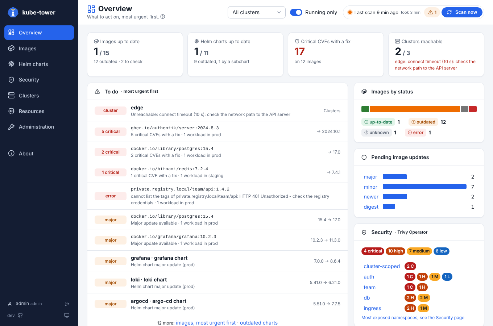
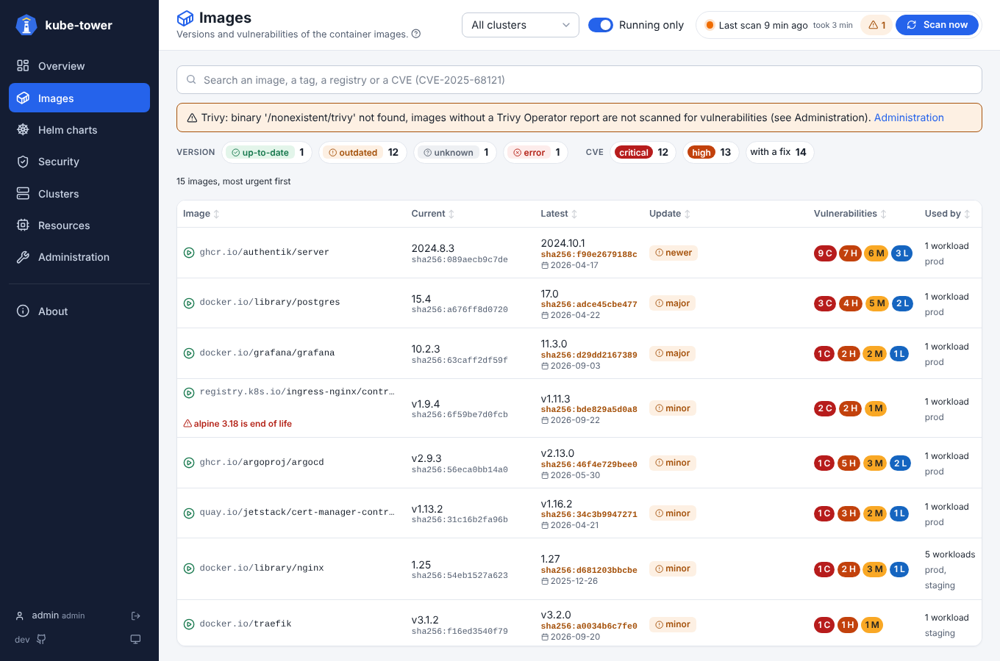
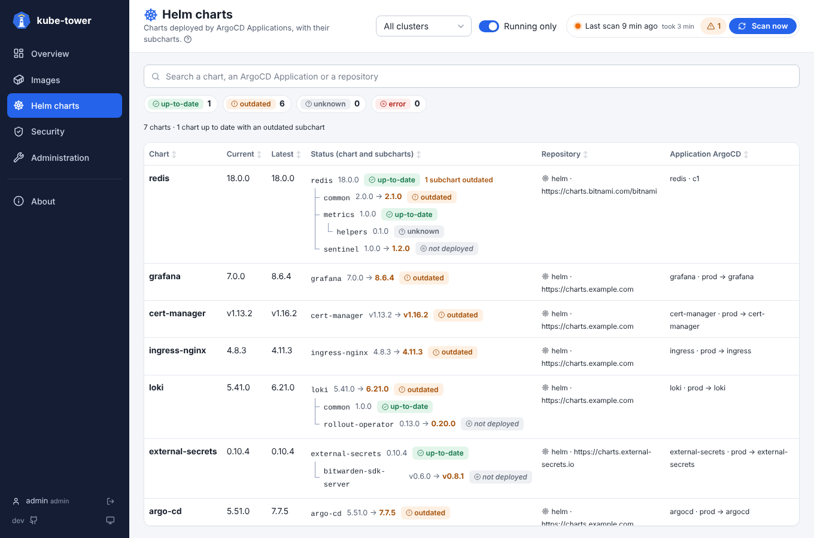
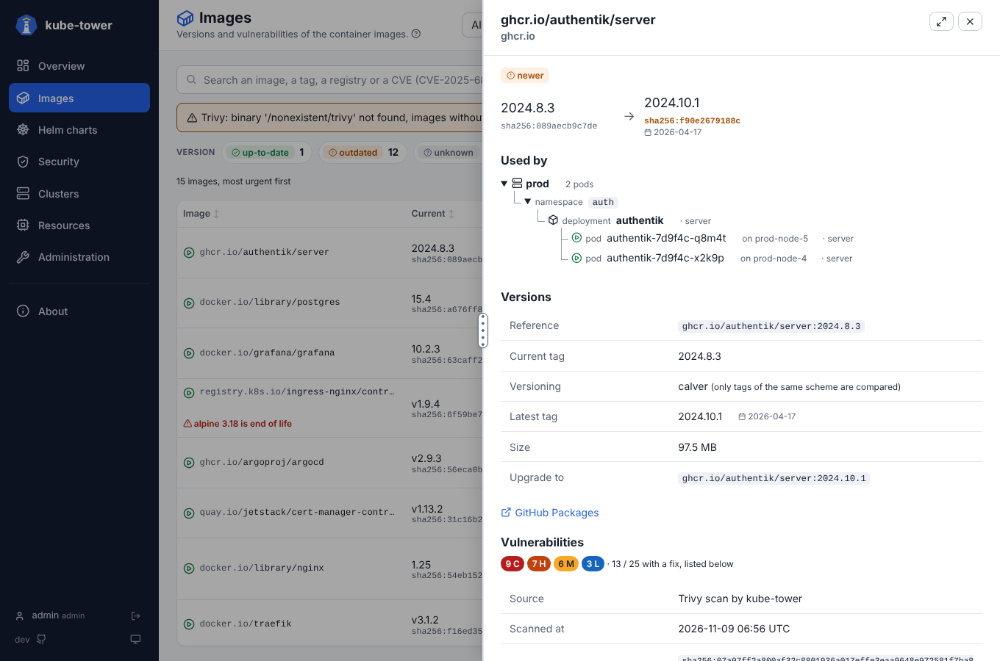
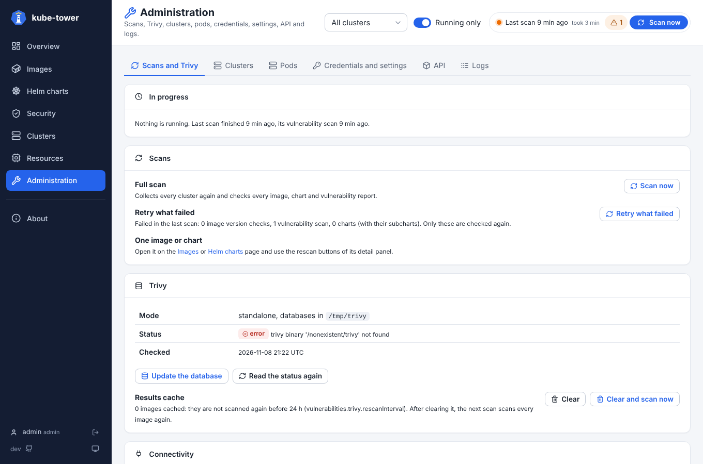
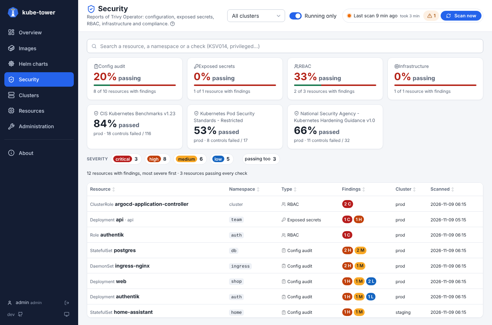
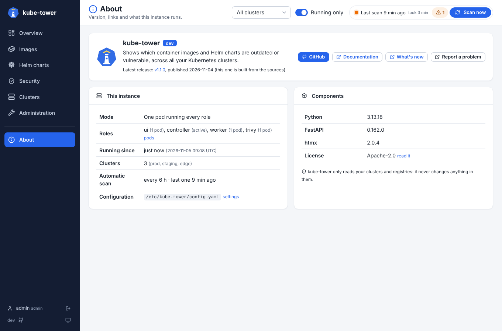
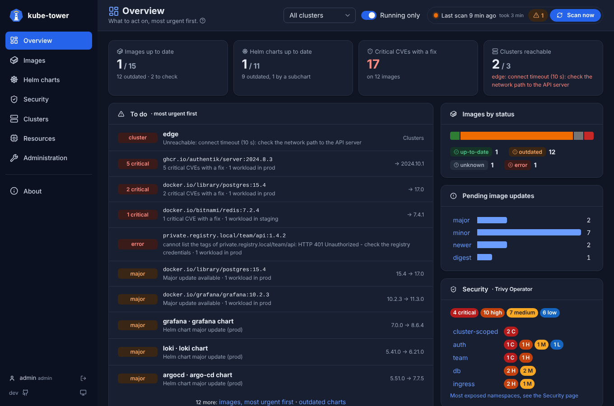
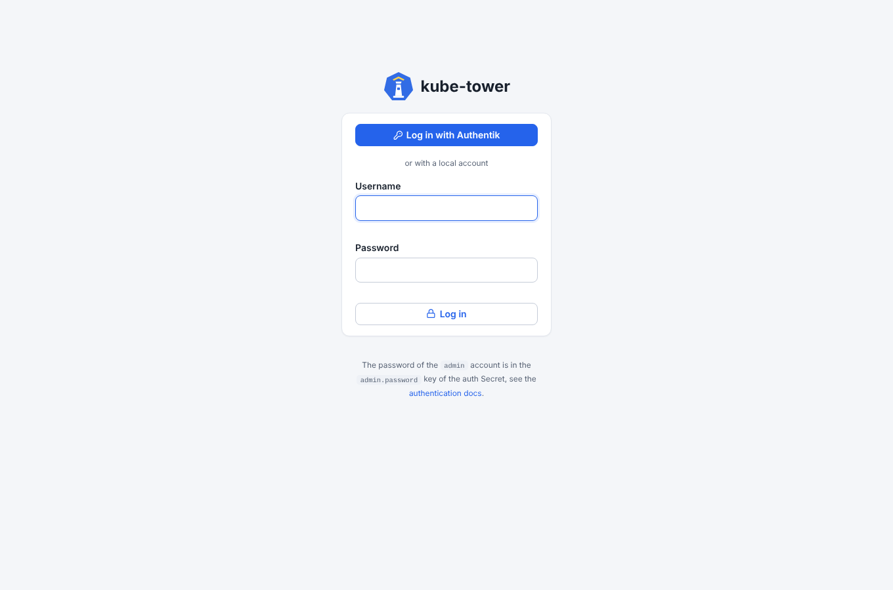

<p align="center">
  
</p>

<h1 align="center">kube-tower</h1>

<p align="center">
  <strong>Versions, lifecycle and vulnerabilities of every image and Helm chart of your Kubernetes clusters, at a glance.</strong>
</p>

<p align="center">
  <a href="https://arcanexus.github.io/kube-tower/"><strong>Website</strong></a> ·
  <a href="https://github.com/Arcanexus/kube-tower/wiki"><strong>Documentation</strong></a> ·
  <a href="https://github.com/Arcanexus/kube-tower/releases"><strong>Releases</strong></a>
</p>

<p align="center">
  <a href="https://github.com/Arcanexus/kube-tower/releases"></a>
  <a href="https://github.com/Arcanexus/kube-tower/actions/workflows/docker-publish.yml"></a>
  <a href="https://github.com/Arcanexus/kube-tower/actions/workflows/tests.yml"></a>
  <a href="https://github.com/Arcanexus/kube-tower/actions/workflows/tests.yml"></a>
  <a href="LICENSE"></a>
  <a href="https://github.com/Arcanexus/kube-tower/pkgs/container/kube-tower"></a>
</p>

---

kube-tower connects to all your Kubernetes clusters, inventories every **container image** and every
**Helm chart** (with its subcharts), and tells you which ones have a newer version available in their
registry. Think [watchtower](https://containrrr.dev/watchtower/), [Renovate](https://docs.renovatebot.com/)
or [version-checker](https://github.com/jetstack/version-checker), as a **read-only dashboard**: kube-tower
never updates anything, you stay in control of your GitOps workflow.



## Features

| | |
| --- | --- |
| 📦 **Every image** | Pods, Deployments, StatefulSets, DaemonSets and CronJobs (running or not) plus the images cached on nodes. |
| 🔎 **Checked at the source** | Each image is compared with the registry referenced in the manifest: Docker Hub, ghcr.io, quay.io, Amazon ECR, Artifact Registry, ACR, Harbor, Artifactory, Nexus or any OCI registry. |
| 🏷️ **Smart tag matching** | `1.25.3-alpine` is only compared with `x.y.z-alpine` tags, semver with semver, calendar or date versions with their own kind; pre-releases are ignored unless you ask for them. |
| 🔁 **Floating tags too** | `latest`, `stable`… are checked by digest, like watchtower: you know when a newer image was pushed under the same tag. |
| ⎈ **Helm charts and subcharts** | Charts deployed by ArgoCD Applications, from Helm repositories, OCI registries or git paths, with every dependency checked. A subchart that the Helm values of the Application leave out of the release (`condition` or `tags` false) is shown *not deployed* and does not make the chart outdated. |
| 🌐 **Multi-cluster** | Register clusters ArgoCD-style with a Secret, or reuse the cluster Secrets ArgoCD already has. |
| 🛡️ **Vulnerabilities (CVE)** | Read from Trivy Operator reports when the cluster has them, else scanned with Trivy (copied into the pod by the chart, standalone or client/server). Find the images affected by a CVE in one search. |
| 🔒 **Security (Trivy Operator)** | A Security page shows the other reports of Trivy Operator for every cluster: misconfigurations, secrets left in images, risky RBAC roles, nodes and control plane checks, and compliance (CIS, NSA, Pod Security Standards), with how to fix each finding. |
| 🖥️ **A UI made for triage** | Five pages: an Overview with a *To do* list (most urgent first), Images with their versions and vulnerabilities in one list (one search for names, tags and CVE IDs), Helm charts with their subchart tree (*not deployed* badge for the subcharts the values leave out), Security (Trivy Operator reports), Administration. *Cluster* and *Running only* filters common to every page (on by default, *Running only* leaves out the images no pod runs), filters kept in the URL, sortable columns with fixed headers, lists loaded 30 rows at a time as you scroll, resizable or full screen detail panels (digests, image size, registry links, a cluster › namespace › workload › pod tree of where each image is used, subchart tree, CVE list), per item rescan, live logs, light and dark themes, made for phones too (tab bar at the bottom). No CSS framework: about 35 KB of compressed static files. |
| 🔐 **Registry authentication** | Per registry credentials, cloud identities (IRSA / EKS Pod Identity, GKE and AKS Workload Identity), reuse of the clusters' image pull secrets, private CAs. |
| 🧰 **Administration** | State of every role and pod (distributed mode), rescan one item or what failed, update the Trivy database, test the connectivity to clusters and registries, see whether each registry accepts the credentials, follow the logs of every pod. Read-only: nothing is ever changed in the clusters. |
| 🔑 **Login, SSO and roles** | Login the ArgoCD way: a built-in `admin` account with a generated password, local accounts, single sign-on with OpenID Connect (Authentik, Keycloak, Entra ID…) or with the Dex the chart can deploy (GitHub, LDAP, SAML…), with the role from the groups, a `readonly` role that sees everything and an `admin` role that also runs scans and actions, sessions any UI pod can serve, Basic auth for scripts. |
| 🪶 **Stateless** | No database. One small pod, rebuilt inventory every few hours or on demand. |
| 📈 **Observable** | JSON API and Prometheus metrics, ready for Grafana dashboards and alerts. |

| Images | Helm charts |
| --- | --- |
|  |  |
| **Image details** | **Administration** |
|  |  |
| **Security** | **About** |
|  |  |
| **Dark theme** | **Login** |
|  |  |

## Quick start

```sh
helm install kube-tower oci://ghcr.io/arcanexus/charts/kube-tower \
  --namespace kube-tower --create-namespace
kubectl -n kube-tower port-forward svc/kube-tower 8080:80
# Password of the admin account, generated at the first start
kubectl -n kube-tower get secret kube-tower-auth -o jsonpath='{.data.admin\.password}' | base64 -d; echo
```

Open http://localhost:8080 and log in as `admin`: the first scan of the local cluster starts right away.
The [quick start](https://github.com/Arcanexus/kube-tower/wiki/Quick-start) goes on with the next steps: other clusters, private registries,
an ingress or ArgoCD, single sign-on.

## How it works

Every `refreshInterval` (6h by default), kube-tower lists the workloads, nodes and ArgoCD Applications
of every cluster with a read-only ServiceAccount, asks each registry for its published versions, reads
or scans the vulnerabilities of every image, and keeps the result in memory: no database. One pod does
it all, or the chart splits it in UI, controller, worker and Trivy pods for large inventories. See the
[architecture](https://github.com/Arcanexus/kube-tower/wiki/Architecture) and [scaling](https://github.com/Arcanexus/kube-tower/wiki/Scaling).

## Documentation

The documentation is in the **[wiki](https://github.com/Arcanexus/kube-tower/wiki)**, written in [`docs/`](docs/) next to the code and
published after every merge to `main`. The [product website](https://arcanexus.github.io/kube-tower/)
gives a tour of kube-tower.

| Section | Pages |
| --- | --- |
| Getting started | [Quick start](https://github.com/Arcanexus/kube-tower/wiki/Quick-start) · [Prerequisites](https://github.com/Arcanexus/kube-tower/wiki/Prerequisites) · [Installation](https://github.com/Arcanexus/kube-tower/wiki/Installation) · [Upgrading](https://github.com/Arcanexus/kube-tower/wiki/Upgrading) · [Comparison](https://github.com/Arcanexus/kube-tower/wiki/Comparison) |
| Configure | [Clusters](https://github.com/Arcanexus/kube-tower/wiki/Clusters) · [Registries](https://github.com/Arcanexus/kube-tower/wiki/Registries) · [Authentication](https://github.com/Arcanexus/kube-tower/wiki/Authentication) · [Vulnerabilities](https://github.com/Arcanexus/kube-tower/wiki/Vulnerabilities) · [Security](https://github.com/Arcanexus/kube-tower/wiki/Security) · [Scaling](https://github.com/Arcanexus/kube-tower/wiki/Scaling) · [Metrics and Grafana](https://github.com/Arcanexus/kube-tower/wiki/Metrics-and-Grafana) |
| Use the UI | [Usage](https://github.com/Arcanexus/kube-tower/wiki/Usage) · [Overview](https://github.com/Arcanexus/kube-tower/wiki/Overview-page) · [Images](https://github.com/Arcanexus/kube-tower/wiki/Images-page) · [Helm charts](https://github.com/Arcanexus/kube-tower/wiki/Helm-charts-page) · [Administration](https://github.com/Arcanexus/kube-tower/wiki/Administration-page) · [Statuses and versions](https://github.com/Arcanexus/kube-tower/wiki/Statuses-and-versions) |
| Reference | [Configuration](https://github.com/Arcanexus/kube-tower/wiki/Configuration) · [Chart values](https://github.com/Arcanexus/kube-tower/wiki/Chart-values) · [API](https://github.com/Arcanexus/kube-tower/wiki/API) · [Permissions](https://github.com/Arcanexus/kube-tower/wiki/Permissions) · [Network and ports](https://github.com/Arcanexus/kube-tower/wiki/Network-and-ports) |
| Help | [Troubleshooting](https://github.com/Arcanexus/kube-tower/wiki/Troubleshooting) · [Architecture](https://github.com/Arcanexus/kube-tower/wiki/Architecture) · [Development](https://github.com/Arcanexus/kube-tower/wiki/Development) |

## Compared to similar tools

| | kube-tower | watchtower | Renovate | version-checker |
| --- | --- | --- | --- | --- |
| Updates things for you | ❌ never | ✅ containers | ✅ pull requests | ❌ |
| Container images | ✅ | ✅ Docker only | ✅ from git | ✅ |
| Helm charts and subcharts | ✅ from ArgoCD | ❌ | ✅ from git | ❌ |
| Vulnerabilities (CVE) | ✅ Trivy | ❌ | ❌ | ❌ |
| Misconfigurations, secrets, compliance | ✅ Trivy Operator reports | ❌ | ❌ | ❌ |
| Several clusters in one view | ✅ | ❌ | n/a | ❌ one per cluster |
| Web UI | ✅ | ❌ | ❌ | ❌ (Grafana) |

More tools (Nova, Argo CD Image Updater, Trivy Operator) and how they work together with kube-tower:
see the [comparison](https://github.com/Arcanexus/kube-tower/wiki/Comparison).

## Contributing

Issues and pull requests are welcome: see [CONTRIBUTING.md](CONTRIBUTING.md), the [development guide](https://github.com/Arcanexus/kube-tower/wiki/Development) and the [changelog](CHANGELOG.md). Security issues: see [SECURITY.md](SECURITY.md).

## License

[Apache-2.0](LICENSE). Icons by [Lucide](https://lucide.dev) (ISC), [htmx](https://htmx.org) (0BSD).
