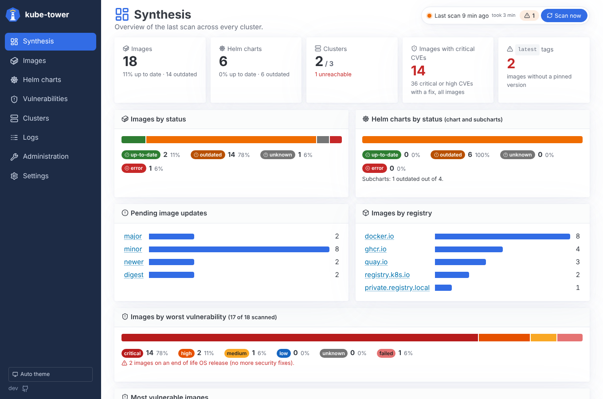
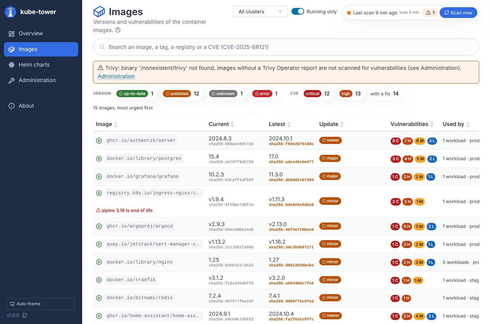
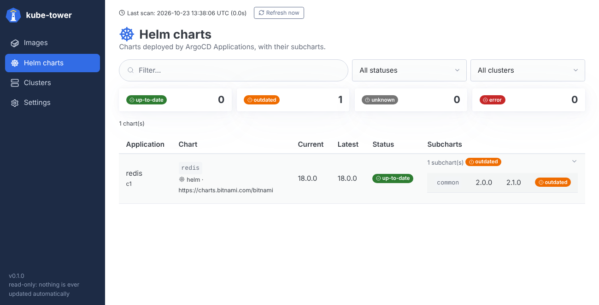
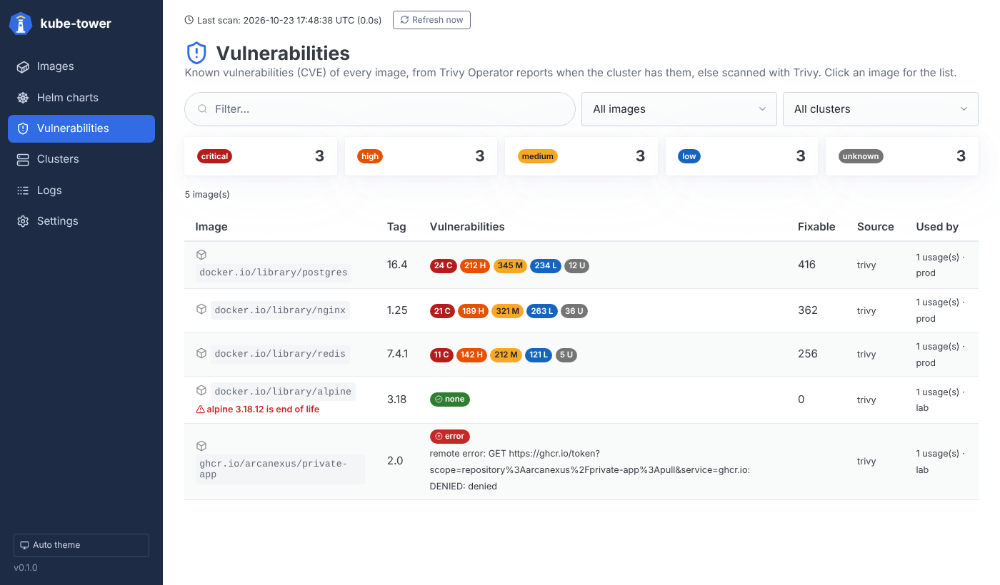
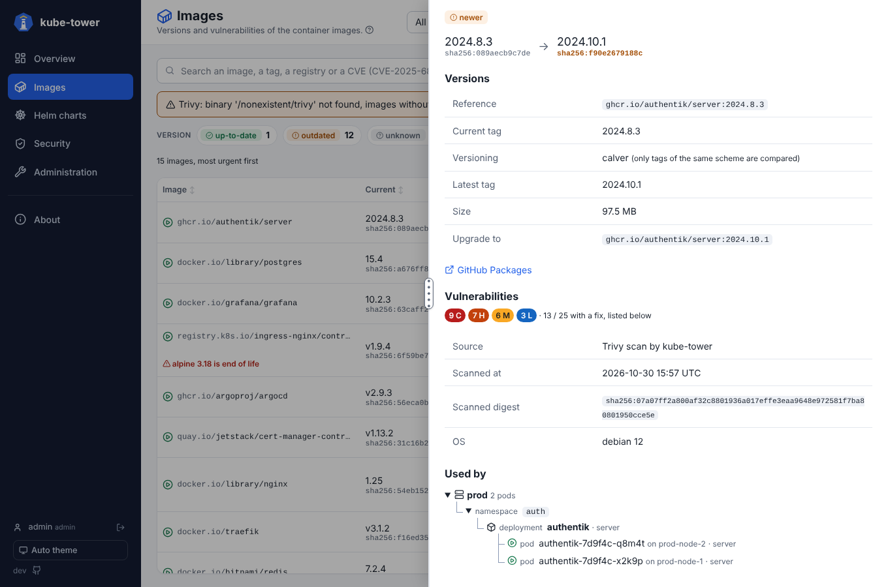
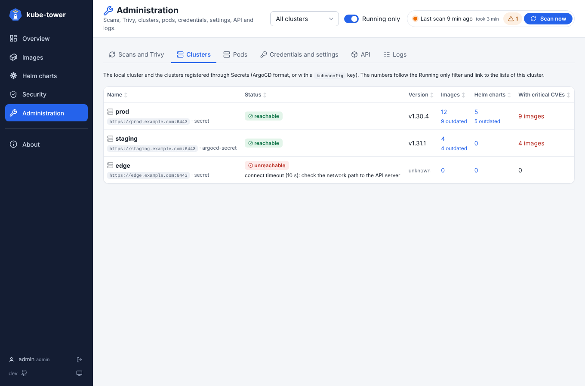
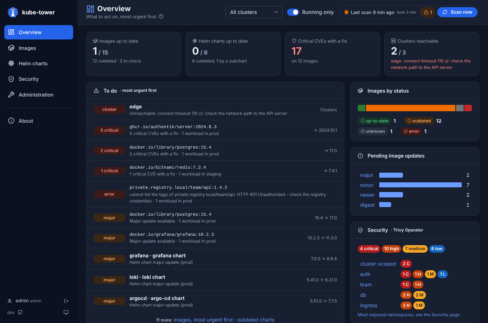

<p align="center">
  
</p>

<h1 align="center">kube-tower</h1>

<p align="center">
  <strong>See what is outdated in your Kubernetes clusters, in one place, without touching anything.</strong>
</p>

<p align="center">
  <a href="https://github.com/Arcanexus/kube-tower/releases"></a>
  <a href="https://github.com/Arcanexus/kube-tower/actions/workflows/docker-publish.yml"></a>
  <a href="https://github.com/Arcanexus/kube-tower/actions/workflows/tests.yml"></a>
  <a href="https://github.com/Arcanexus/kube-tower/actions/workflows/tests.yml"></a>
  <a href="LICENSE"></a>
  <a href="https://github.com/Arcanexus/kube-tower/pkgs/container/kube-tower"></a>
</p>

---

kube-tower connects to all your Kubernetes clusters, inventories every **container image** and every
**Helm chart** (with its subcharts), and tells you which ones have a newer version available in their
registry. Think [watchtower](https://containrrr.dev/watchtower/), [Renovate](https://docs.renovatebot.com/)
or [version-checker](https://github.com/jetstack/version-checker), as a **read-only dashboard**: kube-tower
never updates anything, you stay in control of your GitOps workflow.



## Features

| | |
| --- | --- |
| 📦 **Every image** | Pods, Deployments, StatefulSets, DaemonSets and CronJobs (running or not) plus the images cached on nodes. |
| 🔎 **Checked at the source** | Each image is compared with the registry referenced in the manifest: Docker Hub, ghcr.io, quay.io, Amazon ECR, Artifact Registry, ACR, Harbor, Artifactory, Nexus or any OCI registry. |
| 🏷️ **Smart tag matching** | `1.25.3-alpine` is only compared with `x.y.z-alpine` tags, semver with semver, calendar or date versions with their own kind; pre-releases are ignored unless you ask for them. |
| 🔁 **Floating tags too** | `latest`, `stable`… are checked by digest, like watchtower: you know when a newer image was pushed under the same tag. |
| ⎈ **Helm charts and subcharts** | Charts deployed by ArgoCD Applications, from Helm repositories, OCI registries or git paths, with every dependency checked. |
| 🌐 **Multi-cluster** | Register clusters ArgoCD-style with a Secret, or reuse the cluster Secrets ArgoCD already has. |
| 🛡️ **Vulnerabilities (CVE)** | Read from Trivy Operator reports when the cluster has them, else scanned with Trivy (copied into the pod by the chart, standalone or client/server). Find the images affected by a CVE in one search. |
| 🖥️ **A UI made for triage** | Synthesis home page, filters kept in the URL (including a *Running only* switch for images), sortable columns with fixed headers, lists loaded 30 rows at a time as you scroll, resizable or full screen detail panels (digests, registry links, a cluster › namespace › workload › pod tree of where each image is used, subchart tree, CVE list), per item rescan, live logs, light and dark themes. |
| 🔐 **Registry authentication** | Per registry credentials, cloud identities (IRSA / EKS Pod Identity, GKE and AKS Workload Identity), reuse of the clusters' image pull secrets, private CAs. |
| 🧰 **Administration** | State of every role and pod (distributed mode), rescan one item or what failed, update the Trivy database, test the connectivity to clusters and registries, list unused node images. Read-only: nothing is ever changed in the clusters. |
| 🪶 **Stateless** | No database. One small pod, rebuilt inventory every few hours or on demand. |
| 📈 **Observable** | JSON API and Prometheus metrics, ready for Grafana dashboards and alerts. |

| Images | Helm charts |
| --- | --- |
|  |  |
| **Vulnerabilities** | **Image details** |
|  |  |
| **Clusters** | **Dark theme** |
|  |  |

## Quick start

```sh
helm install kube-tower oci://ghcr.io/arcanexus/charts/kube-tower \
  --namespace kube-tower --create-namespace

kubectl -n kube-tower port-forward svc/kube-tower 8080:80
```

Open http://localhost:8080: the first scan of the local cluster starts right away.

Then, as needed:

- [register other clusters](docs/clusters.md),
- [connect private registries](docs/registries.md),
- [expose the UI with an ingress or deploy with ArgoCD](docs/installation.md).

## How it works

```
 cluster Secrets ─┐
                  ▼
 ┌───────────────────────── kube-tower ─────────────────────────┐
 │ discover clusters → collect images & ArgoCD charts →         │
 │ check versions → scan vulnerabilities                        │──► UI · /api · /metrics
 └──────────────────────────────────────────────────┬───────────┘
                                                    ▼
     OCI registries · Helm repositories · git (Chart.yaml) · Trivy Operator reports / Trivy
```

Every `refreshInterval` (6h by default), kube-tower lists the workloads, nodes and ArgoCD
Applications of every reachable cluster with a read-only ServiceAccount, asks each registry for
its published versions (each repository once per scan), then reads or scans the vulnerabilities
of every image, and keeps the result in memory.
The [architecture](docs/architecture.md) page draws the parts of kube-tower and how they talk to
each other; design choices are explained in [ADR 0001](docs/adr/0001-architecture.md). For large inventories,
the chart can split kube-tower in UI, controller, worker and Trivy Deployments scaled apart, with an
optional Redis / Valkey: see [scaling](docs/scaling.md) and [ADR 0002](docs/adr/0002-horizontal-scaling.md).

## Documentation

| Guide | Content |
| --- | --- |
| [Installation](docs/installation.md) | Helm, ArgoCD, ingress, upgrades, requirements |
| [Configuration](docs/configuration.md) | every setting, registry authentication, secrets |
| [Architecture](docs/architecture.md) | diagrams of the roles, the single and distributed modes, a scan step by step |
| [Scaling](docs/scaling.md) | distributed mode: UI, controller, worker and Trivy pods, standby controller, Redis / Valkey |
| [Clusters](docs/clusters.md) | registering remote clusters, reusing ArgoCD clusters |
| [Registries](docs/registries.md) | Docker Hub, ECR, Artifact Registry, ACR, Harbor, Artifactory...: authentication, private CAs |
| [Usage](docs/usage.md) | the pages, filters and sorting, rescans, administration, statuses, JSON API |
| [Vulnerabilities](docs/vulnerabilities.md) | CVE detection with Trivy Operator reports or Trivy |
| [Metrics and Grafana](docs/metrics.md) | Prometheus exporter, PromQL examples, alerts, Grafana dashboard |
| [Development](docs/development.md) | run locally, tests and coverage, project layout, releases |
| [Troubleshooting](docs/troubleshooting.md) | common errors and how to fix them |

## Compared to similar tools

| | kube-tower | watchtower | Renovate | version-checker |
| --- | --- | --- | --- | --- |
| Updates things for you | ❌ never | ✅ containers | ✅ pull requests | ❌ |
| Container images | ✅ | ✅ Docker only | ✅ from git | ✅ |
| Helm charts and subcharts | ✅ from ArgoCD | ❌ | ✅ from git | ❌ |
| Vulnerabilities (CVE) | ✅ Trivy | ❌ | ❌ | ❌ |
| Several clusters in one view | ✅ | ❌ | n/a | ❌ one per cluster |
| Web UI | ✅ | ❌ | ❌ | ❌ (Grafana) |

## Contributing

Issues and pull requests are welcome: see [CONTRIBUTING.md](CONTRIBUTING.md), the [development guide](docs/development.md) and the [changelog](CHANGELOG.md). Security issues: see [SECURITY.md](SECURITY.md).

## License

[Apache-2.0](LICENSE). Icons by [Lucide](https://lucide.dev) (ISC), styles by [Pico CSS](https://picocss.com) (MIT), [htmx](https://htmx.org) (0BSD).
