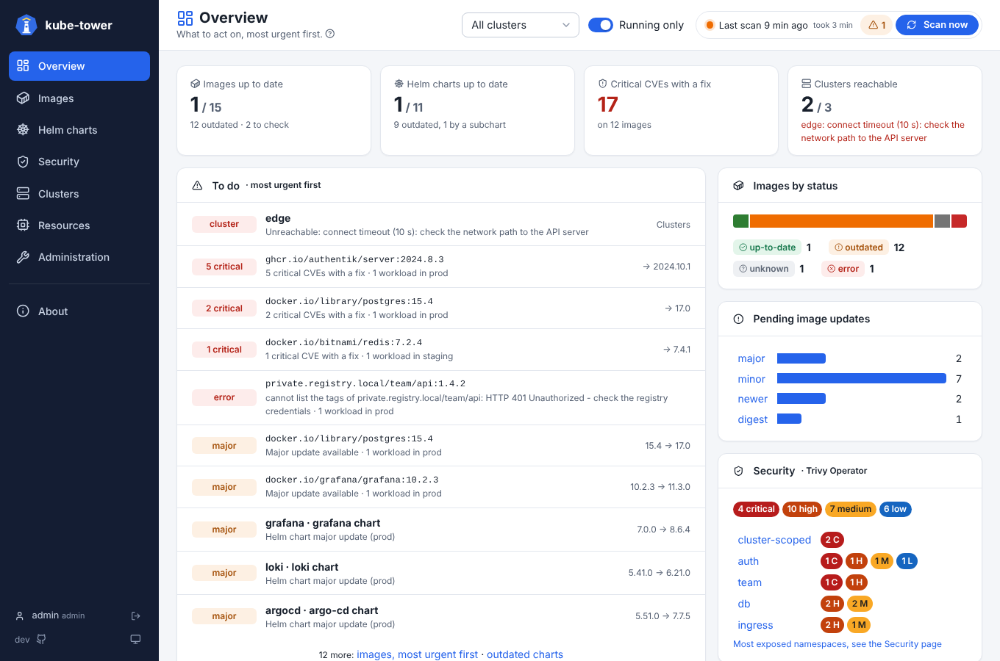

# kube-tower documentation

kube-tower connects to all your Kubernetes clusters, inventories every container image and every Helm
chart (with its subcharts), and shows their versions, their lifecycle and their vulnerabilities in one
dashboard: which ones have a newer version, what is urgent, where each one runs.

## Where to start

| I want to | Read |
| --- | --- |
| Try it in a few minutes | [Quick start](quick-start.md) |
| Know how it differs from Renovate, watchtower, version-checker... | [Comparison](comparison.md) |
| Size the cluster, check what is needed | [Prerequisites](prerequisites.md) |
| Install it for real (ingress, ArgoCD) | [Installation](installation.md) |
| Scan other clusters, private registries, add single sign-on | [Configure](#configure) |
| Understand a page or a status | [Usage](usage.md) and one page per screen, [Statuses and versions](statuses.md) |
| Look up a setting, a chart value, an endpoint, a metric | [Reference](#reference) |
| Fix an error | [Troubleshooting](troubleshooting.md) |

## Getting started

| Page | Content |
| --- | --- |
| [Quick start](quick-start.md) | install, first login, first scan, next steps |
| [Prerequisites](prerequisites.md) | Kubernetes, tools, optional components, network, hardware guidelines by size of inventory |
| [Installation](installation.md) | Helm, ArgoCD (complete example, distributed mode), uninstalling |
| [Upgrading](upgrading.md) | upgrade commands and what changes between versions |
| [Comparison](comparison.md) | kube-tower next to watchtower, Renovate, version-checker, Nova, Argo CD Image Updater, Trivy Operator |

## Configure

| Page | Content |
| --- | --- |
| [Clusters](clusters.md) | registering remote clusters, reusing ArgoCD clusters, EKS, GKE and AKS |
| [Registries](registries.md) | Docker Hub, ECR, Artifact Registry, ACR, Harbor, Artifactory...: credentials, cloud identities, private CAs |
| [Authentication](authentication.md) | admin account, local accounts, single sign-on with OIDC (Authentik, Dex, Keycloak), roles |
| [Vulnerabilities](vulnerabilities.md) | CVEs from Trivy Operator reports or Trivy, the Trivy setups |
| [Security](security.md) | Trivy Operator config audit, exposed secrets, RBAC, infrastructure and compliance reports |
| [Scaling](scaling.md) | distributed mode: UI, controller, worker and Trivy pods, Valkey, sizing |
| [Metrics and Grafana](metrics.md) | Prometheus metrics, PromQL examples, alerts, Grafana dashboard |

## Use the UI

| Page | Content |
| --- | --- |
| [Usage](usage.md) | what all pages share: sidebar, top bar, lists, detail panels, About |
| [Overview page](ui-overview.md) | tiles, the to do list, charts |
| [Images page](ui-images.md) | versions and vulnerabilities of every image, detail panel |
| [Helm charts page](ui-charts.md) | charts and subcharts, detail panel |
| [Administration page](ui-administration.md) | scans, clusters, pods, settings, API, logs |
| [Statuses and versions](statuses.md) | statuses, how tags are compared, versioning schemes, floating tags, charts |

## Reference

| Page | Content |
| --- | --- |
| [Configuration](configuration.md) | every setting of `config.yaml` |
| [Chart values](chart-values.md) | every value of the Helm chart |
| [API](api.md) | JSON endpoints, authentication, examples |
| [Permissions](permissions.md) | every Kubernetes permission, and the options that widen them |
| [Network and ports](network.md) | ports, endpoints, outbound connections, network policies |

## Help and internals

| Page | Content |
| --- | --- |
| [Troubleshooting](troubleshooting.md) | common errors and how to fix them, by topic |
| [Architecture](architecture.md) | the roles, single and distributed modes, a scan step by step, design choices |
| [Development](development.md) | run locally, tests, project layout, documentation, releases |

The [changelog](../CHANGELOG.md) lists what changed in each version.

## Where to read it

This documentation lives in the `docs/` directory of the repository, next to the code: every change
of kube-tower updates it in the same pull request. It is published to the
[wiki](https://github.com/Arcanexus/kube-tower/wiki) after every merge to `main` (by
`.github/workflows/wiki.yml`), so the wiki always shows the documentation of the `main` branch. To
fix or improve a page, edit the file in `docs/` and open a pull request: edits made in the wiki are
overwritten by the next publication.
