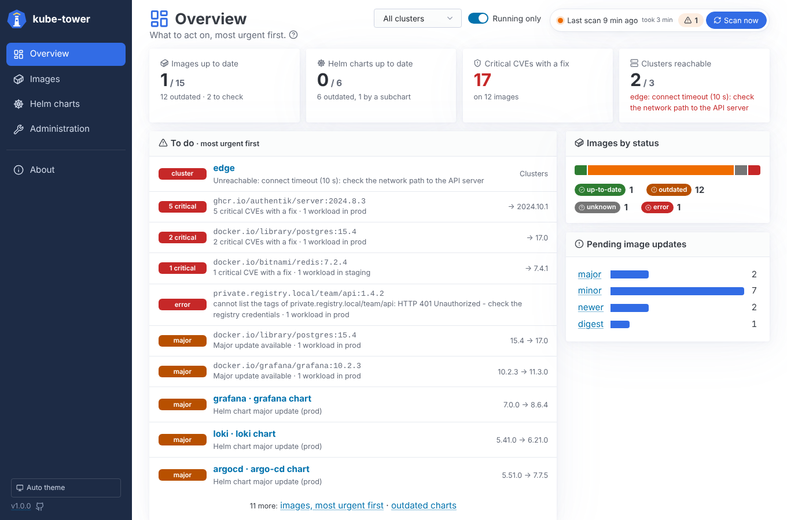

# kube-tower documentation

kube-tower connects to all your Kubernetes clusters, inventories every container image and every Helm
chart (with its subcharts), and tells you which ones have a newer version available, as a read-only
dashboard: it never updates anything.

New here? Install it with the [quick start](../README.md#quick-start), then follow the guides below.

## Getting started

| Guide | Content |
| --- | --- |
| [Installation](installation.md) | Helm, ArgoCD, ingress, upgrades, requirements |
| [Configuration](configuration.md) | every setting, registry authentication, secrets |
| [Authentication](authentication.md) | login, admin password, local accounts, SSO with OIDC (Authentik, Dex, Keycloak), readonly and admin roles, API with Basic auth |
| [Clusters](clusters.md) | registering remote clusters, reusing ArgoCD clusters |
| [Registries](registries.md) | Docker Hub, ECR, Artifact Registry, ACR, Harbor, Artifactory...: authentication, private CAs |

## Using kube-tower

| Guide | Content |
| --- | --- |
| [Usage](usage.md) | the pages, filters and sorting, rescans, administration, statuses, JSON API |
| [Vulnerabilities](vulnerabilities.md) | CVE detection with Trivy Operator reports or Trivy |
| [Security](security.md) | Trivy Operator config audit, exposed secrets, RBAC, infrastructure and compliance reports |
| [Metrics and Grafana](metrics.md) | Prometheus exporter, PromQL examples, alerts, Grafana dashboard |
| [Troubleshooting](troubleshooting.md) | common errors and how to fix them |

## Inside kube-tower

| Guide | Content |
| --- | --- |
| [Architecture](architecture.md) | diagrams of the roles, the single and distributed modes, a scan step by step |
| [Scaling](scaling.md) | distributed mode: UI, controller, worker and Trivy pods, standby controller, Redis / Valkey |
| [Development](development.md) | run locally, tests and coverage, project layout, releases |
| [ADR 0001](adr/0001-architecture.md) | architecture decisions |
| [ADR 0002](adr/0002-horizontal-scaling.md) | horizontal scaling with roles |
| [ADR 0003](adr/0003-valkey-bus.md) | the processes talk through Valkey |

The [changelog](../CHANGELOG.md) lists what changed in each version.

## Where to read it

This documentation lives in the `docs/` directory of the repository, next to the code: every change
of kube-tower updates it in the same pull request. It is published to the
[wiki](https://github.com/Arcanexus/kube-tower/wiki) after every merge to `main` (by
`.github/workflows/wiki.yml`), so the wiki always shows the documentation of the `main` branch. To
fix or improve a page, edit the file in `docs/` and open a pull request: edits made in the wiki are
overwritten by the next publication.
