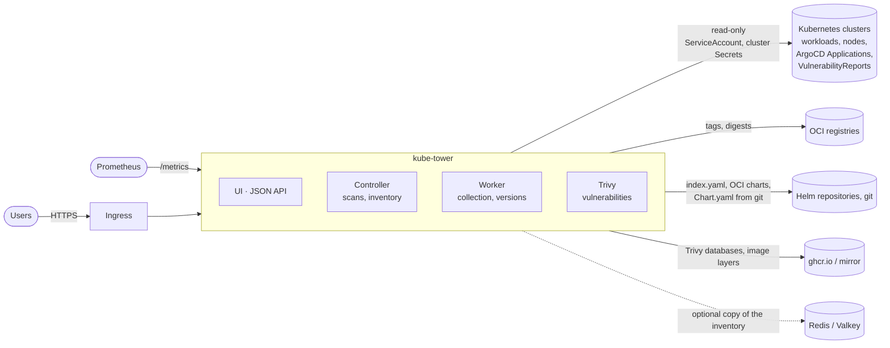
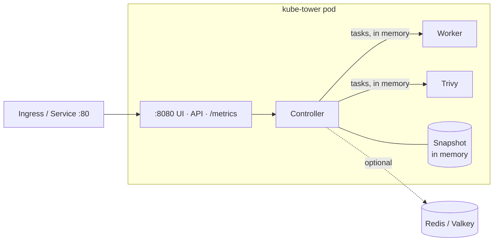
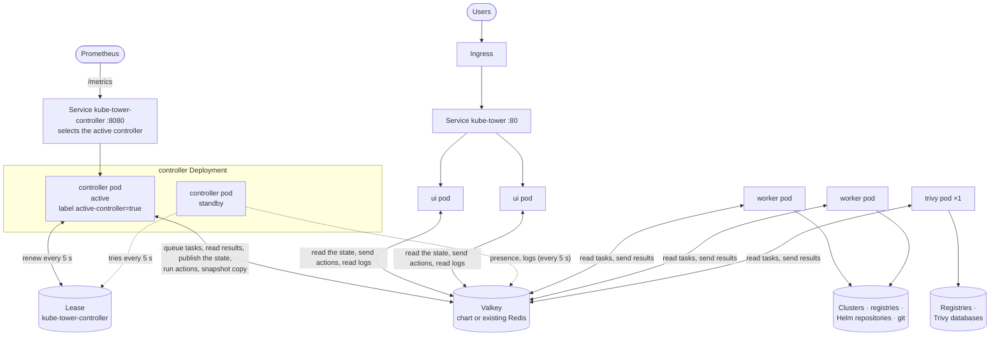
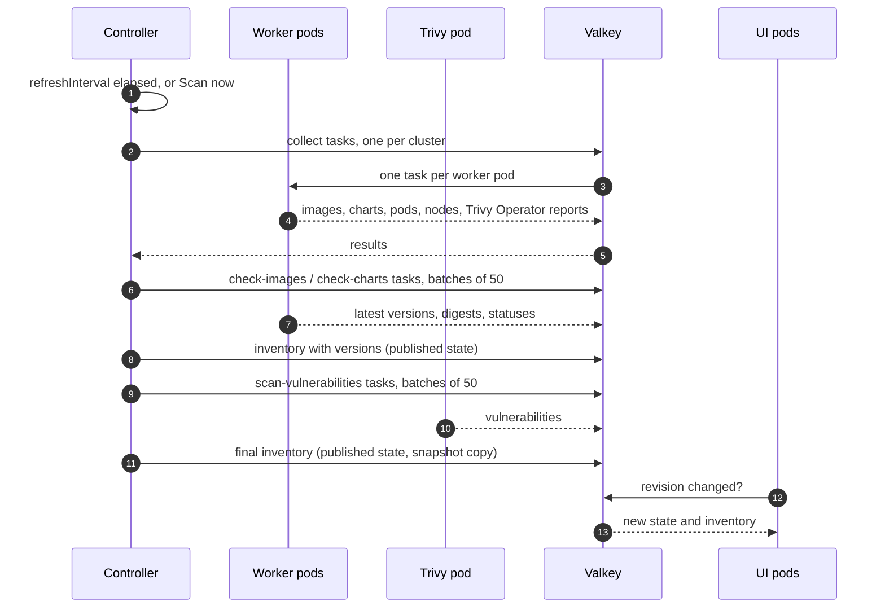

# Architecture

How kube-tower is built and how its parts talk to each other. The design choices are explained in
[ADR 0001](adr/0001-architecture.md) (application) and [ADR 0002](adr/0002-horizontal-scaling.md)
(horizontal scaling), [ADR 0003](adr/0003-valkey-bus.md) (the processes talk through Valkey);
[scaling](scaling.md) tells how to deploy the distributed mode.

## Overview

kube-tower reads, it never changes anything: clusters are read with a read-only ServiceAccount,
registries and Helm repositories are only asked for their published versions.

The four **roles** are parts of the same program, in the same image:

| Role | Does | Talks to |
| --- | --- | --- |
| `ui` | Pages (Jinja2 + htmx), JSON API (`/api/...`) | the controller |
| `controller` | Schedules the scans, rescans and Administration actions, splits them in tasks, merges the results in the inventory (the **snapshot**), serves `/metrics` | its Kubernetes `Lease`, Redis / Valkey |
| `worker` | Runs the `collect`, `check-images` and `check-charts` tasks | the clusters, registries, Helm repositories, git hosts |
| `trivy` | Runs the `scan-vulnerabilities` and `trivy-admin` tasks, keeps the Trivy databases and results cache | the registries (image layers), the Trivy database registry |

## Single mode (default)

One pod runs every role (`roles: [all]`). The roles call each other in memory: no Redis needed.

## Distributed mode

With `mode: distributed`, the chart renders one Deployment per group of roles (by default one per
role). The pods never call each other: every exchange goes through **Valkey** (required), and only the
active controller orchestrates ([ADR 0003](adr/0003-valkey-bus.md)).

- **ui** pods hold no state: each reads the revision of the state published by the controller every
  second, the state when it changed, the inventory when it has a new revision, and sends the actions of
  the users (scan, rescan, retry, Administration) to the controller through Valkey, waiting for its
  answer. Any replica can serve any request, so the ui Deployment can autoscale. They get no
  ServiceAccount token nor credential.
- **controller**: one active pod at a time. The active one holds the `Lease` and labels its pod
  `kube-tower.arcanexus.com/active-controller=true`: the controller Service (`/metrics`) routes to it only. A standby
  takes the Lease about 15 s after the active one stopped renewing it; an active controller that
  cannot renew it in time stops itself, so two controllers never hand out tasks together.
- **worker** pods read their tasks from the Valkey stream of their role (one pod gets each task), run
  them and send the results back to Valkey, where the controller reads them. A task not answered
  within `internal.taskTimeout` is given to another pod, three times at most. A controller taking
  over empties the queues of the previous one.
- **trivy**: one pod, so the Trivy databases are downloaded once and the results cache is shared by
  every cluster.
- **Presence and logs**: every pod but the active controller (standbys included) writes every 5 seconds
  a Valkey key that expires: its roles, state and version. The controller reads them for the
  **Administration** page (state of each role and pod, task each one runs). Every pod ships its new log
  lines to a capped Valkey stream, read by the **Logs** page (lines of every pod, filtered by role). A pod
  not heard of for 30 seconds is shown as lost; a pod that stops says so and leaves the list.
- **Valkey / Redis** (required in distributed mode, optional in single mode): the task queues and
  results, the published state, the actions and their answers, the presence keys and the log lines,
  and a copy of the snapshot that the active controller writes after each change and reads when it
  becomes active. A scan in progress is not kept: a new controller starts a new one.

## A scan, step by step

Each repository is asked once per scan, whatever the number of clusters using it. Rescans of one
image or chart, and the retry of failed items, are the same tasks on a few items.

## Ports and endpoints

| Port | Served by | Paths |
| --- | --- | --- |
| `8080` (`http`) | every pod | pages, `/api/...`, `/metrics` (controller), `/healthz`, `/readyz`, `/leaderz` |
| `6379` | Valkey | Redis protocol: every pod in distributed mode, the controller only in single mode |

No other port: the pods never call each other. The tasks carry registry credentials (image pull
secrets) through Valkey: set a Valkey password. With `networkPolicy.enabled`, only the kube-tower pods
reach Valkey.

## Code

| Module | Part |
| --- | --- |
| `main.py`, `config.py` | app factory, roles, settings |
| `scanner.py`, `tasks.py` | controller: scans split in tasks queued in Valkey, results merged in the snapshot |
| `worker.py`, `collectors/`, `registry/`, `checkers.py`, `trivy.py` | what the worker and trivy roles run |
| `bus.py` | the Valkey keys through which the processes talk: task streams, results, state, replies, presence, logs |
| `internal.py` | the exchanges of the processes: task puller (worker, trivy), publisher of the controller (state, actions, processes), reporter (presence, logs) |
| `processes.py`, `logbuffer.py` | the pods known to the controller and their state, the log lines of every pod |
| `backend.py` | what the web layer uses: `LocalBackend` (same process) or `RemoteBackend` (ui pods) |
| `election.py` | controller election with a Kubernetes `Lease`, active pod label |
| `store.py` | where the snapshot is kept: memory, or memory + Redis / Valkey |
| `web/` | pages, API, metrics |

See [development](development.md) for the full layout.
