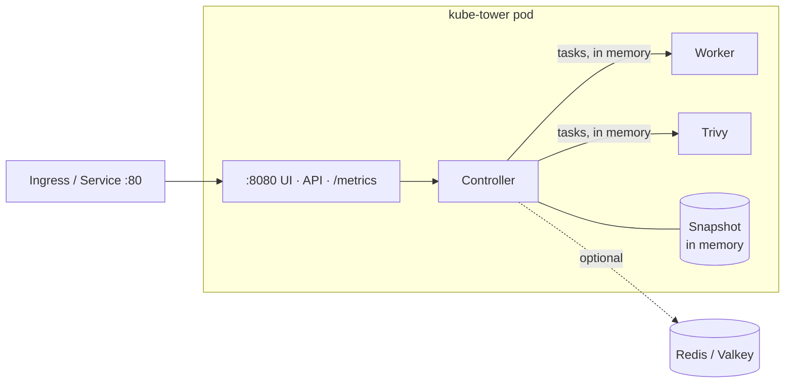
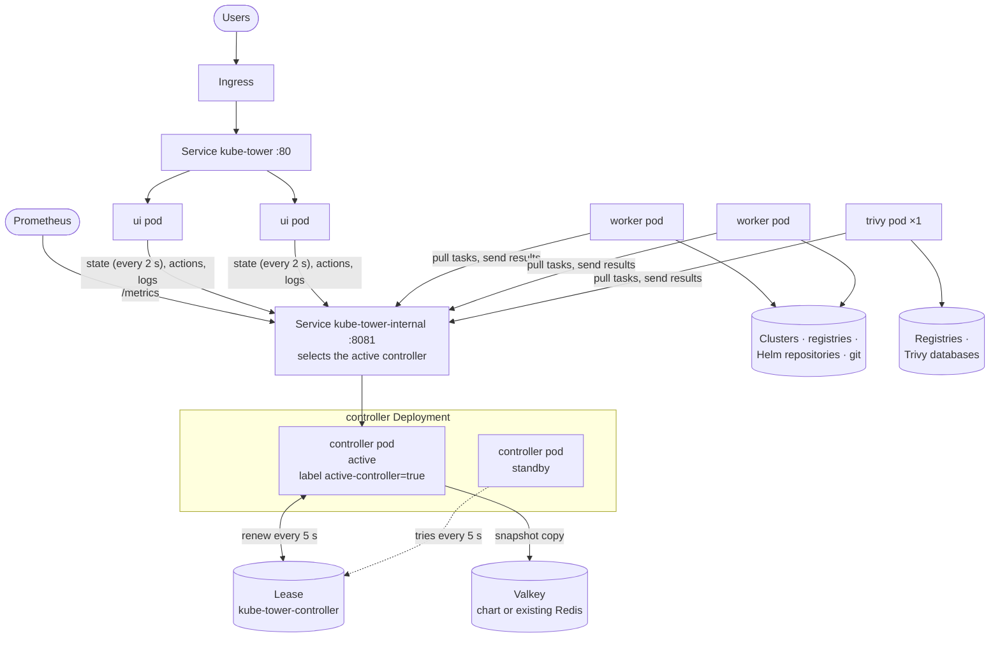
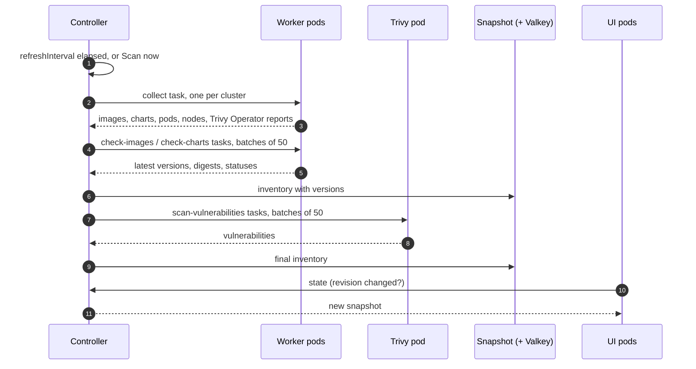

# Architecture

How kube-tower is built and how its parts talk to each other. The design choices are explained in
[ADR 0001](adr/0001-architecture.md) (application) and [ADR 0002](adr/0002-horizontal-scaling.md)
(horizontal scaling); [scaling](scaling.md) tells how to deploy the distributed mode.

## Overview

kube-tower reads, it never changes anything: clusters are read with a read-only ServiceAccount,
registries and Helm repositories are only asked for their published versions.

The four **roles** are parts of the same program, in the same image:

| Role | Does | Talks to |
| --- | --- | --- |
| `ui` | Pages (Jinja2 + htmx), JSON API (`/api/...`) | the controller |
| `controller` | Schedules the scans, rescans and Administration actions, splits them in tasks, merges the results in the inventory (the **snapshot**), serves `/metrics` | its Kubernetes `Lease`, Redis / Valkey |
| `worker` | Runs the `collect`, `check-images` and `check-charts` tasks | the clusters, registries, Helm repositories, git hosts |
| `trivy` | Runs the `scan-vulnerabilities` and `trivy-admin` tasks, keeps the Trivy databases and results cache | the registries (image layers), the Trivy database registry |

## Single mode (default)

One pod runs every role (`roles: [all]`). The roles call each other in memory: no internal API, no
token, no Redis needed.

## Distributed mode

With `mode: distributed`, the chart renders one Deployment per group of roles (by default one per
role). The pods talk over the **internal API** of the controller (`:8081`, a shared token in
`Authorization: Bearer`), reached through the `<release>-internal` Service.

- **ui** pods hold no state: each reads the state of the controller every 2 seconds and sends it the
  actions of the users (scan, rescan, retry, Administration). Any replica can serve any request, so
  the ui Deployment can autoscale. They get no ServiceAccount token nor credential.
- **controller**: one active pod at a time. The active one holds the `Lease` and labels its pod
  `kube-tower.arcanexus.com/active-controller=true`: the internal Service routes to it only. A standby
  takes the Lease about 15 s after the active one stopped renewing it; an active controller that
  cannot renew it in time stops itself, so two controllers never hand out tasks together.
- **worker** pods ask the controller for a task (a pull waits up to 20 s), run it and send the
  result back. A task not answered within `internal.taskTimeout` is given to another pod.
- **trivy**: one pod, so the Trivy databases are downloaded once and the results cache is shared by
  every cluster.
- **Valkey / Redis** (optional, also in single mode): the active controller writes the snapshot
  there after each change, and reads it when it becomes active. Only the inventory is kept: a scan in
  progress and the task queue stay in the controller's memory.

## A scan, step by step

Each repository is asked once per scan, whatever the number of clusters using it. Rescans of one
image or chart, and the retry of failed items, are the same tasks on a few items.

## Ports and endpoints

| Port | Served by | Paths |
| --- | --- | --- |
| `8080` (`http`) | every pod | pages, `/api/...`, `/metrics` (controller), `/healthz`, `/readyz`, `/leaderz` |
| `8081` (`internal`) | controller (distributed mode) | `/internal/v1/tasks/next`, `/internal/v1/tasks/{id}/result`, `/internal/v1/state`, `/internal/v1/logs`, `/internal/v1/actions/{name}` |
| `6379` | Valkey (optional) | Redis protocol, controller only |

The internal API carries registry credentials in the tasks: never expose it. With
`networkPolicy.enabled`, only the kube-tower pods reach it.

## Code

| Module | Part |
| --- | --- |
| `main.py`, `config.py` | app factory, roles, settings |
| `scanner.py`, `tasks.py` | controller: scans split in tasks, results merged in the snapshot |
| `worker.py`, `collectors/`, `registry/`, `checkers.py`, `trivy.py` | what the worker and trivy roles run |
| `internal.py` | internal API, task queue, task puller of the worker and trivy processes |
| `backend.py` | what the web layer uses: `LocalBackend` (same process) or `RemoteBackend` (ui pods) |
| `election.py` | controller election with a Kubernetes `Lease`, active pod label |
| `store.py` | where the snapshot is kept: memory, or memory + Redis / Valkey |
| `web/` | pages, API, metrics |

See [development](development.md) for the full layout.
