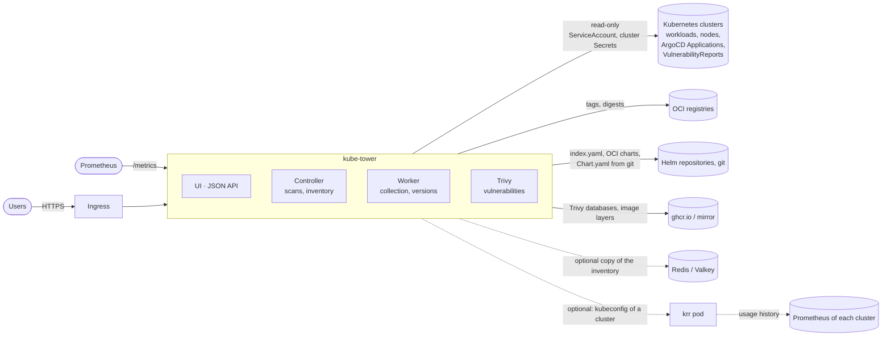
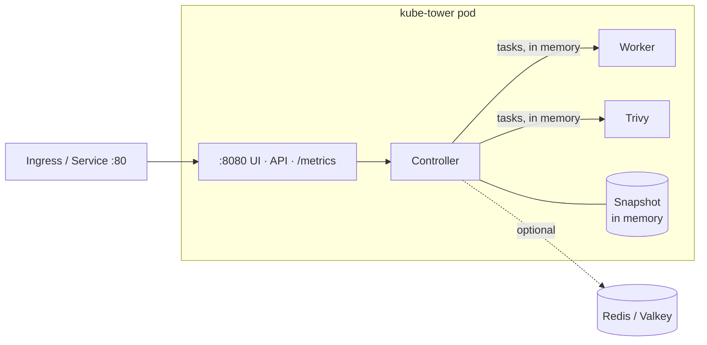
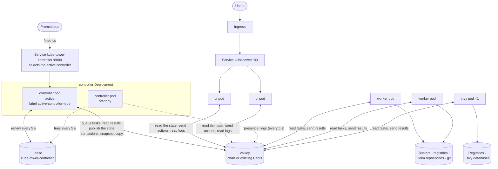
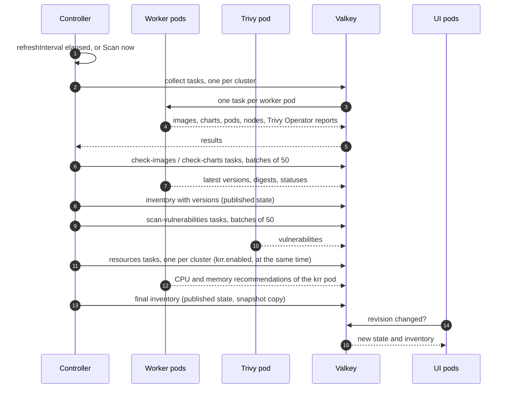

# Architecture

How kube-tower is built and how its parts talk to each other, and why it is built that way
([design choices](#design-choices)). [Scaling](scaling.md) tells how to deploy the distributed mode,
[network and ports](network.md) lists the ports and the connections.

## Overview

kube-tower reads, it never changes anything: clusters are read with a read-only ServiceAccount,
registries and Helm repositories are only asked for their published versions.

The four **roles** are parts of the same program, in the same image:

| Role | Does | Talks to |
| --- | --- | --- |
| `ui` | Pages (Jinja2 + htmx), JSON API (`/api/...`), login and roles when `auth.enabled` | the controller, the OIDC provider (SSO) |
| `controller` | Schedules the scans, rescans and Administration actions, splits them in tasks, merges the results in the inventory (the **snapshot**), serves `/metrics` | its Kubernetes `Lease`, Redis / Valkey |
| `worker` | Runs the `collect`, `check-images`, `check-charts` and `resources` tasks | the clusters, registries, Helm repositories, git hosts, the krr pod |
| `trivy` | Runs the `scan-vulnerabilities` and `trivy-admin` tasks, keeps the Trivy databases and results cache | the registries (image layers), the Trivy database registry |

## Single mode (default)

One pod runs every role (`roles: [all]`). The roles call each other in memory: no Redis needed.

## Distributed mode

With `mode: distributed`, the chart renders one Deployment per group of roles (by default one per
role). The pods never call each other: every exchange goes through **Valkey** (required), and only the
active controller orchestrates.

- **ui** pods hold no state: each reads the revision of the state published by the controller every
  second, the state when it changed, the inventory when it has a new revision, and sends the actions of
  the users (scan, rescan, retry, Administration) to the controller through Valkey, waiting for its
  answer. Any replica can serve any request, so the ui Deployment can autoscale. They get no
  ServiceAccount token nor credential.
- **controller**: one active pod at a time. The active one holds the `Lease` and labels its pod
  `kube-tower.arcanexus.com/active-controller=true`: the controller Service (`/metrics`) routes to it only. A standby
  takes the Lease about 15 s after the active one stopped renewing it; an active controller that
  cannot renew it in time stops itself, so two controllers never hand out tasks together.
- **worker** pods read their tasks from the Valkey stream of their role (one pod gets each task), run
  them and send the results back to Valkey, where the controller reads them. A task not answered
  within `internal.taskTimeout` is given to another pod, three times at most. A controller taking
  over empties the queues of the previous one.
- **trivy**: one pod, so the Trivy databases are downloaded once and the results cache is shared by
  every cluster.
- **Presence and logs**: every pod but the active controller (standbys included) writes every 5 seconds
  a Valkey key that expires: its roles, state and version. The controller reads them for the
  **Administration** page (state of each role and pod, task each one runs). Every pod ships its new log
  lines to a capped Valkey stream, read by the **Logs** page (lines of every pod, filtered by role). A pod
  not heard of for 30 seconds is shown as lost; a pod that stops says so and leaves the list.
- **Valkey / Redis** (required in distributed mode, optional in single mode): the task queues and
  results, the published state, the actions and their answers, the presence keys and the log lines,
  and a copy of the snapshot that the active controller writes after each change and reads when it
  becomes active. A scan in progress is not kept: a new controller starts a new one.

## A scan, step by step

Each repository is asked once per scan, whatever the number of clusters using it. Rescans of one
image or chart, and the retry of failed items, are the same tasks on a few items.

## Design choices

kube-tower is meant to be simple to run and to maintain: one image, no database, no JavaScript
toolchain.

| Choice | Why | Not chosen |
| --- | --- | --- |
| Read-only, never updates anything | A view of versions, lifecycle and vulnerabilities across every cluster; the updates stay in your GitOps workflow (ArgoCD, Renovate pull requests) | Automatic updates, as watchtower does |
| Python 3.13, FastAPI, uvicorn; one multi-arch image (amd64, arm64, arm/v7) | A language the maintainer knows; asyncio fits the many HTTP requests to registries | Go |
| Server-rendered pages: Jinja2, [htmx](https://htmx.org), one hand-written stylesheet, a few lines of plain JavaScript | A page is an HTML file with placeholders, maintainable without frontend skills; no build step, about 35 KB of compressed static files | A React or Vue single page app (a JS toolchain), Streamlit or NiceGUI (harder behind an ingress and to customize) |
| Stateless: the inventory is rebuilt at startup and every `refreshInterval`, kept in memory | Nothing to back up or migrate; a restart costs one scan | A database |
| Settings in a YAML file rendered by the chart into a ConfigMap, secrets only from Kubernetes Secrets | The usual Helm and ArgoCD workflow; unknown keys are refused at startup | Settings edited in the UI |
| Clusters registered with Secrets, ArgoCD style, or the ArgoCD cluster Secrets reused | No new format to learn, no cluster registered twice | A CRD of its own |
| The latest version asked to the registry referenced by the image, each repository once per scan; tags compared only with tags of the same shape and versioning scheme, floating tags by digest | The registry is the source of truth; `1.25.3-alpine` must not be "outdated" because of `1.27.0` (see [statuses and versions](statuses.md)) | A central version database |
| Vulnerabilities from Trivy Operator reports when they exist, else the Trivy CLI copied into the pod by the chart | No scan twice; Trivy upgraded with a tag, without a kube-tower release | Trivy in the image (+170 MB) |
| CPU and memory recommendations by [krr](resources.md), run in a pod of its own (official krr image) that kube-tower calls with the kubeconfig of a cluster | krr needs Python 3.12 and pandas, numpy and pydantic 1, which the kube-tower image cannot hold; the krr pod only accepts the kube-tower ServiceAccount (TokenReview) | krr in the kube-tower image, or reading reports that krr would publish somewhere else |

### Horizontal scaling

One image whose processes run any combination of four roles (`ui`, `controller`, `worker`, `trivy`),
chosen with `roles` or `KUBE_TOWER_ROLES`. `all`, the default, keeps one pod that does everything; the
chart's `mode: distributed` puts the roles in Deployments scaled apart.

- **Trivy is a role of its own**: it is the heavy part (CPU, memory, a database of about 1.6 GB,
  minutes per image) while the version checks are many light HTTP requests. Apart, each is sized on its
  own, only the trivy pod holds the Trivy binary and cache, and slow scans never hold back the version
  checks. One trivy pod only, so the databases are downloaded once and the results cache is shared.
- **The ui pods hold no state and no rights**: no ServiceAccount token, no registry credential. Sessions
  are signed cookies, so any ui pod serves any request and the ui Deployment can autoscale.
- **One active controller**, elected with a Kubernetes `Lease`; standbys take over in about 15 seconds.
  The snapshot metrics come from the active controller only, so no series is duplicated.
- **The snapshot is not stored in Kubernetes objects** (ConfigMap or CRD): etcd limits an object to
  1 MiB, which a snapshot with vulnerabilities outgrows, and frequent writes would load the API server.

### The processes talk through Valkey

In the distributed mode every exchange goes through Valkey (or Redis), required there; the single mode
talks in memory and Valkey stays optional (a copy of the snapshot). The processes only know the address
of Valkey, none of them calls another one, and only the active controller orchestrates: it writes the
tasks and the state, the others write their results, the actions of the users, their presence and their
log lines.

| Keys (after `redis.keyPrefix`) | Valkey type | Written by | Read by |
| --- | --- | --- | --- |
| `tasks:worker`, `tasks:trivy` | stream + consumer group | controller | worker, trivy |
| `results` | stream + consumer group | worker, trivy | controller |
| `actions`, `reply:<id>` | stream + consumer group, list with a TTL | ui / controller | controller / ui |
| `state`, `state:snapshot`, `state:rev` | strings + counter | controller | ui |
| `pods:<name>` | string with a TTL | every process | controller |
| `logs` | capped stream | every process | ui |

- A task read and never acknowledged stays pending: when the key of its process expired, or the task is
  older than `internal.taskTimeout`, the controller queues it again (three attempts at most).
- Each task carries the epoch of the controller that queued it: a controller taking over drops the
  tasks and results of another epoch, reads the snapshot and starts a scan.
- The tasks carry the registry credentials of image pull secrets: messages are deleted once
  acknowledged, a Valkey password is recommended and the chart NetworkPolicy keeps Valkey to the
  kube-tower pods.
- When Valkey cannot be reached, the processes try again with growing delays and the ui pods show their
  last copy of the state.
- Until 1.0.0-rc.3 the processes talked over an internal HTTP API of the controller, with a shared
  token: every pod depended on a Service following the active controller, the task queue was lost with
  it, and each ui pod copied the whole state every 2 seconds.

## Code

| Module | Part |
| --- | --- |
| `main.py`, `config.py` | app factory, roles, settings |
| `scanner.py`, `tasks.py` | controller: scans split in tasks queued in Valkey, results merged in the snapshot |
| `worker.py`, `collectors/`, `registry/`, `checkers.py`, `trivy.py` | what the worker and trivy roles run |
| `bus.py` | the Valkey keys through which the processes talk: task streams, results, state, replies, presence, logs |
| `internal.py` | the exchanges of the processes: task puller (worker, trivy), publisher of the controller (state, actions, processes), reporter (presence, logs) |
| `processes.py`, `logbuffer.py` | the pods known to the controller and their state, the log lines of every pod |
| `backend.py` | what the web layer uses: `LocalBackend` (same process) or `RemoteBackend` (ui pods) |
| `election.py` | controller election with a Kubernetes `Lease`, active pod label |
| `store.py` | where the snapshot is kept: memory, or memory + Redis / Valkey |
| `resources.py` | CPU and memory recommendations: the kubeconfig of a cluster sent to the krr pod, its JSON result read |
| `auth.py`, `oidc.py` | login (`auth.enabled`): local accounts, signed sessions, the auth Secret, single sign-on with OIDC |
| `web/` | pages, API, metrics, login page and role checks (`web/login.py`), Dex proxy (`web/dex.py`) |

See [development](development.md) for the full layout.
