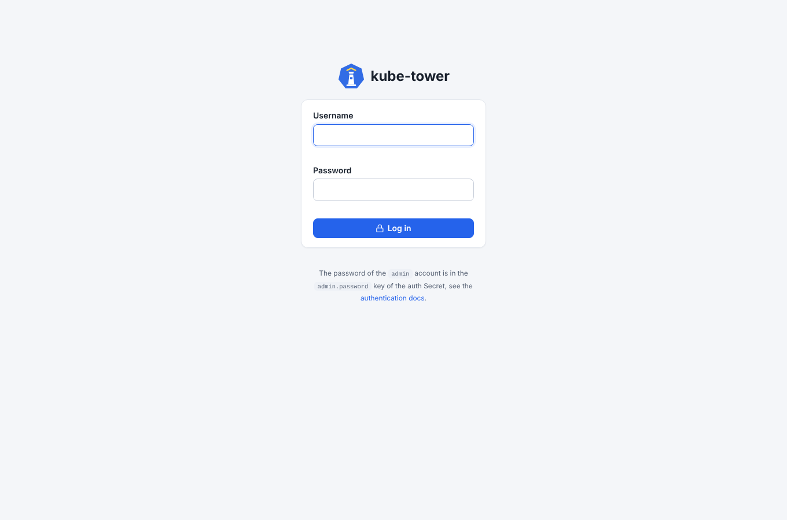
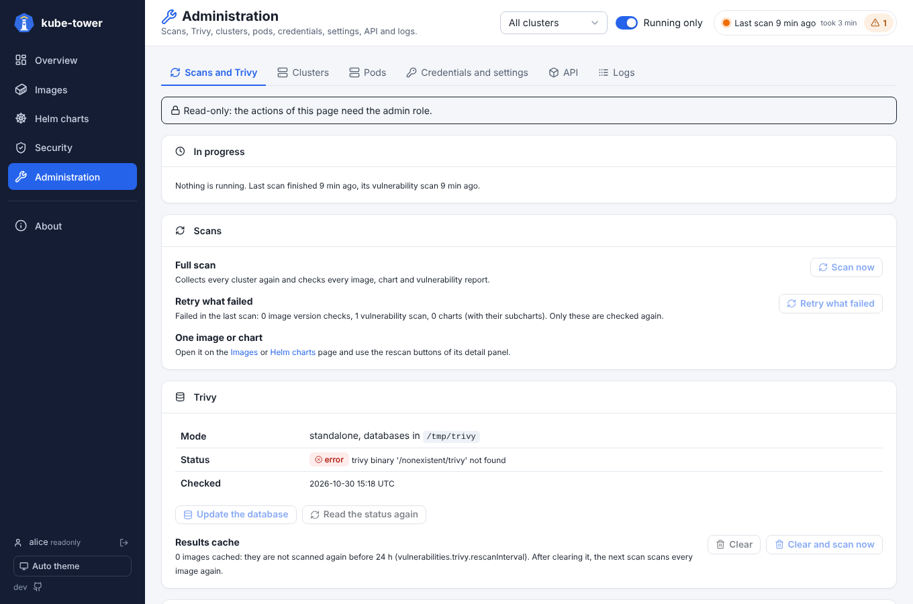

# Authentication

kube-tower can ask for a login on the UI and the API, the ArgoCD way: a built-in `admin` account
with a generated password, local accounts, and two roles. It is off by default: without it,
anyone who reaches kube-tower can use it, as in 1.0.

SSO with OIDC (Dex, Authentik, Keycloak...) comes next, see [#108](https://github.com/Arcanexus/kube-tower/issues/108).

## Turn it on

```yaml
# values.yaml of the chart
auth:
  enabled: true
```

At startup, kube-tower creates the Secret `<release>-auth` (`kube-tower-auth` for a release named
`kube-tower`) with two random values, like the `argocd-initial-admin-secret` of ArgoCD:

| Key | What |
| --- | --- |
| `admin.password` | password of the `admin` account |
| `session.key` | key signing the sessions, shared by every ui pod |

Read the password of `admin`:

```sh
kubectl -n kube-tower get secret kube-tower-auth -o jsonpath='{.data.admin\.password}' | base64 -d; echo
```

```powershell
# PowerShell
[Text.Encoding]::UTF8.GetString([Convert]::FromBase64String((kubectl -n kube-tower get secret kube-tower-auth -o jsonpath='{.data.admin\.password}')))
```



The Secret is made by kube-tower, not by Helm: it stays the same on upgrades and ArgoCD syncs (no
`OutOfSync`), and is left behind by `helm uninstall`. The ui pods mount it once it exists: on a
first install with the roles apart, the login page asks to wait about a minute. To change the
password of `admin`, change `admin.password` in the Secret: the open sessions of `admin` are
closed within a minute, when the kubelet updates the mounted file. Deleting the Secret makes
kube-tower create a new one at its next start, with new values (every session closed).

### Bring your own Secret

With ExternalSecrets, Sealed Secrets or a Secret made by hand, give its name: kube-tower then only
reads it, and the chart does not let it create Secrets.

```yaml
auth:
  enabled: true
  existingSecret: kube-tower-auth   # keys admin.password and session.key
```

`session.key` must be a long random value (at least 32 characters), for example
`openssl rand -base64 48`.

## Roles

| Role | Can |
| --- | --- |
| `readonly` | see every page, open the detail panels, follow the logs, read the API (`GET`) |
| `admin` | also start a scan, rescan an image or a chart, retry what failed, test the connectivity, update the Trivy database or clear its cache: every request that changes something (`POST`, `DELETE`) |

A `readonly` user does not see the *Scan now* and rescan buttons, and the actions of the
Administration page are greyed out. The user and the *Log out* button are at the bottom of the sidebar.


 The API answers `403` to the requests of that role that change
something. Every action of a user is logged with its name, for example
`alice (admin): POST /api/refresh`.

## Local accounts

```yaml
auth:
  enabled: true
  admin: true                       # keep the built-in admin account (false: only the users below)
  users:
    - name: alice
      role: readonly
      existingSecret: kube-tower-alice   # Secret holding the password
      passwordKey: password              # key in that Secret (default password)
    - name: ops
      role: admin
      existingSecret: kube-tower-ops
```

```sh
kubectl -n kube-tower create secret generic kube-tower-alice --from-literal=password='…'
```

Passwords are read at each login: a new password applies without restart, and closes the sessions
opened with the old one. A change of role applies to the open sessions too.

## Visitors who are not logged in

```yaml
auth:
  enabled: true
  anonymousRole: readonly   # "" (default): they must log in
```

With `anonymousRole: readonly`, everyone sees kube-tower as with the `readonly` role, and logs in to
run scans and actions (the *Log in* link at the bottom of the sidebar).

## Sessions

A session is a cookie (`kube_tower_session`, `HttpOnly`, `SameSite=Lax`, `Secure` over https)
signed with `session.key`: nothing is stored on the server, so any ui pod serves any request (see
[scaling](scaling.md)). It lasts `sessionDuration` (24h by default) and is closed by *Log out*, at
the bottom of the sidebar.

A wrong password is answered after one second, and logged with the name tried and the address of
the client (`X-Forwarded-For` behind an ingress).

## API and metrics

Scripts call the API with the Basic auth of a local account:

```sh
curl -u admin:$PASSWORD -X POST https://kube-tower.example.com/api/refresh
curl -u alice:$PASSWORD https://kube-tower.example.com/api/snapshot
```

Without a session nor Basic auth, the API answers `401`. The health probes (`/healthz`,
`/readyz`, `/leaderz`) are always open. `/metrics` stays open for Prometheus; with
`metricsPublic: false` it needs the Basic auth of a local account (`basicAuth` of the
ServiceMonitor).

## Settings

The chart writes them in the configuration (see [configuration](configuration.md)):

```yaml
auth:
  enabled: false
  admin: true                  # built-in admin account, password in the auth Secret (admin.password)
  users:                       # local accounts
    - name: alice
      role: readonly           # readonly | admin
      passwordFile: /etc/kube-tower/users/0/password   # or passwordEnv: ALICE_PASSWORD
  anonymousRole: ""            # "" (login required) | readonly
  sessionDuration: 24h
  secretName: kube-tower-auth  # created with random values when missing (needs get and create on it)
  secretDir: /etc/kube-tower/auth   # where the ui pods find it mounted
  metricsPublic: true
```

The controller creates the Secret in its own namespace: the chart gives its ServiceAccount `get` on
that Secret and `create` on Secrets in the release namespace (Kubernetes cannot limit `create` to a
name), only when `auth.enabled` and without `existingSecret`.
