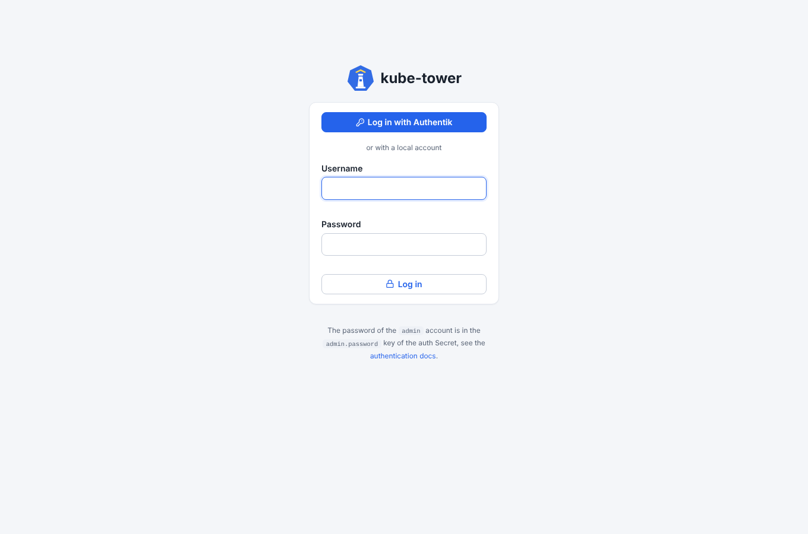

# Authentication

kube-tower asks for a login on the UI and the API, the ArgoCD way: a built-in `admin` account
with a generated password, local accounts, single sign-on with an OpenID Connect provider (Dex,
Authentik, Keycloak, Entra ID, Okta...), and two roles. It is on by default since 1.1.

## The admin account

At startup, kube-tower creates the Secret `<release>-auth` (`kube-tower-auth` for a release named
`kube-tower`) with two random values, like the `argocd-initial-admin-secret` of ArgoCD:

| Key | What |
| --- | --- |
| `admin.password` | password of the `admin` account |
| `session.key` | key signing the sessions, shared by every ui pod |

Read the password of `admin`:

```sh
kubectl -n kube-tower get secret kube-tower-auth -o jsonpath='{.data.admin\.password}' | base64 -d; echo
```

```powershell
# PowerShell
[Text.Encoding]::UTF8.GetString([Convert]::FromBase64String((kubectl -n kube-tower get secret kube-tower-auth -o jsonpath='{.data.admin\.password}')))
```



The Secret is made by kube-tower, not by Helm: it stays the same on upgrades and ArgoCD syncs (no
`OutOfSync`), and is left behind by `helm uninstall`. The ui pods mount it once it exists: on a
first install with the roles apart, the login page asks to wait about a minute. To change the
password of `admin`, change `admin.password` in the Secret: the open sessions of `admin` are
closed within a minute, when the kubelet updates the mounted file. Deleting the Secret makes
kube-tower create a new one at its next start, with new values (every session closed).

### Turn it off

```yaml
# values.yaml of the chart
auth:
  enabled: false
```

Anyone who reaches kube-tower can then use it, with the `admin` role, as in 1.0: keep it for a UI
only reachable with `kubectl port-forward` or behind the authentication of your ingress.

### Bring your own Secret

With ExternalSecrets, Sealed Secrets or a Secret made by hand, give its name: kube-tower then only
reads it, and the chart does not let it create Secrets.

```yaml
auth:
  enabled: true
  existingSecret: kube-tower-auth   # keys admin.password and session.key
```

`session.key` must be a long random value (at least 32 characters), for example
`openssl rand -base64 48`.

## Roles

Each user gets one or more roles: `readonly` (sees everything, runs nothing), `admin` (may do
everything) or your own, with the permissions and the clusters you choose. They are set in
`auth.roles` and given to local accounts (`users[].role`), OIDC groups (`auth.oidc.roleGroups`) and
the visitors not logged in (`anonymousRole`). See [RBAC](rbac.md).

## Local accounts

```yaml
auth:
  enabled: true
  admin: true                       # keep the built-in admin account (false: only the users below)
  users:
    - name: alice
      role: readonly
      existingSecret: kube-tower-alice   # Secret holding the password
      passwordKey: password              # key in that Secret (default password)
    - name: ops
      role: admin                        # readonly, admin or a role of auth.roles
      existingSecret: kube-tower-ops
```

```sh
kubectl -n kube-tower create secret generic kube-tower-alice --from-literal=password='…'
```

Passwords are read at each login: a new password applies without restart, and closes the sessions
opened with the old one. A change of role applies to the open sessions too.

## Single sign-on (OIDC)

kube-tower logs users in with an OpenID Connect provider (authorization code flow with PKCE, as a
confidential client). Their roles come from their groups (see [RBAC](rbac.md#oidc-groups)).

1. In the provider, create a client (an *application*) for kube-tower: confidential, with the
   redirect URI `<auth.url>auth/callback`, for example `https://kube-tower.example.com/auth/callback`,
   and the groups in the ID token (or the userinfo endpoint).
2. Put its client id and client secret in a Secret (by hand, or with ExternalSecrets or Sealed Secrets):

   ```sh
   kubectl -n kube-tower create secret generic kube-tower-oidc \
     --from-literal=clientId=kube-tower --from-literal=clientSecret='…'
   ```

3. Set the values:

   ```yaml
   auth:
     enabled: true
     url: https://kube-tower.example.com/   # the URL users open, with its sub-path if any
     oidc:
       name: Authentik                      # the login button says "Log in with Authentik"
       issuer: https://auth.example.com/application/o/kube-tower/
       existingSecret: kube-tower-oidc     # keys clientId and clientSecret
       adminGroups: [kube-tower-admins]     # admin role
       readonlyGroups: []                   # readonly role
       roleGroups:                          # roles of auth.roles
         team-prod: [k8s-prod-team]
       defaultRole: readonly                # everyone else; "" refuses them
   ```

The login page then offers *Log in with Authentik*, above the local accounts form. Keep `admin: true`
as a way in when the provider is down, or set `admin: false` (and no `users`) to only offer the SSO.

| Setting | Default | What |
| --- | --- | --- |
| `issuer` | `""` | Issuer URL, exactly as the provider writes it in `/.well-known/openid-configuration` |
| `existingSecret` | `""` | Secret holding the client of kube-tower in the provider: its client id (key `clientIdKey`, default `clientId`) and client secret (key `clientSecretKey`, default `clientSecret`) |
| `clientId` | `""` | The client id in the values instead of the Secret, if you prefer |
| `scopes` | `openid profile email groups` | Scopes asked for (Dex needs `groups` for the groups) |
| `usernameClaim` | `preferred_username` | Claim naming the user (else `email`, else `sub`) |
| `groupsClaim` | `groups` | Claim listing the groups, read from the ID token, else from the userinfo endpoint |
| `adminGroups` / `readonlyGroups` | `[]` / `[]` | Groups given the `admin` / `readonly` role |
| `roleGroups` | `{}` | Groups of each other role, `{role: [groups]}`, see [RBAC](rbac.md#oidc-groups) |
| `defaultRole` | `readonly` | Role of a user in none of these groups; `""` refuses them |
| `caFile` | `""` | PEM file of a private CA of the provider (mount it with `extraVolumes`) |

The roles are decided at login: a change of groups applies at the next login (sessions last
`sessionDuration`). *Log out* closes the kube-tower session, not the one of the provider.

The ID token comes straight from the token endpoint of the provider, over a connection kube-tower
opens: its issuer, audience, expiry and nonce are checked, the TLS certificate of the provider stands
for its signature (OpenID Connect Core 3.1.3.7). Use an `https` issuer; a plain `http` one (a Dex
inside the cluster) is logged as a warning.

### Authentik

Create an *OAuth2/OpenID Provider* (client type *Confidential*, redirect URI
`https://kube-tower.example.com/auth/callback`, scopes `openid`, `email`, `profile`), then an
*Application* using it, with the slug `kube-tower`. The issuer is
`https://auth.example.com/application/o/kube-tower/`. Authentik puts the groups of the user in the
`groups` claim of the `profile` scope.

### Dex of the chart

Like ArgoCD, the chart can deploy its own [Dex](https://dexidp.io), served by kube-tower on
`<auth.url>api/dex`: the users log in with its connectors (GitHub, GitLab, LDAP, SAML, Google,
Microsoft, another OIDC provider...) without any other identity provider to run.

```yaml
auth:
  enabled: true
  url: https://kube-tower.example.com/
  oidc:
    adminGroups: [my-org:ops]          # GitHub teams are "org:team" groups
dex:
  enabled: true
  name: GitHub                         # the login button says "Log in with GitHub"
  connectors:
    - type: github
      id: github
      name: GitHub
      config:
        clientID: Iv1.0123456789abcdef
        clientSecret: $GITHUB_CLIENT_SECRET
        redirectURI: https://kube-tower.example.com/api/dex/callback
        orgs:
          - name: my-org
  envFrom:
    - secretRef:
        name: dex-github               # holds GITHUB_CLIENT_SECRET
```

- The chart writes the Dex configuration in the Secret `<release>-dex`: issuer `<auth.url>api/dex`,
  memory storage (one replica), kube-tower as its only client, your `connectors`. Secrets go in
  `dex.env` / `dex.envFrom` and are written `$NAME` in the connectors.
- The client secret between kube-tower and Dex is generated with the auth Secret (key
  `dex.clientSecret`): Dex starts once kube-tower has created it. With `auth.existingSecret`, add
  that key to your Secret.
- The browser only talks to kube-tower: requests under `/api/dex/` are passed to the Dex Service, so
  the ingress, the TLS certificate and a port-forward work as for the rest of kube-tower. The
  callback URL of the connectors is `<auth.url>api/dex/callback`.
- The roles come from the groups Dex sends (`auth.oidc.adminGroups`, `readonlyGroups`,
  `defaultRole`).
- With `networkPolicy.enabled`, only kube-tower reaches Dex; Dex reaches its providers.

| Value | Default | What |
| --- | --- | --- |
| `dex.enabled` | `false` | Deploy Dex, served on `<auth.url>api/dex` (needs `auth.enabled` and `auth.url`) |
| `dex.name` | `Dex` | Login button: "Log in with <name>" |
| `dex.connectors` | `[]` | [Dex connectors](https://dexidp.io/docs/connectors/) |
| `dex.env` / `dex.envFrom` | `[]` | Secrets of the connectors, as env vars |
| `dex.image` | `ghcr.io/dexidp/dex:v2.46.1` | Dex image |
| `dex.resources`, `.nodeSelector`, `.tolerations`, `.affinity` | 10m CPU, 32Mi | Pod settings |

### Dex of your own

```yaml
# Dex configuration
staticClients:
  - id: kube-tower
    name: kube-tower
    secret: <client secret>
    redirectURIs: [https://kube-tower.example.com/auth/callback]
```

The issuer is the `issuer` of the Dex configuration (`https://dex.example.com` for example). Keep
the `groups` scope so that Dex sends the groups of its connectors (GitHub teams as `org:team`, LDAP
groups...).

### Keycloak

Create an OpenID Connect client with *Client authentication* on and the redirect URI above, then add
a *Group Membership* mapper (token claim name `groups`, *Full group path* off) to its dedicated scope.
The issuer is `https://keycloak.example.com/realms/<realm>`. Keycloak refuses unknown scopes: set
`scopes: [openid, profile, email]`.

## Visitors who are not logged in

```yaml
auth:
  enabled: true
  anonymousRole: readonly   # "" (default): they must log in; or a role of auth.roles (not admin)
```

With `anonymousRole: readonly`, everyone sees kube-tower as with the `readonly` role, and logs in to
run scans and actions (the *Log in* link at the bottom of the sidebar).

## Sessions

A session is a cookie (`kube_tower_session`, `HttpOnly`, `SameSite=Lax`, `Secure` over https)
signed with `session.key`: nothing is stored on the server, so any ui pod serves any request (see
[scaling](scaling.md)). It lasts `sessionDuration` (24h by default) and is closed by *Log out*, at
the bottom of the sidebar.

A wrong password is answered after one second, and logged with the name tried and the address of
the client (`X-Forwarded-For` behind an ingress).

## API and metrics

Scripts call the API with the Basic auth of a local account:

```sh
curl -u admin:$PASSWORD -X POST https://kube-tower.example.com/api/refresh
curl -u alice:$PASSWORD https://kube-tower.example.com/api/snapshot
```

Without a session nor Basic auth, the API answers `401`. The health probes (`/healthz`,
`/readyz`, `/leaderz`) are always open. `/metrics` stays open for Prometheus; with
`metricsPublic: false` it needs the Basic auth of a local account (`basicAuth` of the
ServiceMonitor).

## Settings

The chart writes them in the configuration (see [configuration](configuration.md)):

```yaml
auth:
  enabled: false               # the chart sets true (auth.enabled, on by default)
  admin: true                  # built-in admin account, password in the auth Secret (admin.password)
  users:                       # local accounts
    - name: alice
      role: readonly           # readonly | admin | a role of roles
      passwordFile: /etc/kube-tower/users/0/password   # or passwordEnv: ALICE_PASSWORD
  roles: {}                    # other roles: {name: {permissions: [scan, rescan, retry, trivy, connectivity, logs, settings] or [*], clusters: [patterns]}}
  anonymousRole: ""            # "" (login required) | readonly | a role of roles (not admin)
  sessionDuration: 24h
  secretName: kube-tower-auth  # created with random values when missing (needs get and create on it)
  secretDir: /etc/kube-tower/auth   # where the ui pods find it mounted
  metricsPublic: true
  url: ""                      # URL users open kube-tower with: the SSO sends them back to <url>auth/callback
  oidc:
    name: SSO
    issuer: ""                 # empty: no SSO
    clientId: ""               # empty: read from clientIdEnv
    clientIdEnv: KUBE_TOWER_OIDC_CLIENT_ID   # set by the chart from the key clientId of auth.oidc.existingSecret
    clientSecretFile: ""       # or clientSecretEnv (default KUBE_TOWER_OIDC_CLIENT_SECRET, set by the chart)
    clientSecretEnv: KUBE_TOWER_OIDC_CLIENT_SECRET
    scopes: [openid, profile, email, groups]
    usernameClaim: preferred_username
    groupsClaim: groups
    adminGroups: []
    readonlyGroups: []
    roleGroups: {}             # {role: [groups]}
    defaultRole: readonly
    caFile: ""
    providerUrl: ""            # where kube-tower reaches the provider when not at the issuer (the chart's Dex)
  dexUrl: ""                   # Dex served on <url>api/dex: the address of its Service (chart: dex.enabled)
```

The controller creates the Secret in its own namespace: the chart gives its ServiceAccount `get` on
that Secret and `create` on Secrets in the release namespace (Kubernetes cannot limit `create` to a
name), only when `auth.enabled` and without `existingSecret`.
