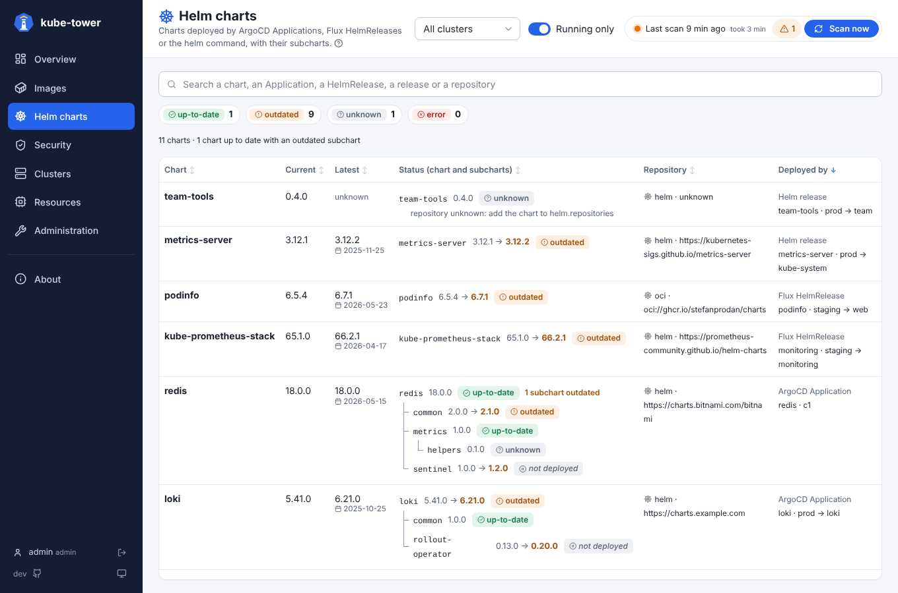

# Helm charts: ArgoCD, Flux and the helm command

kube-tower finds the Helm charts of a cluster in three places, and checks each one the same way (latest
version, subcharts, see [statuses and versions](statuses.md)). The [Helm charts page](ui-charts.md) shows
what deploys each chart in its **Deployed by** column.



| Deployed by | Read from | On by default | Permission |
| --- | --- | --- | --- |
| **ArgoCD Application** | `applications.argoproj.io` in `helm.applicationNamespaces` | yes | `get`, `list` on Applications |
| **Flux HelmRelease** | `helmreleases.helm.toolkit.fluxcd.io`, and their `HelmRepository`, `OCIRepository` or `GitRepository` | yes (`helm.flux`) | `get`, `list` on these resources |
| **Helm release** (`helm install`) | the release Secrets of Helm (`owner=helm`, `status=deployed`) | no (`helm.releases`) | `list` on **every Secret** of the cluster |

Nothing happens on a cluster without ArgoCD or Flux. A chart deployed by Flux is shown once, as its
HelmRelease, even though Flux also leaves a Helm release behind.

## ArgoCD Applications

The source of each Application (single or multi-source) gives the chart, its repository and its version;
the Helm values of the Application (value files and inline values) tell which subcharts are deployed.
Applications are read in the `argocd` namespace; set `helm.applicationNamespaces` (`[]` for all
namespaces) when they live elsewhere.

## Flux HelmReleases

For each HelmRelease (`helm.toolkit.fluxcd.io/v2`, `v2beta2` or `v2beta1`):

- the **chart** and its **repository** come from its `spec.chart.spec` and the source it points to:
  the URL of a `HelmRepository` (HTTP, or OCI with `type: oci`), an `OCIRepository` (`spec.chartRef`), or
  a `GitRepository` (the chart is then read from git, like an ArgoCD git source);
- the **version** is the one Flux last installed (`status.history`), so a version range such as `18.x`
  in the HelmRelease still shows the real version;
- `spec.values` tells which subcharts are deployed (`valuesFrom` ConfigMaps and Secrets are not read: a
  subchart only switched off there is shown deployed).

A HelmRelease pointing to a `HelmChart` object or a `Bucket` is listed with its chart name and an
*unknown* status.

## Releases installed with the helm command

Off by default, because Helm keeps each release in a Secret: finding them needs `list` on every Secret of
the cluster (RBAC cannot limit a `list` to some labels). Turn it on with:

```yaml
config:
  helm:
    releases: true        # the chart then adds `list secrets` to the ClusterRole of the local cluster
```

For remote clusters, uncomment the matching rule in
[remote-cluster-rbac.yaml](../deploy/remote-cluster-rbac.yaml). kube-tower reads the deployed revision of
each release, keeps the name, version and subcharts of its chart and only the **booleans** of its values
(the conditions and tags of the subcharts): the other values, which can hold secrets, are dropped at once.

Helm does not record where a chart was installed from. kube-tower looks for its repository:

1. in `helm.repositories`, chart name (or fnmatch pattern) to repository:

   ```yaml
   config:
     helm:
       repositories:
         ingress-nginx: https://kubernetes.github.io/ingress-nginx
         "mycompany-*": oci://registry.example.com/charts
   ```

2. else on [Artifact Hub](https://artifacthub.io): among the Helm packages with exactly this name, the
   official one, else one of a verified publisher, else the most starred. Set `helm.artifactHubUrl: ""`
   to turn the lookup off (air-gapped clusters), or point it to another Artifact Hub instance.

A chart whose repository stays unknown is shown *unknown*, with the hint to add it to
`helm.repositories`; its subcharts are still checked (their repositories are in its `Chart.yaml`). Check
the repository Artifact Hub chose in the detail panel: a chart published in several repositories (a fork,
a mirror) may need an entry in `helm.repositories`.

## Settings

```yaml
helm:
  enabled: true
  applicationNamespaces: [argocd]   # ArgoCD Applications; [] = every namespace
  flux: true                        # Flux HelmReleases
  releases: false                   # releases installed with the helm command (list secrets)
  repositories: {}                  # chart name or pattern -> repository, for those releases
  artifactHubUrl: https://artifacthub.io   # "" = no lookup
  includePrerelease: false
  checkDependencies: true
  fetchReleaseDates: true
```

The metric `kube_tower_chart_outdated` has a `manager` label (`argocd`, `flux` or `helm`), see
[metrics](metrics.md).
