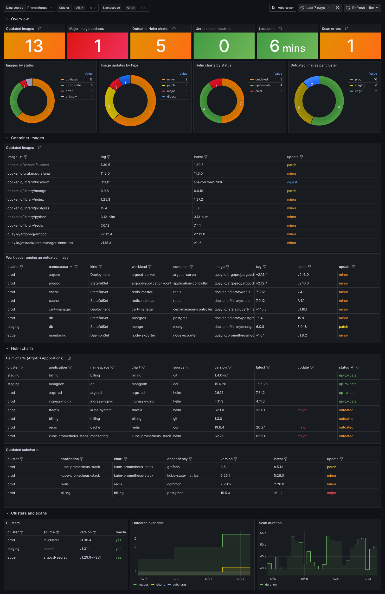

# Metrics and Grafana

`GET /metrics` is a Prometheus exporter: every scrape renders the result of the **last scan**
(kube-tower scans every `refreshInterval`, 6h by default), so scraping every few minutes is enough.
A series disappears as soon as the image, chart or cluster is no longer found.

- [Scraping](#scraping)
- [Metrics](#metrics)
- [PromQL examples](#promql-examples)
- [Alerts](#alerts)
- [Grafana dashboard](#grafana-dashboard)

## Scraping

With the Prometheus operator (kube-prometheus-stack…), enable the ServiceMonitor:

```yaml
serviceMonitor:
  enabled: true
  interval: 5m
  labels:
    release: kube-prometheus-stack   # if your Prometheus only selects labelled ServiceMonitors
```

The ServiceMonitor sets `honorLabels: true`: kube-tower exports the `namespace` and `container`
of the **scanned** workloads, which must not be replaced by those of the kube-tower pod. Without
the operator, set `honor_labels: true` in your scrape configuration for the same reason.

## Metrics

Every metric is a gauge rebuilt from the last scan, except `kube_tower_scans_total`.

### Container images

| Metric | Labels | Value |
| --- | --- | --- |
| `kube_tower_image_outdated` | `image`, `tag`, `latest`, `status`, `update` | 1 if a newer version is available, else 0 |
| `kube_tower_image_workload_info` | `cluster`, `namespace`, `kind`, `workload`, `container`, `image`, `tag` | always 1: a workload running the image |
| `kube_tower_image_nodes` | `cluster`, `image`, `tag` | number of nodes of the cluster holding the image |

- `image` is `registry/repository` (e.g. `docker.io/library/nginx`), `tag` the tag in use.
- `latest` is the latest tag of the same shape and versioning scheme, or the new digest for a floating tag (`latest`, `stable`…).
- `status` is `up-to-date`, `outdated`, `unknown` (floating tag without digest, version constraint…) or `error`.
- `update` tells how big the update is: `major`, `minor`, `patch`, `newer` (a newer calendar version,
  date or build number, which has no major/minor/patch), `digest` (new image under the same floating
  tag) or empty when up to date.
- An image is reported **once** by `kube_tower_image_outdated`, even when several clusters run it.
  Join with `kube_tower_image_workload_info` or `kube_tower_image_nodes` on `image, tag` to filter or
  group by cluster, namespace or workload (see the examples below).
- `kind` is `Deployment`, `StatefulSet`, `DaemonSet`, `CronJob` or `Pod`. Pods are only listed when no
  controller runs the same container in the same namespace (bare pods, Jobs…): pod names change on
  every rollout and would create new series each time.
- Images only found on nodes (`node.status.images`, i.e. pulled but not necessarily running) appear
  in `kube_tower_image_nodes` only, as a node count per cluster rather than one series per node.

### Helm charts

| Metric | Labels | Value |
| --- | --- | --- |
| `kube_tower_chart_outdated` | `cluster`, `application`, `destination_namespace`, `chart`, `source`, `version`, `latest`, `status`, `update`, `manager` | 1 if the chart **or one of its subcharts** has a newer version |
| `kube_tower_chart_dependency_outdated` | `cluster`, `application`, `chart`, `dependency`, `version`, `latest`, `status`, `update` | 1 if the subchart has a newer version and is deployed |

- `source` is `helm` (HTTP repository), `oci` or `git`.
- `manager` is what deploys the chart: `argocd` (`application` is the Application), `flux` (the
  HelmRelease) or `helm` (the release installed with the helm command), see [chart sources](chart-sources.md).
- On `kube_tower_chart_outdated`, `status` is the worst status of the chart and its subcharts, while
  `latest` and `update` describe the chart itself: a chart can be `outdated` with an empty `update`
  when only a subchart is behind.
- On `kube_tower_chart_dependency_outdated`, `status` is `not-deployed` (and the value 0) for a subchart
  that the Helm values of the Application leave out of the release (see [Helm charts page](ui-charts.md)).

### Vulnerabilities

See [vulnerabilities](vulnerabilities.md) for where they come from.

| Metric | Labels | Value |
| --- | --- | --- |
| `kube_tower_image_vulnerabilities` | `image`, `tag`, `severity`, `source` | number of vulnerabilities of that severity |
| `kube_tower_image_vulnerabilities_fixable` | `image`, `tag`, `severity` | those with a fixed version |
| `kube_tower_image_os_eosl` | `image`, `tag`, `os` | 1 if the OS of the image is end of life |
| `kube_tower_image_vulnerability_scan_failed` | `image`, `tag` | 1 if the scan failed |
| `kube_tower_last_vulnerability_scan_timestamp_seconds` | | end of the last vulnerability scan |

### Security (Trivy Operator)

The reports of the [Security](security.md) page.

| Metric | Labels | Value |
| --- | --- | --- |
| `kube_tower_security_findings` | `cluster`, `namespace`, `type`, `severity` | Failed checks and exposed secrets |
| `kube_tower_security_resources` | `cluster`, `type`, `result` (`pass` / `fail`) | Resources checked |
| `kube_tower_compliance_controls` | `cluster`, `compliance`, `title`, `result` (`pass` / `fail`) | Controls of each compliance framework |

### Clusters and scans

| Metric | Labels | Value |
| --- | --- | --- |
| `kube_tower_cluster_reachable` | `cluster` | 1 if the cluster answered during the last scan |
| `kube_tower_cluster_info` | `cluster`, `source`, `version` | always 1 (`source`: `in-cluster`, `secret`, `argocd-secret`; `version`: Kubernetes version) |
| `kube_tower_kubernetes_end_of_life_days` | `cluster`, `version`, `cycle` | days until the end of life of the Kubernetes release of the API server (negative once passed) |
| `kube_tower_platform_vulnerabilities` | `component` (`kubernetes`, `containerd`), `version`, `severity` | known vulnerabilities of a version run by the clusters (OSV) |
| `kube_tower_deprecated_api_requested` | `cluster`, `group`, `version`, `resource`, `subresource`, `removed_release` | always 1: a deprecated API requested since the API server started (`removed_release`: the Kubernetes release that removes it, `""` when none is planned) |
| `kube_tower_nodes` | `cluster`, `role`, `pool`, `kubelet_version`, `ready` (`true` / `false`) | nodes of each group with this kubelet version (see the [Clusters page](ui-clusters.md)) |
| `kube_tower_last_scan_timestamp_seconds` | | end of the last scan (Unix time) |
| `kube_tower_last_scan_duration_seconds` | | duration of the last scan |
| `kube_tower_last_scan_errors` | | non fatal errors of the last scan (e.g. a resource kube-tower may not list, a registry that cannot be queried), detailed under the scan status of the top bar |
| `kube_tower_scan_in_progress` | | 1 while a scan is running |
| `kube_tower_scans_total` | `result` (`success`, `failure`) | scans since kube-tower started (counter) |
| `kube_tower_build_info` | `version` (image tag: `1.2.3` for a release, the branch name otherwise) | always 1 |

### CPU and memory (krr)

With [krr](resources.md) enabled. CPU in cores, memory in bytes.

| Metric | Labels | Value |
| --- | --- | --- |
| `kube_tower_resources_current` | `cluster`, `namespace`, `kind`, `workload`, `container`, `resource` (`cpu`, `memory`), `type` (`request`, `limit`) | current request or limit of the container (no series when not set) |
| `kube_tower_resources_recommended` | same | request or limit that krr recommends (no series when it advises none, or has not enough data) |
| `kube_tower_resources_containers` | `cluster`, `fit` (`critical`, `warning`, `ok`, `good`, `unknown`) | containers analysed by krr with this fit |

```promql
# CPU requested and not used, per cluster (cores)
sum by (cluster) (kube_tower_resources_current{resource="cpu", type="request"}
  - on (cluster, namespace, kind, workload, container, resource, type) kube_tower_resources_recommended)
```

### Cardinality

The number of series grows with the number of distinct images and charts, not with the number of
pods or nodes: roughly one series per image, one per (workload, container), one per
(cluster, image) found on nodes, one per chart and subchart, one per (node group, kubelet version), and with krr up to eight per container
analysed. A few thousand series for a few hundred
workloads is typical. To drop a metric you do not need, use `serviceMonitor.metricRelabelings`:

```yaml
serviceMonitor:
  metricRelabelings:
    - sourceLabels: [__name__]
      regex: kube_tower_image_nodes
      action: drop
```

## PromQL examples

```promql
# Number of outdated images, and of major updates
count(kube_tower_image_outdated == 1)
count(kube_tower_image_outdated{update="major"} == 1)

# Outdated images used in cluster "prod" (workloads or nodes)
kube_tower_image_outdated == 1
  and on (image, tag)
  group by (image, tag) (kube_tower_image_workload_info{cluster="prod"} or kube_tower_image_nodes{cluster="prod"})

# Workloads running an outdated image, with the latest version
kube_tower_image_workload_info
  * on (image, tag) group_left (latest, update)
  (kube_tower_image_outdated == 1)

# Outdated workloads per namespace
count by (cluster, namespace) (
  kube_tower_image_workload_info and on (image, tag) kube_tower_image_outdated == 1
)

# Outdated Helm charts per cluster, outdated subcharts
count by (cluster) (kube_tower_chart_outdated == 1)
kube_tower_chart_dependency_outdated == 1

# Nodes not ready, and clusters whose nodes run more than one kubelet version
sum by (cluster) (kube_tower_nodes{ready="false"})
count by (cluster) (count by (cluster, kubelet_version) (kube_tower_nodes)) > 1

# Clusters whose Kubernetes release ends within 90 days, or has ended
kube_tower_kubernetes_end_of_life_days < 90

# Deprecated APIs still requested, by cluster and release that removes them
count by (cluster, removed_release) (kube_tower_deprecated_api_requested{removed_release!=""})
```

```promql
# Images with critical vulnerabilities that have a fix, in cluster "prod"
kube_tower_image_vulnerabilities_fixable{severity="critical"} > 0
  and on (image, tag) kube_tower_image_workload_info{cluster="prod"}
```

## Alerts

Example `PrometheusRule` (or plain Prometheus rules):

```yaml
groups:
  - name: kube-tower
    rules:
      - alert: KubeTowerScanStale
        expr: time() - kube_tower_last_scan_timestamp_seconds > 2 * 6 * 3600
        for: 30m
        annotations:
          summary: kube-tower has not finished a scan for 12h
      - alert: KubeTowerScanErrors
        expr: kube_tower_last_scan_errors > 0
        for: 1h
        annotations:
          summary: "The last kube-tower scan had {{ $value }} error(s), see the scan errors on its pages"
      - alert: KubeTowerClusterUnreachable
        expr: kube_tower_cluster_reachable == 0
        for: 1h
        annotations:
          summary: "kube-tower cannot reach cluster {{ $labels.cluster }}"
      - alert: MajorImageUpdate
        expr: kube_tower_image_outdated{update="major"} == 1
        for: 1d
        labels:
          severity: info
        annotations:
          summary: "{{ $labels.image }}:{{ $labels.tag }} can be upgraded to {{ $labels.latest }}"
      - alert: OutdatedHelmCharts
        expr: sum(kube_tower_chart_outdated) > 0
        for: 1d
        labels:
          severity: info
        annotations:
          summary: "{{ $value }} Helm chart(s) have a newer version"
```

## Grafana dashboard

The dashboard is [`charts/kube-tower/dashboards/kube-tower.json`](../charts/kube-tower/dashboards/kube-tower.json)
(Grafana 10 or later). It has a data source selector and `cluster` / `namespace` filters, and shows:




- **Overview**: outdated images, major image updates, outdated charts, unreachable clusters, age of the
  last scan, scan errors; images and charts by status, image updates by type, outdated images per cluster.
- **Container images**: outdated images (current, latest, update type) and the workloads running them.
- **Helm charts**: every chart (ArgoCD, Flux, helm) with its status, and the outdated subcharts.
- **Vulnerabilities**: images with critical and high vulnerabilities, fixable critical/high vulnerabilities,
  end of life OS images, failed vulnerability scans, age of the last vulnerability scan; vulnerabilities by
  severity and over time, the most vulnerable images and the workloads running an image with critical
  vulnerabilities (see [Vulnerabilities](vulnerabilities.md)).
- **Clusters and scans**: registered clusters, outdated items over time, scan duration.

### With the Grafana sidecar (kube-prometheus-stack)

Let the chart create a ConfigMap that the Grafana dashboard sidecar loads automatically:

```yaml
grafanaDashboard:
  enabled: true
  namespace: ""                 # namespace watched by the sidecar, defaults to the release namespace
  labels:
    grafana_dashboard: "1"      # sidecar.dashboards.label / labelValue of your Grafana
  annotations:
    grafana_folder: Kubernetes  # with sidecar.dashboards.folderAnnotation=grafana_folder
```

The sidecar must watch the ConfigMap's namespace (`sidecar.dashboards.searchNamespace: ALL` in the
Grafana chart, or deploy the ConfigMap in Grafana's namespace with `grafanaDashboard.namespace`).

### Manual import

In Grafana, **Dashboards › New › Import**, upload `kube-tower.json` and pick your Prometheus data
source in the **Data source** selector at the top of the dashboard. Grafana operator users can
reference the same file from a `GrafanaDashboard` resource.
