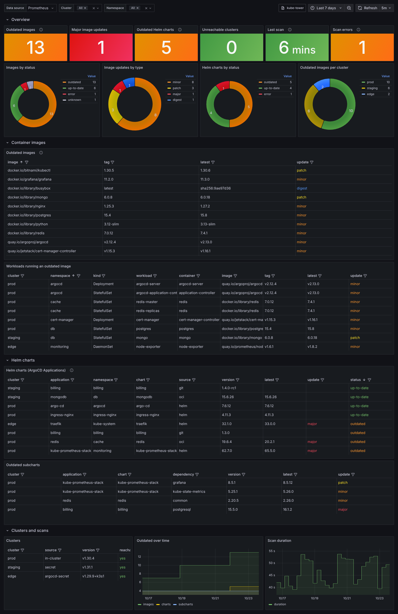

# Metrics and Grafana

`GET /metrics` is a Prometheus exporter: every scrape renders the result of the **last scan**
(kube-tower scans every `refreshInterval`, 6h by default), so scraping every few minutes is enough.
A series disappears as soon as the image, chart or cluster is no longer found.

- [Scraping](#scraping)
- [Metrics](#metrics)
- [PromQL examples](#promql-examples)
- [Alerts](#alerts)
- [Grafana dashboard](#grafana-dashboard)

## Scraping

With the Prometheus operator (kube-prometheus-stack…), enable the ServiceMonitor:

```yaml
serviceMonitor:
  enabled: true
  interval: 5m
  labels:
    release: kube-prometheus-stack   # if your Prometheus only selects labelled ServiceMonitors
```

The ServiceMonitor sets `honorLabels: true`: kube-tower exports the `namespace` and `container`
of the **scanned** workloads, which must not be replaced by those of the kube-tower pod. Without
the operator, set `honor_labels: true` in your scrape configuration for the same reason.

## Metrics

Every metric is a gauge rebuilt from the last scan, except `kube_tower_scans_total`.

### Container images

| Metric | Labels | Value |
| --- | --- | --- |
| `kube_tower_image_outdated` | `image`, `tag`, `latest`, `status`, `update` | 1 if a newer version is available, else 0 |
| `kube_tower_image_workload_info` | `cluster`, `namespace`, `kind`, `workload`, `container`, `image`, `tag` | always 1: a workload running the image |
| `kube_tower_image_nodes` | `cluster`, `image`, `tag` | number of nodes of the cluster holding the image |

- `image` is `registry/repository` (e.g. `docker.io/library/nginx`), `tag` the tag in use.
- `latest` is the latest tag of the same shape, or the new digest for a floating tag (`latest`, `stable`…).
- `status` is `up-to-date`, `outdated`, `unknown` (floating tag without digest, version constraint…) or `error`.
- `update` tells how big the update is: `major`, `minor`, `patch`, `digest` (new image under the same
  floating tag) or empty when up to date.
- An image is reported **once** by `kube_tower_image_outdated`, even when several clusters run it.
  Join with `kube_tower_image_workload_info` or `kube_tower_image_nodes` on `image, tag` to filter or
  group by cluster, namespace or workload (see the examples below).
- `kind` is `Deployment`, `StatefulSet`, `DaemonSet`, `CronJob` or `Pod`. Pods are only listed when no
  controller runs the same container in the same namespace (bare pods, Jobs…): pod names change on
  every rollout and would create new series each time.
- Images only found on nodes (`node.status.images`, i.e. pulled but not necessarily running) appear
  in `kube_tower_image_nodes` only, as a node count per cluster rather than one series per node.

### Helm charts (ArgoCD Applications)

| Metric | Labels | Value |
| --- | --- | --- |
| `kube_tower_chart_outdated` | `cluster`, `application`, `destination_namespace`, `chart`, `source`, `version`, `latest`, `status`, `update` | 1 if the chart **or one of its subcharts** has a newer version |
| `kube_tower_chart_dependency_outdated` | `cluster`, `application`, `chart`, `dependency`, `version`, `latest`, `status`, `update` | 1 if the subchart has a newer version |

- `source` is `helm` (HTTP repository), `oci` or `git`.
- On `kube_tower_chart_outdated`, `status` is the worst status of the chart and its subcharts, while
  `latest` and `update` describe the chart itself: a chart can be `outdated` with an empty `update`
  when only a subchart is behind.

### Vulnerabilities

See [vulnerabilities](vulnerabilities.md#metrics): `kube_tower_image_vulnerabilities`,
`kube_tower_image_vulnerabilities_fixable`, `kube_tower_image_os_eosl`,
`kube_tower_image_vulnerability_scan_failed` and `kube_tower_last_vulnerability_scan_timestamp_seconds`.

### Clusters and scans

| Metric | Labels | Value |
| --- | --- | --- |
| `kube_tower_cluster_reachable` | `cluster` | 1 if the cluster answered during the last scan |
| `kube_tower_cluster_info` | `cluster`, `source`, `version` | always 1 (`source`: `in-cluster`, `secret`, `argocd-secret`; `version`: Kubernetes version) |
| `kube_tower_last_scan_timestamp_seconds` | | end of the last scan (Unix time) |
| `kube_tower_last_scan_duration_seconds` | | duration of the last scan |
| `kube_tower_last_scan_errors` | | non fatal errors of the last scan (e.g. a resource kube-tower may not list, a registry that cannot be queried), detailed on the Status page |
| `kube_tower_scan_in_progress` | | 1 while a scan is running |
| `kube_tower_scans_total` | `result` (`success`, `failure`) | scans since kube-tower started (counter) |
| `kube_tower_build_info` | `version` (image tag: `1.2.3` for a release, the branch name otherwise) | always 1 |

### Cardinality

The number of series grows with the number of distinct images and charts, not with the number of
pods or nodes: roughly one series per image, one per (workload, container), one per
(cluster, image) found on nodes, one per chart and subchart. A few thousand series for a few hundred
workloads is typical. To drop a metric you do not need, use `serviceMonitor.metricRelabelings`:

```yaml
serviceMonitor:
  metricRelabelings:
    - sourceLabels: [__name__]
      regex: kube_tower_image_nodes
      action: drop
```

## PromQL examples

```promql
# Number of outdated images, and of major updates
count(kube_tower_image_outdated == 1)
count(kube_tower_image_outdated{update="major"} == 1)

# Outdated images used in cluster "prod" (workloads or nodes)
kube_tower_image_outdated == 1
  and on (image, tag)
  group by (image, tag) (kube_tower_image_workload_info{cluster="prod"} or kube_tower_image_nodes{cluster="prod"})

# Workloads running an outdated image, with the latest version
kube_tower_image_workload_info
  * on (image, tag) group_left (latest, update)
  (kube_tower_image_outdated == 1)

# Outdated workloads per namespace
count by (cluster, namespace) (
  kube_tower_image_workload_info and on (image, tag) kube_tower_image_outdated == 1
)

# Outdated Helm charts per cluster, outdated subcharts
count by (cluster) (kube_tower_chart_outdated == 1)
kube_tower_chart_dependency_outdated == 1
```

## Alerts

Example `PrometheusRule` (or plain Prometheus rules):

```yaml
groups:
  - name: kube-tower
    rules:
      - alert: KubeTowerScanStale
        expr: time() - kube_tower_last_scan_timestamp_seconds > 2 * 6 * 3600
        for: 30m
        annotations:
          summary: kube-tower has not finished a scan for 12h
      - alert: KubeTowerScanErrors
        expr: kube_tower_last_scan_errors > 0
        for: 1h
        annotations:
          summary: "The last kube-tower scan had {{ $value }} error(s), see its Status page"
      - alert: KubeTowerClusterUnreachable
        expr: kube_tower_cluster_reachable == 0
        for: 1h
        annotations:
          summary: "kube-tower cannot reach cluster {{ $labels.cluster }}"
      - alert: MajorImageUpdate
        expr: kube_tower_image_outdated{update="major"} == 1
        for: 1d
        labels:
          severity: info
        annotations:
          summary: "{{ $labels.image }}:{{ $labels.tag }} can be upgraded to {{ $labels.latest }}"
      - alert: OutdatedHelmCharts
        expr: sum(kube_tower_chart_outdated) > 0
        for: 1d
        labels:
          severity: info
        annotations:
          summary: "{{ $value }} Helm chart(s) have a newer version"
```

## Grafana dashboard

The dashboard is [`charts/kube-tower/dashboards/kube-tower.json`](../charts/kube-tower/dashboards/kube-tower.json)
(Grafana 10 or later). It has a data source selector and `cluster` / `namespace` filters, and shows:




- **Overview**: outdated images, major image updates, outdated charts, unreachable clusters, age of the
  last scan, scan errors; images and charts by status, image updates by type, outdated images per cluster.
- **Container images**: outdated images (current, latest, update type) and the workloads running them.
- **Helm charts**: every ArgoCD Application chart with its status, and the outdated subcharts.
- **Vulnerabilities**: images with critical and high vulnerabilities, fixable critical/high vulnerabilities,
  end of life OS images, failed vulnerability scans, age of the last vulnerability scan; vulnerabilities by
  severity and over time, the most vulnerable images and the workloads running an image with critical
  vulnerabilities (see [Vulnerabilities](vulnerabilities.md)).
- **Clusters and scans**: registered clusters, outdated items over time, scan duration.

### With the Grafana sidecar (kube-prometheus-stack)

Let the chart create a ConfigMap that the Grafana dashboard sidecar loads automatically:

```yaml
grafanaDashboard:
  enabled: true
  namespace: ""                 # namespace watched by the sidecar, defaults to the release namespace
  labels:
    grafana_dashboard: "1"      # sidecar.dashboards.label / labelValue of your Grafana
  annotations:
    grafana_folder: Kubernetes  # with sidecar.dashboards.folderAnnotation=grafana_folder
```

The sidecar must watch the ConfigMap's namespace (`sidecar.dashboards.searchNamespace: ALL` in the
Grafana chart, or deploy the ConfigMap in Grafana's namespace with `grafanaDashboard.namespace`).

### Manual import

In Grafana, **Dashboards › New › Import**, upload `kube-tower.json` and pick your Prometheus data
source in the **Data source** selector at the top of the dashboard. Grafana operator users can
reference the same file from a `GrafanaDashboard` resource.
