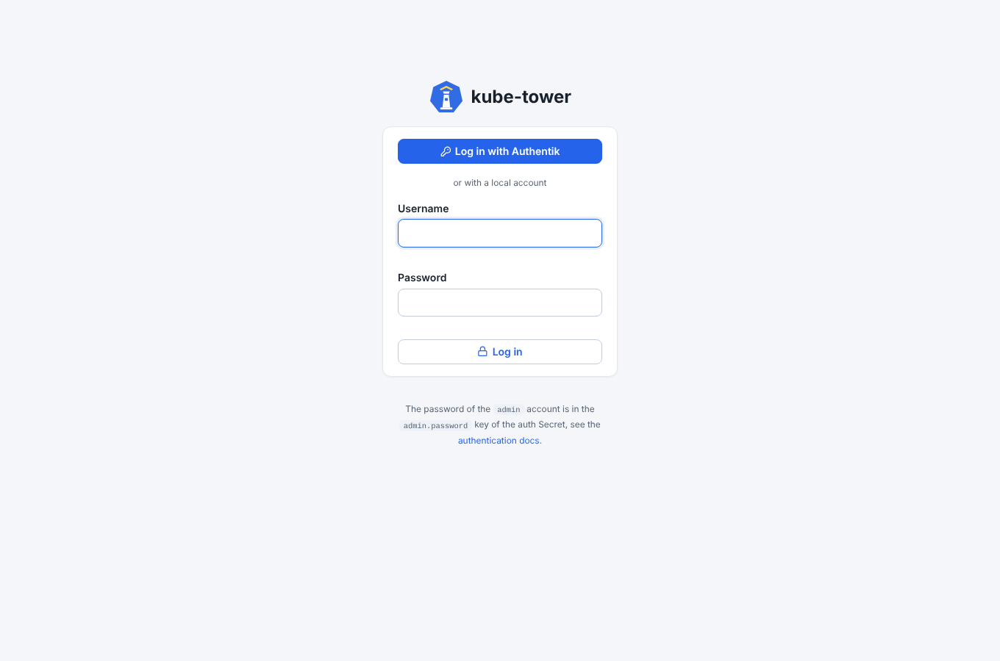
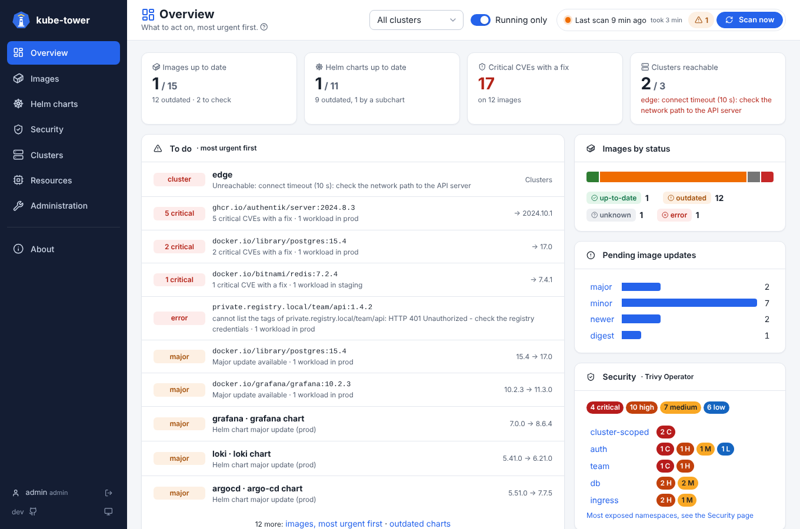

# Quick start

From nothing to the first dashboard in a few minutes, on any Kubernetes 1.25+ cluster with about
0.5 CPU core and 2 GiB of memory free (see [prerequisites](prerequisites.md)). kube-tower
only reads: it never changes anything in the cluster.

## 1. Install

```sh
helm install kube-tower oci://ghcr.io/arcanexus/charts/kube-tower \
  --namespace kube-tower --create-namespace
```

This runs one pod that scans the cluster it runs in: its workloads, the images cached on its nodes, and
the Helm charts of its ArgoCD Applications (when ArgoCD is installed). Vulnerabilities are read from
Trivy Operator when it is installed, else scanned with Trivy.

## 2. Open the UI

```sh
kubectl -n kube-tower port-forward svc/kube-tower 8080:80

# Password of the admin account, generated at the first start
kubectl -n kube-tower get secret kube-tower-auth -o jsonpath='{.data.admin\.password}' | base64 -d; echo
```

Open http://localhost:8080 and log in as `admin`.



## 3. Read the first scan

The first scan starts right away and takes from a few seconds to a few minutes, depending on the
number of images (the vulnerability scans come last). The **Overview** then tells what to act on first:
unreachable clusters, critical vulnerabilities with a fix, major updates.



- **Images**: every image with its current and latest version and its vulnerabilities; click a line for
  its details and where it is used.
- **Helm charts**: every chart of the ArgoCD Applications with its subcharts.
- **Security**: the reports of Trivy Operator, when it is installed.
- **Administration**: scans, clusters, credentials, logs.

The [usage](usage.md) page tours the UI and links to one page per screen, [statuses and versions](statuses.md) explains what
`outdated`, `unknown` and the update types mean.

## 4. Next steps

| To | See |
| --- | --- |
| Expose the UI with an ingress, or deploy with ArgoCD | [installation](installation.md) |
| Scan other clusters | [clusters](clusters.md) |
| Check private images, avoid the Docker Hub rate limits | [registries](registries.md) |
| Add accounts, single sign-on, or turn the login off (`auth.enabled=false`) | [authentication](authentication.md) |
| Choose how vulnerabilities are scanned | [vulnerabilities](vulnerabilities.md) |
| Get alerts and a Grafana dashboard | [metrics and Grafana](metrics.md) |
| Something does not work | [troubleshooting](troubleshooting.md) |

To remove it: `helm uninstall kube-tower -n kube-tower && kubectl delete namespace kube-tower`.
