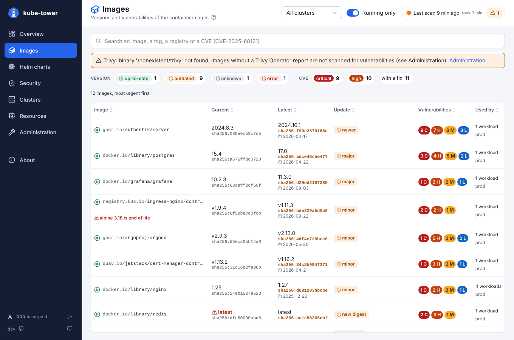
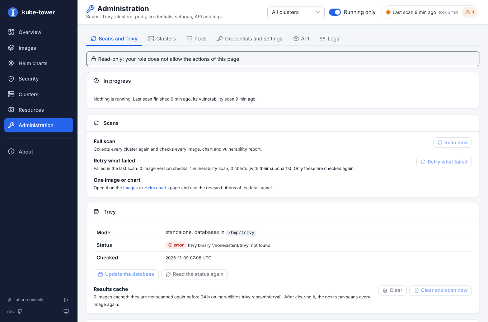
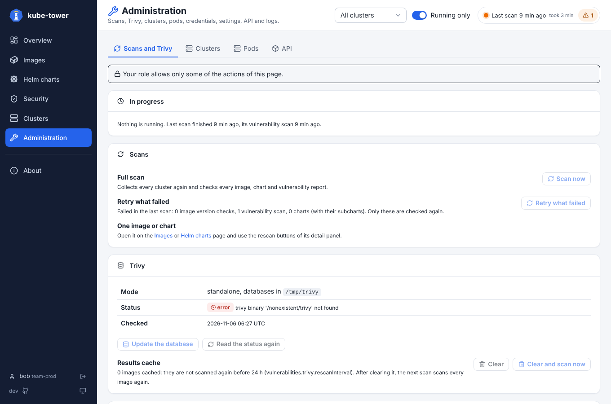

# RBAC: roles and permissions

Who may do what in kube-tower, once the [login](authentication.md) is on: each user has one or more
**roles**, each role gives **permissions** (the actions it may run) and, optionally, the **clusters**
its users see. (The Kubernetes permissions kube-tower itself uses on your clusters are on the
[Permissions](permissions.md) page.)

## Permissions

Every logged-in user sees every page, opens the detail panels and reads the API (`GET`). A role adds
**permissions**. Each action needs one, and so do two tabs of the Administration:

| Permission | Allows |
| --- | --- |
| `scan` | *Scan now* (`POST /api/refresh`) |
| `rescan` | rescan an image or a chart from its detail panel (`POST /api/rescan/…`) |
| `retry` | *Retry what failed* |
| `trivy` | update the Trivy database, read its status again, clear its cache (*Clear and scan now* needs `scan` too) |
| `connectivity` | test the connectivity to the clusters and registries |
| `logs` | the Logs tab of the Administration (and its live tail) |
| `settings` | the Settings tab of the Administration |

## Built-in roles

| Role | Permissions |
| --- | --- |
| `readonly` | `logs`, `settings`: sees everything, runs nothing |
| `admin` | all of them |

## Your own roles

Define more roles in `auth.roles`, with a list of permissions (`*` gives them all) and, optionally,
the clusters their users see:

```yaml
auth:
  roles:
    team-prod:
      permissions: [rescan, connectivity]
      clusters: ["prod-*"]          # names or patterns; empty or left out: every cluster
    security:
      permissions: [rescan, trivy, logs]
```

A user with several roles gets the permissions and the clusters of all of them; a role without
`clusters` (`readonly` and `admin` included) shows every cluster. A role name must not be `readonly`
or `admin`, and an unknown permission stops kube-tower at startup with the list of the valid ones.

## Giving the roles

### Local accounts

```yaml
auth:
  users:
    - name: bob
      role: team-prod                  # readonly, admin or a role of auth.roles
      existingSecret: kube-tower-bob
```

A change of role applies to the open sessions at once (see [local accounts](authentication.md#local-accounts)).

### OIDC groups

```yaml
auth:
  oidc:
    adminGroups: [kube-tower-admins]   # admin
    readonlyGroups: []                 # readonly
    roleGroups:                        # any role, built-in or of auth.roles
      team-prod: [k8s-prod-team]
      security: [secops]
    defaultRole: readonly              # users in none of these groups; "" refuses them
```

A user gets every role whose groups they are in, else `defaultRole`. The roles are decided at login:
a change of groups applies at the next login. With the Dex of the chart, the groups are the ones Dex
sends (see [Dex of the chart](authentication.md#dex-of-the-chart)); with Authentik, Keycloak or
another provider, the `groups` claim of the ID token.

### Visitors who are not logged in

`auth.anonymousRole: readonly` (or a role of `auth.roles`, not `admin`) lets everyone use kube-tower
with that role without logging in, see [visitors who are not logged in](authentication.md#visitors-who-are-not-logged-in).

## Clusters of a role

A user whose roles list `clusters` only sees those clusters, everywhere: the pages, the cluster filter,
the detail panels, the Administration tabs and the API (`/api/snapshot`). An image used in several
clusters shows only its usages in theirs. The scan errors naming another cluster are hidden, and a
rescan of an image or chart they don't see answers `404`.



Some things are not split by cluster, so give them with care to a limited role:

| What | Why |
| --- | --- |
| `scan`, `retry`, `trivy` | They act on every cluster: a full scan, the retry of everything that failed, the Trivy database |
| `logs`, `settings` | The logs and the settings name every cluster |
| Registries and Helm repositories of the connectivity test | They are shared by the clusters |
| `/metrics` | Prometheus scrapes it without a user |

## In the UI and the API

Without a permission, its buttons are hidden or greyed out, with the reason in their tooltip. A tab
the role may not open is hidden. The API answers `403` with the permission missing, for example
`{"detail": "permission scan needed"}`. The user, their roles and the *Log out* button are at the
bottom of the sidebar.



A role with some permissions, here `rescan` and `connectivity`: the other actions are greyed out,
and the Logs and Settings tabs are hidden.



Every action is logged with the user's name and roles, for example
`alice (admin): POST /api/refresh`. Every refusal is logged too, with the permission missing:
`bob (team-prod) not allowed to POST /api/refresh: permission scan needed`.

## Settings

```yaml
auth:
  roles:                       # {name: role}
    team-prod:
      permissions: [rescan, connectivity]   # scan, rescan, retry, trivy, connectivity, logs, settings, or *
      clusters: ["prod-*"]                   # fnmatch patterns of cluster names; empty: every cluster
  users:
    - name: bob
      role: team-prod
  anonymousRole: ""
  oidc:
    adminGroups: []
    readonlyGroups: []
    roleGroups: {}             # {role: [groups]}
    defaultRole: readonly
```
