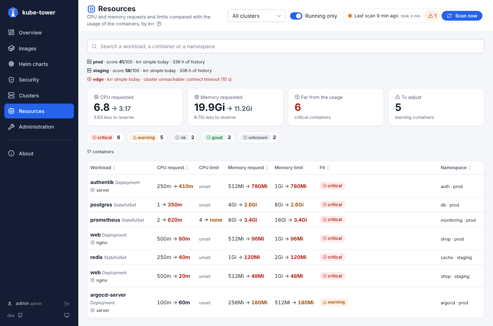

# Resources (CPU and memory recommendations with krr)

The **Resources** page compares the CPU and memory **requests and limits** of every container with what
it really uses, as [krr](https://github.com/robusta-dev/krr) (Robusta's Kubernetes Resource Recommender)
computes from the metrics of Prometheus. It shows, for every cluster at once, what is reserved and never
used, and what is at risk of CPU throttling or OOM kills.

kube-tower runs krr itself, in a pod of its own, and keeps its results with the rest of the inventory:
nothing else to install than Prometheus, which you probably already have. It only reads: the requests
and limits stay a change in git, made by you.



The [Resources page](ui-resources.md) shows them: totals, the list of containers furthest from their usage
first, and for each container the resources block to paste in its manifest.

## What it needs

- **Prometheus** (or VictoriaMetrics, Thanos, Mimir...) with the cAdvisor metrics of the containers
  (`container_cpu_usage_seconds_total`, `container_memory_working_set_bytes`) and the
  [kube-state-metrics](https://github.com/kubernetes/kube-state-metrics) ones (`kube_pod_owner`,
  `kube_replicaset_owner`...). kube-prometheus-stack has all of them.
- About **two weeks of history** for the best recommendations (krr reads 14 days by default; with less
  than 3 hours of data it answers *not enough data*).
- The Helm chart, with `krr.enabled`. krr needs Python 3.12 and libraries that the kube-tower image does not
  have, so it runs in its own pod, the [official krr image](https://hub.docker.com/r/robustadev/krr).

## Enable it

```yaml
krr:
  enabled: true   # runs krr in its own pod and turns config.resources.enabled on
```

With no other setting, krr finds Prometheus in each cluster by its usual labels (kube-prometheus-stack,
Prometheus Operator, VictoriaMetrics, Thanos, Mimir...) and reaches it **through the Kubernetes API server**
(`services/proxy`), with the credentials kube-tower has for that cluster. To give its address instead:

```yaml
config:
  resources:
    prometheus:
      # The first entry whose clusters match is used
      - clusters: ["prod-*"]
        url: https://thanos.example.com
        # One Prometheus for several clusters: the label that tells them apart, and its value
        # (default: the name of the cluster in kube-tower)
        clusterLabel: cluster
        authHeaderEnv: PROMETHEUS_AUTH   # "Bearer <token>", from a Secret through extraEnv
      - clusters: ["staging"]
        url: http://prometheus-operated.monitoring:9090
        headers:
          X-Scope-OrgID: staging        # e.g. a Mimir tenant
```

The authorization header is read from an env var (`authHeaderEnv`) or a file (`authHeaderFile`, a mounted
Secret) at each run: it never goes in the ConfigMap. Put the env var on the kube-tower pods with
`extraEnv` (in the distributed mode, on the worker pods), for example:

```yaml
extraEnv:
  - name: PROMETHEUS_AUTH
    valueFrom:
      secretKeyRef: {name: prometheus-token, key: header}
```

## Settings

The modes and every key are summed up in [configuration](configuration.md#resources-krr).

```yaml
resources:
  enabled: false        # the chart sets it when krr.enabled
  serverUrl: ""         # the krr pod of the chart (set by the chart); empty: the krr command below
  binary: krr           # krr command run in the kube-tower pod when serverUrl is empty (development)
  strategy: simple      # simple, or simple_limit (with a CPU limit)
  namespaces: []        # empty: every namespace
  args: []              # other krr options, e.g. ["--history_duration", "168", "--cpu_percentile", "99"]
  interval: 24h         # the recommendations of a cluster are reused this long before krr runs again
  timeout: 15m          # per cluster
  prometheus: []        # see above
```

The **simple** strategy of krr recommends:

| Value | Recommendation |
| --- | --- |
| CPU request | 95th percentile of the CPU usage over the history |
| CPU limit | none: a CPU limit throttles a container even when the node has free CPU |
| Memory request and limit | the peak of the memory usage plus 15% |

Each value gets a **fit**: *critical* (far from the usage), *warning* (to adjust), *ok*, *good*, or
*unknown* (not enough data). Containers scaled by a HorizontalPodAutoscaler are left without
recommendation by default (krr option `--allow_hpa` to change it). The options of krr are on its
[README](https://github.com/robusta-dev/krr#readme); kube-tower chooses the cluster, the output format and
the output file, the other options are given as they are with `args`.

## How it runs

At each full scan, once the versions are checked, the controller asks krr for the recommendations of
every reachable cluster whose last ones are older than `interval` (or failed), two clusters at a time, at
the same time as the vulnerability scans. A worker builds a kubeconfig of the cluster and sends it, with the krr options, to the krr pod,
which runs krr against that cluster and answers its JSON result. The kubeconfig connects the way kube-tower
does: its address, CA, TLS server name, `proxy-url`, and its token, user and password, or client
certificate. This holds for every kind of [cluster](clusters.md):

| Cluster | What krr gets |
| --- | --- |
| `in-cluster` | the token of the kube-tower ServiceAccount, read again before each run, and the CA of the pod |
| ArgoCD layout (`server` and `config`) | the `bearerToken`, or the `username` and `password`, or the client certificate, and `tlsClientConfig` |
| `kubeconfig` key with a token, a user and password, or a certificate | the same data |
| `kubeconfig` key with an exec plugin (EKS, GKE, AKS...) | the token or certificate the plugin gives kube-tower before the run: krr runs no plugin |

A proxy set by the environment of the kube-tower pods (`HTTPS_PROXY`) is not written: the krr pod has its own
environment.

When the controller starts from the inventory kept in Valkey (restart, upgrade, krr just enabled), it does
not wait for the next scan: the reachable clusters without recommendations yet are analysed at once. The krr
pod logs nothing until it is asked: with no scan running, `listening on :8080` is its only line.
The Pods tab of the [Administration page](ui-administration.md#pods) shows the krr pod with the other pods of the
release, and the krr runs in progress, read from its `/healthz`.

The krr pod only accepts the requests of the kube-tower ServiceAccount: it checks the token of the caller
with a `TokenReview` (its ServiceAccount is bound to `system:auth-delegator`), and a NetworkPolicy lets only
the kube-tower pods reach it when `networkPolicy.enabled`. The kubeconfigs are written in its `/tmp`
(an `emptyDir`) during the run only. The results stay in memory, like the rest of the inventory, and in
Valkey when it is used.

The CPU and memory of the krr pod depend on the size of the clusters: 512 MiB is enough for a few
hundred containers; raise `krr.resources` for more (krr loads the history of every container of a cluster
at once).

## Permissions

krr reads, in each analysed cluster, the workloads, their ReplicaSets, Jobs and HorizontalPodAutoscalers,
and the Services (to find Prometheus, reached through `services/proxy` when no URL is given). The chart
adds these rules to the ClusterRole of the local cluster when `krr.enabled`; for a
[remote cluster](clusters.md), apply [`deploy/remote-cluster-rbac.yaml`](../deploy/remote-cluster-rbac.yaml)
again. Details in [permissions](permissions.md#krr-cpu-and-memory-recommendations).

## Metrics

`kube_tower_resources_current`, `kube_tower_resources_recommended` and `kube_tower_resources_containers`
give the current and recommended values per container and the containers by fit per cluster: see
[metrics](metrics.md#cpu-and-memory-krr).

## Troubleshooting

The last run of each cluster is on top of the Resources page, with its error. The usual ones:

| Error | Cause and fix |
| --- | --- |
| `Wasn't able to connect to any Prometheus service ... (...): give its url in resources.prometheus` | krr found no Prometheus, or the one it found did not answer: the parentheses say why (`Couldn't connect to Prometheus found under <url> Caused by ...`, or the API refusing the lookup). Give its `url` in `resources.prometheus` |
| `Prometheus not found`, `No Prometheus URL is specified` then a connection error | krr found no Prometheus in the cluster: give its `url` in `resources.prometheus` |
| `403 Forbidden` on `services/proxy` | kube-tower may not reach Prometheus through the API server: apply the RBAC again, or give the `url` |
| *not enough data* on every container | less than 3 hours of history, or the cAdvisor metrics are missing |
| `NoPrometheusPods` warning | the kube-state-metrics metrics are missing: krr cannot link the pods to their workload |
| `krr server ... unreachable` | the krr pod did not answer for about 3 minutes (kube-tower tries again while it starts): check `kubectl get pods -l app.kubernetes.io/name=<release>-krr` and the NetworkPolicy |
| `Unable to automatically discover a Prometheus in the cluster ((401) Reason: Unauthorized ...` | the API server refused the credentials of the kubeconfig. The 1.3.0 release candidates sent no token for `in-cluster` and the clusters read from a kubeconfig: upgrade. Otherwise check that the cluster is reachable from the Clusters page |
| `krr server answered 401` / `403` | the token of kube-tower was refused: the krr pod only accepts the ServiceAccount of the release |
| `krr not found` | `resources.enabled` without the krr pod: set `krr.enabled` in the chart |

## Not covered

- History and trends: kube-tower keeps the last recommendations only. Use the metrics for trends.
- Applying the recommendations: kube-tower never changes the workloads. Copy the resources block of the
  detail panel into the manifest or the Helm values.
