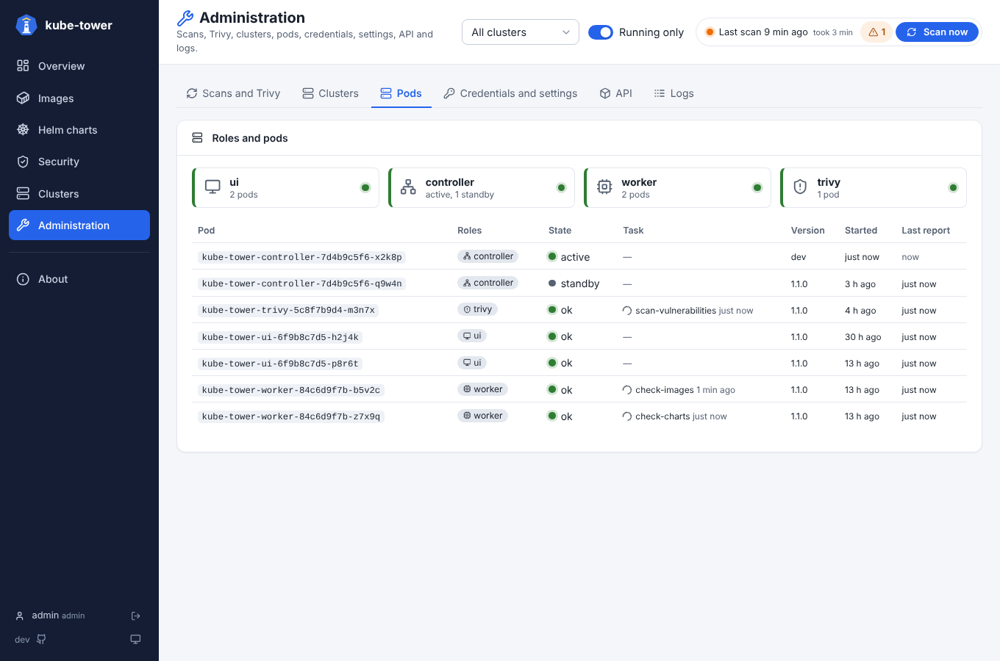

# Scaling

By default kube-tower runs as one pod that does everything (`mode: single`). For large inventories,
or to keep the UI available while a scan uses the CPU, the chart can split it in several Deployments
that work together (`mode: distributed`). The image is the same: each pod runs some of the four
**roles**.

| Role | Does | Replicas | Kubernetes access |
| --- | --- | --- | --- |
| `ui` | Pages, JSON API; shows the state of the controller, sends it the actions of the users | any, autoscaling | none |
| `controller` | Schedules scans and rescans, holds the inventory and the task queue, serves `/metrics` | 1 active + standbys | cluster Secrets, its `Lease` |
| `worker` | Collects the clusters, checks the versions in registries and Helm repositories | any, autoscaling | read-only ClusterRole, cluster Secrets |
| `trivy` | Scans the images with Trivy, keeps the Trivy databases and results | always 1 | none needed |

See [architecture](architecture.md) for the diagrams and the [design choices](architecture.md#design-choices).

```
       ui (×N) ◄─── Ingress / Service
          ▲  state, actions, logs
          ▼
   Valkey (required) ◄──► controller (1 active, standbys) ◄─── Prometheus (/metrics)
          ▲  tasks, results, presence, logs
   ┌──────┴────────────┐
worker (×N)        trivy (×1)
```

The pods never call each other: every exchange goes through Valkey, and only the active controller
orchestrates.

## Distributed mode

```yaml
mode: distributed
# Required: the pods talk through Valkey (or an existing Redis, see below)
redis:
  valkey:
    enabled: true
  password: <a password>    # or existingSecret: the tasks carry registry credentials
```

This renders four Deployments, `<release>-controller`, `-ui`, `-worker` and `-trivy`:

- the **controller** runs with 2 replicas: the active one holds a Kubernetes `Lease` and labels its
  pod `kube-tower.arcanexus.com/active-controller=true`; the other waits and takes over about 15
  seconds after the active one stopped. Both pods are ready (`helm --wait` and the ArgoCD health
  checks pass), the `<release>-controller` Service selects the labelled one for the ServiceMonitor
  (`/metrics`). The active controller queues the tasks in Valkey, reads their results, publishes the
  state that the ui pods show and runs their actions. Rollouts
  replace one controller pod at a time (`maxUnavailable: 1`, `maxSurge: 0`);
- the **ui** pods serve the pages through the usual Service and Ingress, from the state published in
  Valkey (read again when its revision changes). They get no ServiceAccount token, no registry
  credential nor git token;
- the **worker** pods read the collection and version check tasks from Valkey, where the controller
  queues them, and send their results back there;
- the **trivy** pod scans the images: one replica only, whatever the values, so the Trivy databases
  are downloaded once and the results cache is shared by every cluster.

Each group has its own `replicas`, `resources`, `nodeSelector`, `tolerations` and `affinity` (the
top-level ones by default), and `autoscaling` for groups without the controller or trivy roles:

```yaml
distributed:
  groups:
    ui:
      autoscaling:
        enabled: true
        minReplicas: 1
        maxReplicas: 4
        targetCPUUtilizationPercentage: 80   # of the CPU request (100m by default)
    worker:
      replicas: 4
      resources:
        limits:
          memory: 1Gi
```

The groups are free: a group runs the roles listed in `roles` (`all` for every one). Every role must
run in a group, `controller` and `trivy` in one group only. Set a group to `null` to remove it, e.g.
to run the UI with the controller:

```yaml
distributed:
  groups:
    controller:
      roles: [controller, ui]
    ui: null
```

A pod with `ui` and `controller` that is a standby shows no inventory: such pods use `/leaderz` as
readiness probe, so the UI Service skips the standby (which then stays not ready: `helm --wait` and
ArgoCD wait for it). To scale the pages, run `ui` in a group of its own.

Every pod writes every 5 seconds a key in Valkey that expires unless written again (standby
controllers too), and ships its log lines there: the **Administration** page shows the state of each
role and pod, and the **Logs** page gathers the lines of every pod, filtered by role (see
[Pods tab](ui-administration.md#pods)).



The scans are split in batches of `config.internal.batchSize` images or charts (50) shared by the
worker and trivy pods. A task that is not answered within `config.internal.taskTimeout` (30m) is given
to another pod, e.g. when a worker was stopped in the middle of it, three times at most.

With `networkPolicy.enabled`, the kube-tower pods reach Valkey, which accepts the kube-tower pods only
(see [network policies](network.md#distributed-mode)).

### Sizing

Measured with an inventory of 141 images (about 400 vulnerabilities each) and 51 charts, one CPU core:

| Request | CPU per request |
| --- | --- |
| Overview | about 22 ms |
| Clusters tab, Images filtered by CVE | 14 to 18 ms |
| Images, Helm charts, Administration, detail panels | 4 to 7 ms |
| `/api/snapshot` (whole inventory as JSON, built in a thread) | about 530 ms |

A user navigating loads a page every few seconds: **one ui pod serves about 10 users** with a few
tens of millicores. An idle ui pod uses about 5m of CPU and 150Mi of memory (it reads the revision of
the state every second, the state when it changed, and decodes the inventory again when it has a new
revision); an idle worker about 3m. The defaults follow: `ui` 1 replica, 100m CPU and 192Mi requested; `worker` 2 replicas,
100m CPU and 256Mi requested.

The autoscaling target is a share of the CPU **request**: with a request far below what a pod uses
when it starts or serves a page, the HorizontalPodAutoscaler adds pods at every page load and removes
them minutes later. The default `autoscaling.behavior` damps it: one pod more per minute at most,
after 2 minutes above the target; pods removed after 5 minutes below it. Workers mostly wait for the
registries, so their CPU says little about the work queued: a fixed number of workers is usually the
better choice, autoscaling them helps with many clusters scanned often.

## Redis / Valkey

The distributed mode requires it: the pods talk through it. In both modes, the controller also keeps
a copy of the inventory there: a restarted controller, or a standby taking over, shows it at once,
then waits for the rest of `refreshInterval` before the next scan. Without it (single mode only), a
restarted controller starts with an empty inventory and scans first.

```yaml
redis:
  # A Valkey deployed by the chart (one pod, data in memory)...
  valkey:
    enabled: true
  # ...or an existing Redis / Valkey
  url: rediss://my-redis.example:6380/0
  existingSecret: kube-tower-redis   # optional password, key: password
  keyPrefix: ""                      # prefix of the keys (empty: the release name)
```

In single mode only the controller connects to it; in distributed mode every pod does. The chart's
Valkey keeps its data in memory: it survives a controller restart, not its own. A scan in progress
is never kept: a new controller empties the task queues of the previous one and starts a new scan
when one is due. Several installations can share one Redis: each uses its own `keyPrefix` (and
`config.redis.key` for the snapshot).

## Without the chart: the roles in config.yaml

The chart sets all of this from `mode: distributed`. What it does, for a deployment of your own (every
key is listed in [configuration](configuration.md)):

`roles` is the horizontal scaling: one image whose pods run any combination of the `ui`,
`controller`, `worker` and `trivy` roles, all in one pod or apart and scaled independently. By default
a process runs every role (`all`). The chart sets all of this with `mode: distributed`; when the roles
run apart:

- every process talks through Redis or Valkey (`redis.url`, required), never to another process; the process with `controller` schedules
  the scans and queues there the tasks of the roles it does not run;
- processes with `worker` and/or `trivy` (and no `controller`) read these tasks from Valkey, run them
  and send the results back there; a `worker` reads the cluster list itself. A task not answered
  within `internal.taskTimeout` (its process stopped) is queued again, three times at most.
  The version checks and Trivy scans of a scan are split in tasks of `internal.batchSize` images or
  charts (the tags of one image stay together), so several processes share them;
- a process with `ui` and no `controller` shows the state that the controller publishes in Valkey
  (its revision read every second), and sends it the actions of the users there; any number of them can
  serve the pages. The metrics of the snapshot are served by the process with `controller` only;
- with `internal.leaderElection: true`, several replicas can run the `controller` role: they share
  the `internal.leaseName` Lease of their namespace (RBAC: get, create and update `leases` in
  `coordination.k8s.io`). The holder schedules the scans and publishes the state; the others wait,
  answer 503 on `/leaderz` (and on `/readyz`), and take over about 15 seconds after the active one
  stopped. With `internal.labelPod: true`, the active controller labels its own pod
  `kube-tower.arcanexus.com/active-controller=true` (and a standby `false`; RBAC: patch `pods`), for a
  Service selecting the active one while every controller pod stays ready; otherwise use `/leaderz`
  as readiness probe. A controller that cannot renew its Lease in time stops and is restarted as a standby.
  The new controller empties the task queues of the previous one and starts a full scan, unless the
  stored snapshot is recent (below);
- with `redis.url`, the controller also writes the snapshot to Redis or Valkey (compressed, at each
  change, the last version only) and reads it back when it becomes the active controller: a restarted
  controller, or a standby taking over, shows the last inventory at once and waits for the rest of
  `refreshInterval` before scanning. A scan in progress is not kept: it starts again. The tasks carry
  the registry credentials of image pull secrets: protect Redis with a password (`passwordEnv`).

Every process but the active controller writes every 5 seconds a key that expires in Valkey (standby
controllers included), and every process ships its log lines there: the Pods tab of the Administration
page shows the state of each role and process, and its Logs tab the lines of every process with its pod name,
filtered by role. When Trivy runs in trivy processes, the Administration
page reads the status of one of them; a database update runs in one of them and the others refresh
theirs before their next task, and a cleared cache is forgotten by each one at its next task. The
connectivity test runs in the controller.

## With ArgoCD, permissions, network

- An ArgoCD Application for the distributed mode is in [installation](installation.md#distributed-mode-with-argocd).
- The extra RBAC of the distributed mode (the `Lease` of the controller, the label of its pod) is in
  [permissions](permissions.md#distributed-mode).
- The ports, and the NetworkPolicy of Valkey, are in [network and ports](network.md).
- Upgrading from 1.0.0-rc.3 or earlier: see [upgrading](upgrading.md#100-rc4-the-pods-talk-through-valkey).
