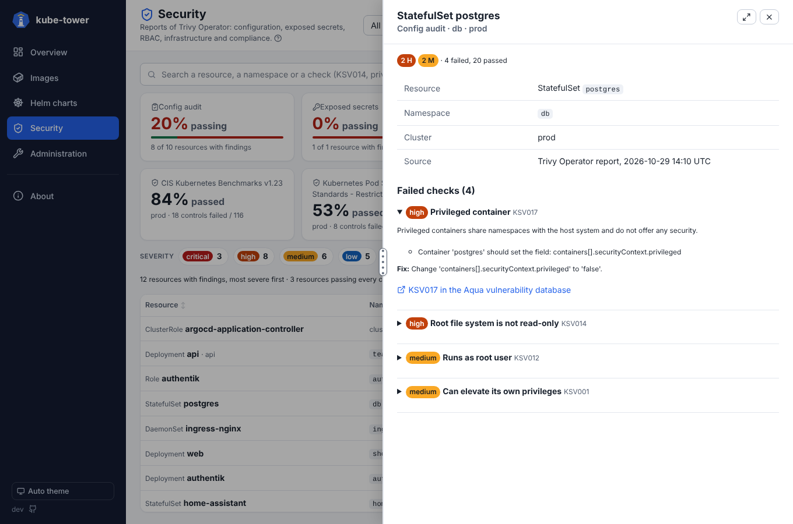

# Security (Trivy Operator reports)

When [Trivy Operator](https://aquasecurity.github.io/trivy-operator/) runs in at least one scanned
cluster, kube-tower adds a **Security** page to the navigation (between Helm charts and
Administration). It shows the reports the operator writes besides the `VulnerabilityReports` (those
are on the [Images](vulnerabilities.md) page), for every cluster at once:

| Type | Trivy Operator reports (`aquasecurity.github.io/v1alpha1`) | What it checks |
| --- | --- | --- |
| **Config audit** | `ConfigAuditReport`, `ClusterConfigAuditReport` | Misconfigurations of workloads and cluster resources: privileged containers, root user, writable root file system, missing limits... |
| **Exposed secrets** | `ExposedSecretReport` | Secrets left in the images (cloud keys, tokens, private keys), with the file and the line found, the secret masked by Trivy |
| **RBAC** | `RbacAssessmentReport`, `ClusterRbacAssessmentReport` | Roles and ClusterRoles granting too much: wildcards, secrets access, privilege escalation... |
| **Infrastructure** | `InfraAssessmentReport`, `ClusterInfraAssessmentReport` | Nodes and control plane components (API server, kubelet, etcd flags) |
| **Compliance** | `ClusterComplianceReport` | CIS Kubernetes Benchmark, NSA hardening guide, Pod Security Standards: passed and failed controls |

kube-tower only reads these reports: it never runs the checks itself and never changes anything.
Clusters without Trivy Operator are simply skipped (the CRDs are not found). Without Trivy Operator
on any cluster, the page is not in the navigation (`security` still answers, and says why it is
empty). The reports are read at each scan, like the rest of the inventory.


## The page

- **One tile per type of report**: the share of checked resources that pass every check, and how
  many have findings. Click a tile to list only that type, again to show every type.
- **Compliance tiles**, one per framework and cluster: the share of controls passed. Click one for
  its failed controls, most severe first. A framework not evaluated yet says so (Trivy Operator fills
  them on its own schedule, `compliance.cron`).
- **The list**: one line per resource with failed checks (a Deployment, a ClusterRole, a node, the
  container of an image with secrets), its namespace, the type of report, the number of findings per
  severity, the cluster and when it was checked. Most severe first; the headers sort it.
- **Severity chips** keep the resources with at least one finding of that severity; **passing too**
  also lists the resources that pass every check (*none* in the Findings column).
- **The search** looks in the resource names, namespaces, containers, images, and the IDs and titles
  of the checks: `KSV017`, `privileged`, `billing`...
- The **Cluster** filter of the top bar applies; *Running only* does not (reports are about
  resources, not images).

Click a line for its detail panel: every failed check with its severity, the message of Trivy (which
container, which field), the description, how to fix it and a link to the check in the Aqua
vulnerability database (`KSV…`, `KCV…`). For exposed secrets: the rule, the file in the image and the
masked line. Rotate a secret found in an image: anyone who can pull the image can read it.



The **Overview** gets a Security card too: the findings per severity and the most exposed
namespaces.

## Settings

```yaml
security:
  # Read the Trivy Operator security reports (Security page)
  enabled: true
  # Exposed secrets: the lines Trivy found, the secret masked; false to leave them out
  exposedSecrets: true
```

## Permissions

kube-tower needs `get` and `list` on the report CRDs. The chart's ClusterRole has them; for a
[remote cluster](clusters.md), apply [`deploy/remote-cluster-rbac.yaml`](../deploy/remote-cluster-rbac.yaml)
again:

```yaml
- apiGroups: ["aquasecurity.github.io"]
  resources: [vulnerabilityreports, configauditreports, clusterconfigauditreports, exposedsecretreports,
              rbacassessmentreports, clusterrbacassessmentreports, infraassessmentreports,
              clusterinfraassessmentreports, clustercompliancereports]
  verbs: ["get", "list"]
```

A `403` on one of them is shown in the scan errors (status pill) with the CRD that could not be listed;
the other types are still shown.

## Metrics

| Metric | Labels | Value |
| --- | --- | --- |
| `kube_tower_security_findings` | `cluster`, `namespace`, `type`, `severity` | Failed checks and exposed secrets |
| `kube_tower_security_resources` | `cluster`, `type`, `result` (`pass` / `fail`) | Resources checked |
| `kube_tower_compliance_controls` | `cluster`, `compliance`, `title`, `result` (`pass` / `fail`) | Controls of each compliance framework |

See [Metrics](metrics.md) for PromQL examples.

## Not covered

- History and trends: kube-tower is stateless, it shows the reports as they are now. Use the metrics
  and Prometheus for trends.
- `SbomReports`: the software bill of materials of the images is not shown.
