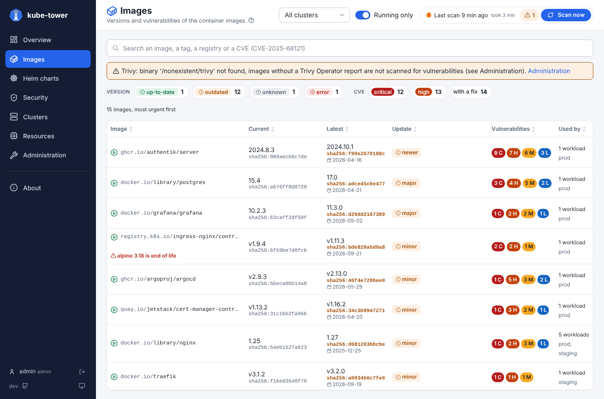

# Statuses and versions

How kube-tower decides that an image or a Helm chart is up to date, outdated or cannot be compared.
The same statuses are used by the pages, the [API](api.md) and the [metrics](metrics.md).

## Statuses

| Status | Meaning |
| --- | --- |
| 🟢 `up-to-date` | Nothing newer is published (or, for floating tags, the running digest is the published one) |
| 🟠 `outdated` | A newer version, or a newer image under the same floating tag, is available |
| ⚪ `unknown` | Cannot be compared: image pinned by digest only, floating tag without known digest, version constraint (`1.x`), local subchart (`file://`) |
| 🔴 `error` | The registry or repository could not be queried: the message tells why (authentication, not found, timeout…) |
| `not deployed` | Subcharts only: left out of the release by the Helm values (`condition` or `tags` false). Ignored in the status of the chart |

## Images

The **current** version is the tag used by the workloads. The **latest** version is the highest tag
published in the registry referenced by the image (Docker Hub, ghcr.io, ECR, Harbor...) that has the
same **shape** and the same **versioning scheme** as the current one:

- same shape: the same `v` prefix, the same number of numeric components and the same suffix, so
  `1.25.3-alpine` is only compared with `x.y.z-alpine` tags, and `v2.1` with `vX.Y` tags;
- pre-releases (`1.3.0-rc.1`, `2.0.0-beta`) are ignored, unless `images.includePrerelease` is `true`;
- each repository is asked once per scan, whatever the number of clusters and workloads using it.

### Versioning schemes

kube-tower tells from the current tag how the image is versioned, shows it in the detail panel
(**Versioning**) and only compares the tag with tags of the same scheme, on top of the same shape
(prefix, number of components, suffix):

| Scheme | Tags | Update type |
| --- | --- | --- |
| `semver` | `1.25.3`, `v2.1`, `7` | `major`, `minor`, `patch` |
| `calver` | `2024.10.1`, `2024.10` (a year from 1990 to 2100, then more numbers) | `newer` |
| `date` | `20241024`, `20241024.1`, `202410241530` (a date, then optional hours, minutes, seconds) | `newer` |
| `build` | `4521` (a single number from 1000) | `newer` |

So `redis:7` is not reported outdated because of a `4521` CI build tag, and `1.2` is not compared
with `2024.10`. A single number below 1000 counts as `semver`: a build number `999` is not compared
with `1000` and above.

### Update types

| Update | When |
| --- | --- |
| `major`, `minor`, `patch` | `semver` tags: the first, second or third number changed |
| `newer` | `calver`, `date` and `build` tags, which have no major, minor or patch |
| `new digest` | a floating tag pushed again (see below) |

The Overview lists the major updates in its **To do** list, and the Images page filters on each type
(`images?update=major`).

### Floating tags

`latest`, `stable`, `main` and every other tag that is not a version are checked like watchtower does:
the digest published for the tag in the registry is compared with the digest the pods actually run.
A different digest means a newer image was pushed under the same tag: the image is `outdated`, with the
update `new digest`. A floating tag without a known running digest (no pod runs it, no node has it) is
`unknown` until the image runs. Turn this off with `images.checkFloatingDigests: false`.

Images using `latest` (or no tag at all, which means `latest`) are shown in red on the Images page: the
running version changes on every pull, pin a version instead.

An image pinned by digest only (`nginx@sha256:...`) has no tag to compare: it is `unknown`.

## Helm charts

Charts are read from ArgoCD Applications (single and multi-source), Flux HelmReleases and Helm releases
([chart sources](chart-sources.md)) and compared with semver ordering:

| Source type | Current version | Latest version |
| --- | --- | --- |
| `helm` (HTTP repository) | Application `targetRevision` | from the repository `index.yaml` |
| `oci` | Application `targetRevision` | from the registry tags |
| `git` (chart in a git path) | `version` of `Chart.yaml` at `targetRevision` | n/a: the chart follows git, only its subcharts are checked |

- A `targetRevision` that is a constraint (`1.x`, `*`, `>=1.2`) is `unknown`.
- Pre-releases are ignored unless `helm.includePrerelease` is `true`.
- Subcharts (the `dependencies` of `Chart.yaml`, and their own subcharts, down to 3 levels) are
  compared the same way, each from its own repository; a local subchart (`file://`) is `unknown`.
- The status of a chart is the worst status of the chart and of its subcharts that are deployed: a chart
  can be `outdated` only because a subchart is behind.
- A subchart that the Helm values leave out of the release is `not deployed`, see
  [Helm charts](ui-charts.md).
