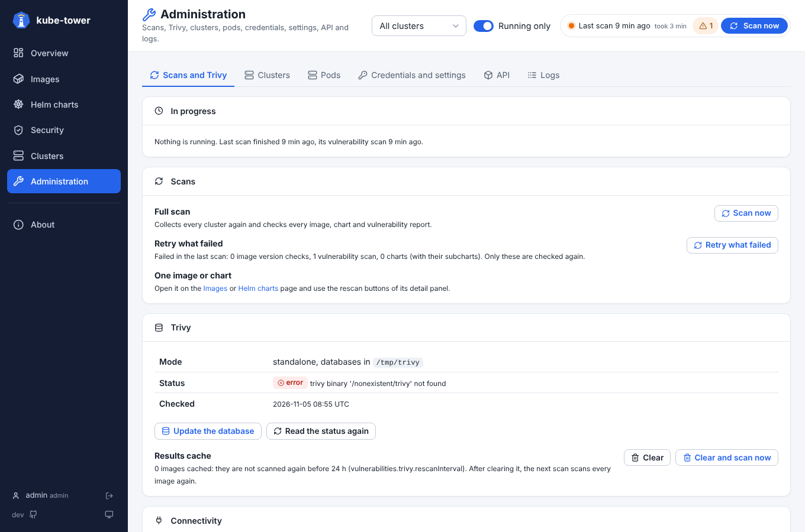
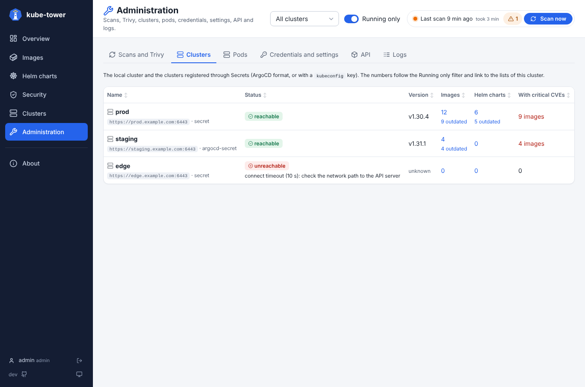
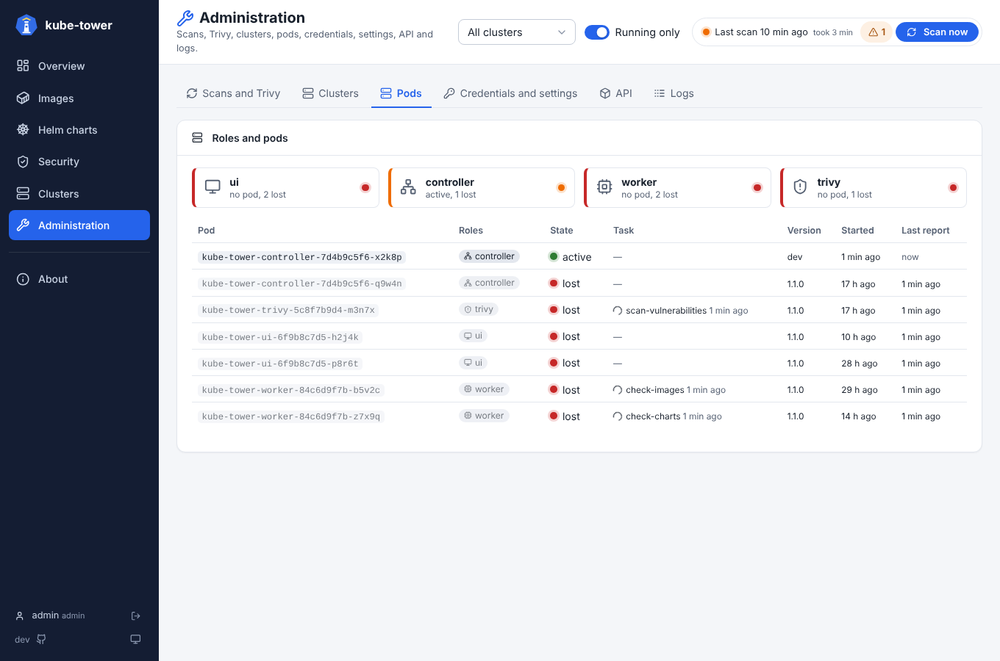
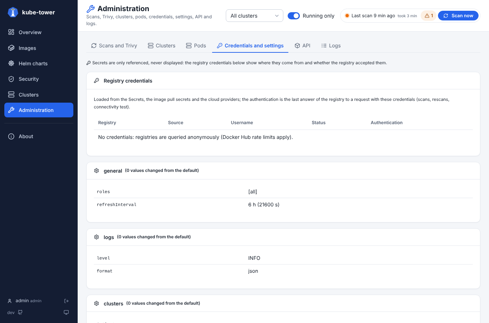
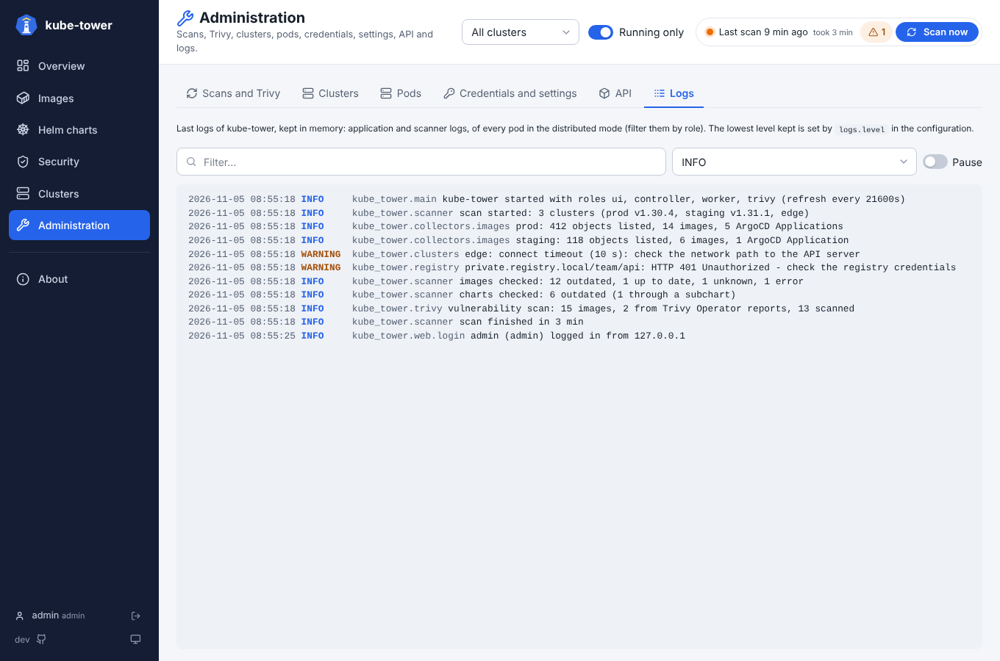

# Administration page

Six tabs to run and check kube-tower; Logs is the last one. Each action needs a permission of
the user's role: without it, its button is greyed out. The Logs and Settings tabs are hidden for roles
without the `logs` or `settings` permission (see [RBAC](rbac.md)).

## Scans and Trivy

The actions run in the background; the tab follows them and reloads when they are over.

| Section | What you can do |
| --- | --- |
| In progress | See what runs now (scan phases, rescans, actions) and since when |
| Scans | **Scan now**; **Retry what failed** checks again only what was in error (after fixing credentials or a rate limit) |
| Trivy | Trivy and database versions; **Update the database** (standalone mode); **Clear** the cached results, or **Clear and scan now** |
| Connectivity | **Test the connectivity** of every cluster, registry, Helm repository and the Trivy server, with the reason of each failure (proxy, DNS, TLS, 401/403…) |

A scan checks the versions first, then the vulnerabilities: during the Trivy phase, a new scan, *Retry
what failed* and the rescans can already start.

## Clusters

Every cluster: API server, where it comes from (`in-cluster`, `secret`, `argocd-secret`), Kubernetes
version, whether it answered (or the error), and its images, charts and critical CVEs. Each number opens
the list of that cluster. See [clusters](clusters.md). Their nodes are on the [Clusters page](ui-clusters.md).

## Pods

- One tile per role (**ui**, **controller**, **worker**, **trivy**): green when its pods run, orange when
  some are lost, red when none runs it.
- Then every pod: roles, state (**active** / **standby** controller, **ok**, **lost** after 30 s without
  report), current task, version, start time, last report. Refreshed every 5 seconds.
- In single mode, the only line is the one pod. See [scaling](scaling.md).

## Credentials and settings

- **Credentials**: every registry credential loaded (Secrets, image pull secrets, cloud providers),
  where it comes from, its username, and whether the registry **accepted** or **refused** it (with the
  answer) or did **not try yet**. Secret values are never shown. See [registries](registries.md).
- **Settings**: the effective configuration, one table per section, values changed from the defaults
  highlighted, the whole YAML at the bottom. Secrets are only referenced, never shown.

## API

Links to the API documentation (`api/docs`), the last scan as JSON (`api/snapshot`) and the metrics
(`metrics`). See [API](api.md).

## Logs

- The last 2000 lines of kube-tower, followed live like `kubectl logs -f`; filter by text or level,
  pause to read.
- Only lines at `logs.level` or above are kept: set `DEBUG` to debug a scan.
- In [distributed mode](scaling.md), the lines of every pod (the last 10,000), with the pod name and
  switches per role.

| Level | What is logged |
| --- | --- |
| `DEBUG` | Every registry, Helm repository and git request, tokens requested, objects listed, each check result |
| `INFO` | Scan start and end, clusters scanned, per cluster summaries, credentials loaded (names only) |
| `WARNING` | Non fatal problems: unreachable cluster, invalid cluster Secret, 403, item that cannot be checked |
| `ERROR` | A scan that failed as a whole (with the stack trace); the previous results are kept |
