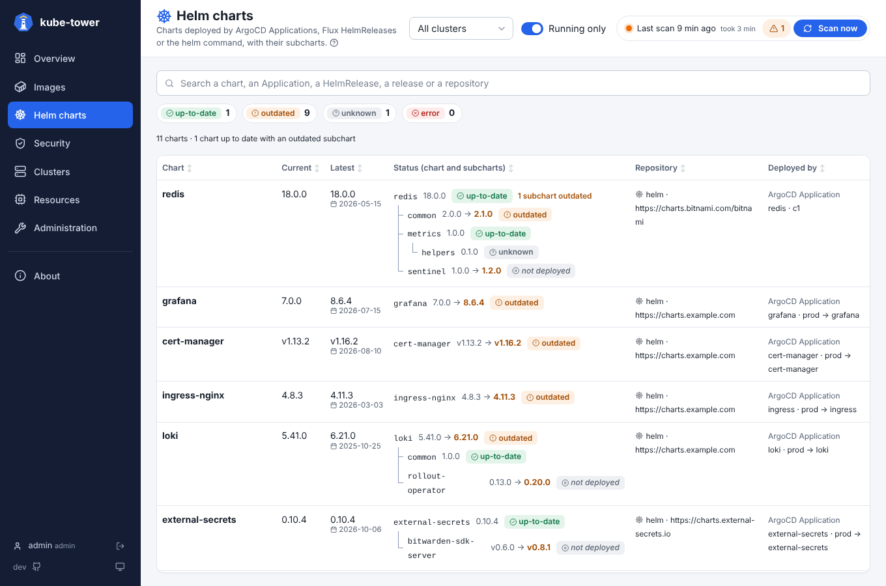
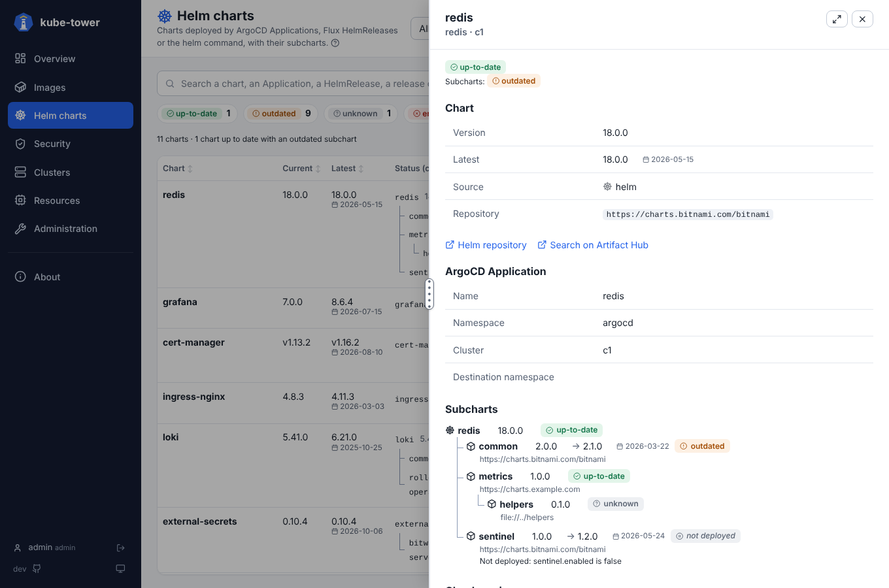

# Helm charts page

One line per chart deployed by an ArgoCD Application (one per Helm source of a multi-source Application),
a Flux HelmRelease or the helm command (see [where charts are found](chart-sources.md)), with the chart
and all its subcharts. How lists and detail panels work in general is in
[usage](usage.md).

## The list

| Column | Meaning |
| --- | --- |
| Chart | Chart name |
| Current, Latest | Version deployed and latest version published, with its release date: `created` in the `index.yaml` of the repository, or the `org.opencontainers.image.created` annotation of an OCI chart (pushed with Helm 3.15 or later). Off with `helm.fetchReleaseDates: false` |
| Status | The chart and its subcharts as **one tree** (3 levels), each with its version (→ latest when behind) and its status |
| Repository | Where the chart comes from, and its type (`helm`, `oci`, `git`) |
| Deployed by | *ArgoCD Application*, *Flux HelmRelease* or *Helm release*, its name, cluster and destination namespace |

- A chart up to date with an outdated subchart says how many subcharts are behind, and counts as
  `outdated` in the chips and the sort.
- **Search** by chart, Application, HelmRelease, release or repository (`flux`, `helm release` find them all).
- How each kind of source is compared: [statuses and versions](statuses.md#helm-charts).

## Subcharts not deployed

A subchart that the Helm values of the release leave out is shown **not deployed**,
with the reason (e.g. `bitwarden-sdk-server.enabled is false`):

- its version is still compared, but it does not count in the status of the chart, the chips, the sort,
  the metrics or the scan errors; its own subcharts are not read;
- kube-tower evaluates the `condition` and `tags` of each dependency like Helm does, with the values
  ArgoCD renders the chart with: `values.yaml` of the chart, then the `valueFiles` of the Application
  (also from git, or a `$ref` source, read through `git.rawUrlTemplates`), then `values` /
  `valuesObject` and `parameters`;
- a value file that cannot be read (private git without `git.token`...) gives a warning, and every
  subchart then counts as deployed;
- a Flux HelmRelease uses its `spec.values` (not `valuesFrom`), a Helm release the values it was
  installed with;
- only the booleans of the inline values are kept, the other values can hold secrets.

## Detail panel

The source, the ArgoCD Application, Flux HelmRelease or Helm release, links to the repository and Artifact Hub
(for a Helm release, the repository found in `helm.repositories` or on Artifact Hub), and the subchart tree
with the repository of each subchart.

