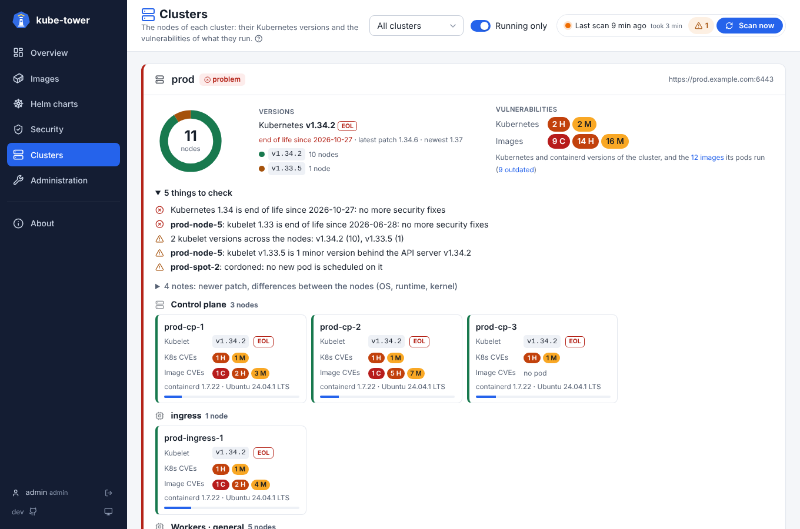
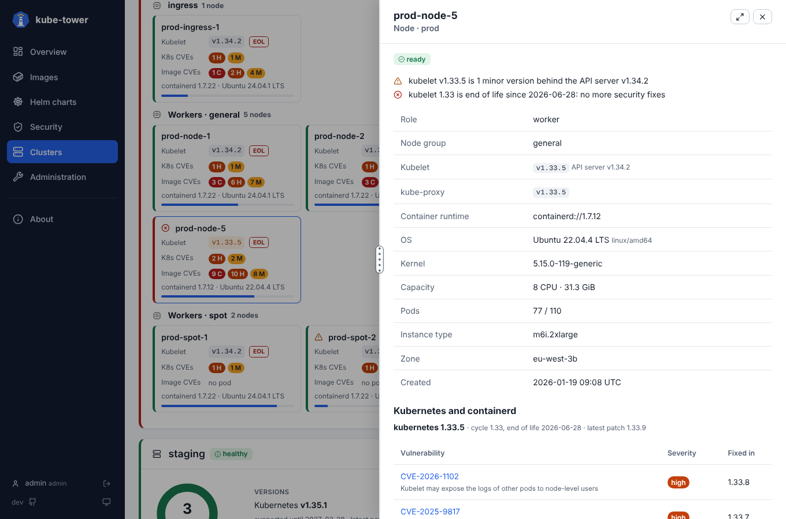

# Clusters page

The nodes of every cluster, grouped by role and node group, with their Kubernetes versions and the
vulnerabilities of what they run. How to connect a cluster is in [clusters](clusters.md); their registration and
connectivity are in the Clusters tab of the [Administration](ui-administration.md#clusters). How
detail panels work in general is in [usage](usage.md).

## One card per cluster

The card header gives the state of the cluster: *healthy* (green), *to check* (orange), *problem* (red)
or *unreachable* with the error of the last scan. Then, side by side:

| Block | Shows |
| --- | --- |
| **Ring** | The nodes split by kubelet version: green on the version of the API server, orange behind it, red unsupported. The number of nodes in the middle |
| **Versions** | The Kubernetes version of the API server with an **EOL** tag when its release cycle is at (or near) its end of life, the date it is supported until, its latest patch and the newest release; then each kubelet version with its number of nodes |
| **Vulnerabilities** | Two lines of critical, high and medium CVEs, each counted once: **Kubernetes**, those of the Kubernetes (API server, kubelets) and containerd versions of the cluster; **Images**, those of the images its pods run, with links to these images and to the outdated ones |

Under them:

- **Things to check** (open, errors first): a Kubernetes release at or near its end of life, kubelets behind or newer
  than the API server, nodes not ready, cordoned or under pressure, kubelet versions mixed across the
  nodes, a newer patch of the release.
- **Notes** (folded): a newer patch of the release, and the OS images, container runtimes and kernels
  that are not the same on every node.

## One card per node

The nodes are grouped by role (Control plane, Workers, `ingress`…), then by node group. Each card shows:

- the **name**, with a warning or error icon when the node has a finding (hover the card to read them);
- the **kubelet version**, orange when behind the API server, red when unsupported, with an **EOL** tag
  when its release cycle is at (or near) its end of life;
- **K8s CVEs**: the vulnerabilities of its kubelet and containerd versions;
- **Image CVEs**: those of the images its pods run: critical, high and medium counts, *none*, *not
  scanned*, or *no pod*;
- the container runtime and the OS, and a bar of the pods it runs out of its maximum.

Its left border takes the colour of its worst finding. Click it for its details.

The **Cluster** filter of the top bar applies. *Running only* does not: the vulnerabilities are always
those of the images that pods run. A role [limited to some clusters](rbac.md#clusters-of-a-role) only
sees those.

## Roles and node groups

| Group | Taken from |
| --- | --- |
| Role | `control-plane` for the `node-role.kubernetes.io/control-plane` (or `master`) label, else the name of another `node-role.kubernetes.io/<role>` label (`ingress`, `gpu`…), else `worker` |
| Node group | The first label of `clusters.nodePoolLabels` found on the node: EKS node group, GKE node pool, AKS agent pool, Karpenter node pool, `node.kubernetes.io/pool` |

Managed control planes (EKS, GKE, AKS) have no node: only their API server version shows.

## Findings

What turns a node or a cluster orange or red:

| Level | Finding |
| --- | --- |
| error | The node is not ready |
| error | Its kubelet (or kube-proxy) is newer than the API server, or more than 3 minor versions behind it: outside the [version skew policy](https://kubernetes.io/releases/version-skew-policy/) of Kubernetes |
| warning | Its kubelet is 1 to 3 minor versions behind the API server: supported, but to upgrade before the API server moves on |
| warning | The node is cordoned (no new pod is scheduled on it), or has a condition such as `MemoryPressure`, `DiskPressure`, `PIDPressure` |
| warning | The nodes of the cluster run different kubelet versions (often an upgrade left half done) |
| error | The release cycle of the API server (or of a kubelet) is past its end of life: no more security fixes |
| warning | It reaches its end of life within `kubernetesVersions.warnDays` days (90) |
| info | The nodes run different OS images, container runtimes or kernels |
| info | A newer patch of the release of the API server is out |

Distribution suffixes are ignored to compare versions: `v1.30.4-eks-a737599`, `v1.31.2+k3s1`,
`v1.29.8-gke.1211000`.

## Detail panel

Click a node for its findings, role and node group, kubelet and kube-proxy versions (next to the API
server's), container runtime, OS and kernel, CPU and memory capacity, pods running out of the maximum,
instance type, zone and creation date. Then its Kubernetes and containerd versions with their release
cycle, end of life and every known vulnerability (ID linked to OSV, severity, version that fixes it).
Below: the images its pods run, most vulnerable first, with
their status and CVEs; click one for its own details.

## Where the data comes from

kube-tower reads the nodes (`list nodes`, already needed for the images they cache) at each scan, even
with `images.enabled: false`. Nothing else is asked from the clusters: no new permission.

The end of life of each Kubernetes release comes from [endoflife.date](https://endoflife.date/kubernetes),
and the vulnerabilities of the Kubernetes (`k8s.io/kubernetes`) and containerd
(`github.com/containerd/containerd`) versions from [OSV](https://osv.dev). The controller asks them once
per scan, for the distinct versions the clusters run; a flaw listed by OSV under several IDs (GO-, GHSA-,
CVE-) is counted once. Without access to them (air-gapped clusters), set `kubernetesVersions.enabled:
false`, or point `endOfLifeUrl` and `osvUrl` to mirrors (see [configuration](configuration.md)): the page
then shows *not looked up*, and the scan carries on.

The same data is exported as metrics: `kube_tower_nodes`, `kube_tower_kubernetes_end_of_life_days`,
`kube_tower_platform_vulnerabilities` (see [metrics](metrics.md)).
