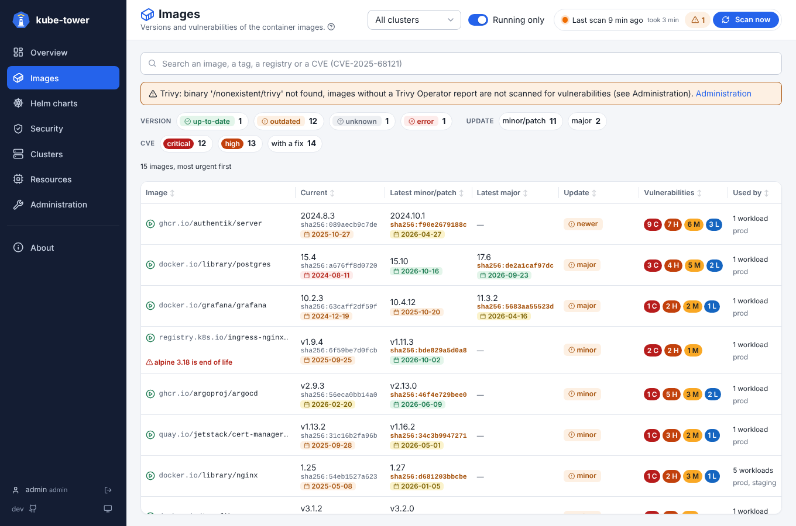
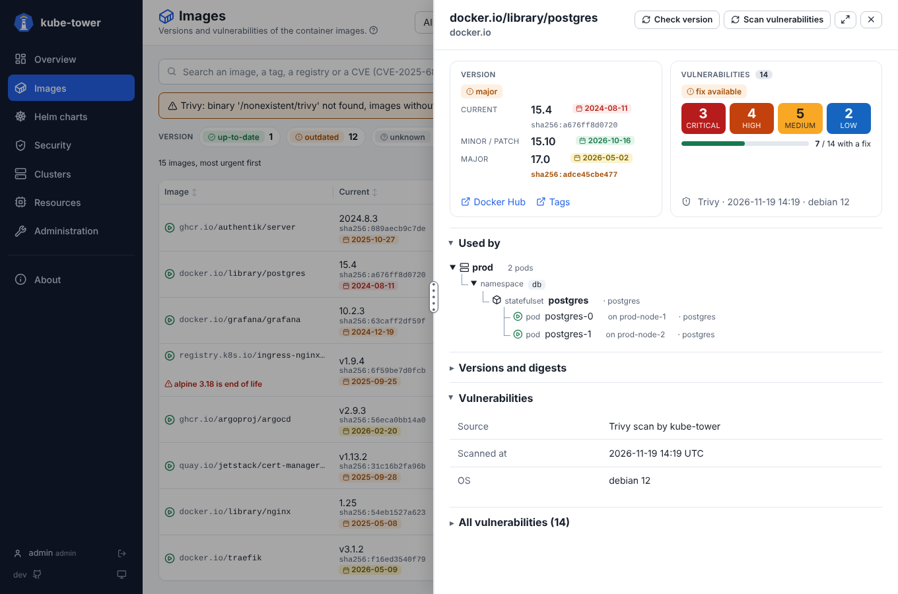

# Images page

One line per image reference (`registry/repository:tag`), whatever the number of workloads using it,
with its **versions** and its **vulnerabilities**. How lists, filters and detail panels work in general
is in [usage](usage.md).

## The list

The most urgent come first: critical CVEs with a fix, then outdated images (major updates first), then
checks in error, then the most vulnerable.

| Column | Meaning |
| --- | --- |
| Image | Normalized name (`nginx` becomes `docker.io/library/nginx`), with an icon: green ▶ a pod runs it, grey ⏸ none does |
| Current | Tag used by the workloads, with the start of its digest and its [release date](#release-dates-and-their-age) |
| Minor / patch | Latest release of the same major version: highest tag of the same shape, [versioning scheme](statuses.md#versioning-schemes) and major number (`15.4` → `15.10`), with its digest (orange when it differs) and its release date. The current tag when there is no newer one. For versions without major number (calendar, date, build number, `redis:7`), the highest of all |
| Major | When a newer major version exists: the latest release of the newest major version, with its latest patch (`15.4` → `17.6`, not `16.0` or `17.0`), with its digest and release date; `—` when there is none |
| Update | `major`, `minor`, `patch`, `newer` or `new digest`, else the [status](statuses.md) |
| Vulnerabilities | Count by severity (C, H, M, L), `pending` while scanning, `scan failed` (reason on hover) or `not scanned` (see [troubleshooting](troubleshooting.md#vulnerabilities)) |
| Used by | Number of workloads (or `cached on nodes`) and their clusters |

### Release dates and their age

Each version shows its release date, colored by its age:

| Color | Age (default) | For the current version | For a latest version |
| --- | --- | --- | --- |
| green | under 6 months | recent | its project releases |
| yellow | 6 months to a year | aging | |
| orange | 1 to 2 years | old: plan an update | no release for a while |
| red | over 2 years | very old | probably no longer maintained |

So you see at a glance whether the version you run is recent enough, and whether its major version (the
*Minor / patch* column) or the image itself (the *Major* column) is still maintained: a red *Minor / patch*
next to a green *Major* means the major version you run gets no more fixes. Hover a date for its exact time
and age. Change the ages with `images.releaseAgeDays` (default `[180, 365, 730]`, see
[configuration](configuration.md)).

Also shown:

- `latest` (or no tag) in **red**: the running version changes on every pull, pin a version;
- **end of life OS** under the image name.

## Search and chips

- **Search** by words of the reference (`nginx`, `ghcr.io 1.2`) or by vulnerability ID, all or part
  (`CVE-2025-68121`, `2025-681`, `GHSA-`), several separated by spaces or commas.
- With an ID, only the affected images are listed, with the matching IDs; their panel lists those
  vulnerabilities first.
- **Chips**: the version status, and the **CVE** chips (critical or high, with a fix). Their numbers
  are images.

## Detail panel

The [rescan](usage.md#rescan-one-image-or-chart) buttons sit at the top, next to the full screen and
close buttons. Below, two cards side by side: the **version** (status, then one line each for the current
version, the latest minor / patch release and, when there is one, the latest major release, each with its
release date colored by its age and its digest, and the links to the page and the tags of the image on its registry: Docker Hub,
GitHub Packages, Quay, ECR Public Gallery, Microsoft Artifact Registry) and the
**vulnerabilities** (total, a *fix available* or *no fix yet* status, one tile per severity, a bar of how many
have a fix, an end of life OS, and the source, date and OS of the scan). Both cards have the same layout:
label, status, values, details, and their last line (registry links, scan source) at the bottom. Then the sections, each
folded or unfolded with a click on its title:

| Section | Opened | Content |
| --- | --- | --- |
| Used by | yes | Tree cluster › namespace › workload › pods, with nodes and containers; the nodes caching the image close each cluster |
| Versions and digests | no | Reference, versioning scheme, release of the current tag, latest minor / patch and latest major tags with their release dates, upgrade targets (minor / patch and major), **size**; digests of the running pods, digest published for the same tag (different: the tag was pushed again), digest of the latest tag |
| Vulnerabilities | yes | Source (Trivy Operator or Trivy), scan date, scanned digest, OS |
| All vulnerabilities | no (yes after a CVE search) | Each one with severity, score, package, installed and fixed version, linked to its advisory |

Notes:

- The **size** comes from the nodes that pulled the image: the download size with containerd, the
  unpacked size with Docker. A range when nodes differ; unknown if no node pulled it.
- A workload without pod says **no pod running** (scaled to zero, CronJob between two runs).
- Published digests need `images.fetchTagDigests` (on by default).
- The **release date** of each tag is when it was pushed on Docker Hub (its web API, outside the
  pull rate limit), else when the image was built: the `org.opencontainers.image.created` annotation,
  or the `created` date of its config (linux/amd64). Images built reproducibly carry a fixed date
  (1970, 1980) and show none. Each date is read once per version; turn it off with
  `images.fetchReleaseDates: false`.

Where the vulnerabilities come from: [vulnerabilities](vulnerabilities.md).
