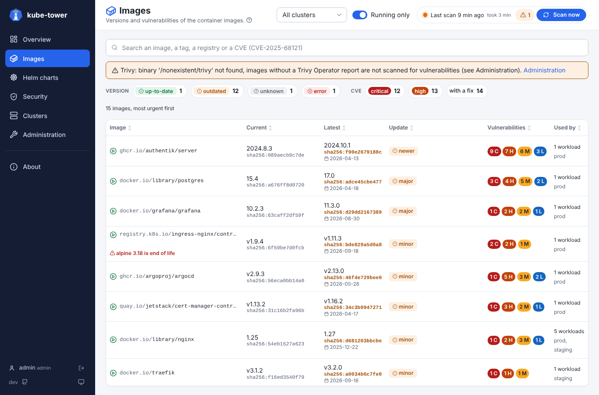
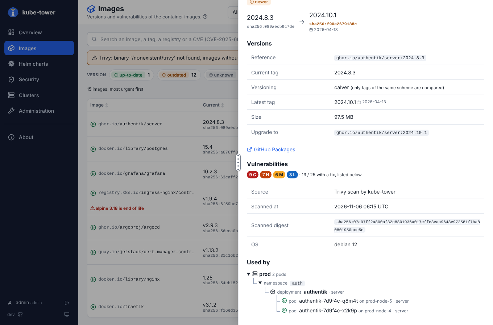

# Images page

One line per image reference (`registry/repository:tag`), whatever the number of workloads using it,
with its **versions** and its **vulnerabilities**. How lists, filters and detail panels work in general
is in [usage](usage.md).

## The list

The most urgent come first: critical CVEs with a fix, then outdated images (major updates first), then
checks in error, then the most vulnerable.

| Column | Meaning |
| --- | --- |
| Image | Normalized name (`nginx` becomes `docker.io/library/nginx`), with an icon: green ▶ a pod runs it, grey ⏸ none does |
| Current | Tag used by the workloads, with the start of its digest |
| Latest | Highest tag of the same shape and [versioning scheme](statuses.md#versioning-schemes), with its digest (orange when it differs) and its release date |
| Update | `major`, `minor`, `patch`, `newer` or `new digest`, else the [status](statuses.md) |
| Vulnerabilities | Count by severity (C, H, M, L), `pending` while scanning, `scan failed` (reason on hover) or `not scanned` (see [troubleshooting](troubleshooting.md#vulnerabilities)) |
| Used by | Number of workloads (or `cached on nodes`) and their clusters |

Also shown:

- `latest` (or no tag) in **red**: the running version changes on every pull, pin a version;
- **end of life OS** under the image name.

## Search and chips

- **Search** by words of the reference (`nginx`, `ghcr.io 1.2`) or by vulnerability ID, all or part
  (`CVE-2025-68121`, `2025-681`, `GHSA-`), several separated by spaces or commas.
- With an ID, only the affected images are listed, with the matching IDs; their panel lists those
  vulnerabilities first.
- **Chips**: the version status, and the **CVE** chips (critical or high, with a fix). Their numbers
  are images.

## Detail panel

| Section | Content |
| --- | --- |
| Versions | Reference, versioning scheme, latest tag, upgrade target, **size**, links to the registry page |
| Vulnerabilities | Counts by severity and with a fix, source (Trivy Operator or Trivy), scan date, scanned digest, OS |
| Used by | Tree cluster › namespace › workload › pods, with nodes and containers; the nodes caching the image close each cluster |
| Digests | Digests of the running pods, digest published for the same tag (different: the tag was pushed again), digest of the latest tag |
| Check again | The [rescan](usage.md#rescan-one-image-or-chart) buttons |
| All vulnerabilities | Each one with severity, score, package, installed and fixed version, linked to its advisory |

Notes:

- The **size** comes from the nodes that pulled the image: the download size with containerd, the
  unpacked size with Docker. A range when nodes differ; unknown if no node pulled it.
- A workload without pod says **no pod running** (scaled to zero, CronJob between two runs).
- Published digests need `images.fetchTagDigests` (on by default).
- The **release date** of the latest tag is when it was pushed on Docker Hub (its web API, outside the
  pull rate limit), else when the image was built: the `org.opencontainers.image.created` annotation,
  or the `created` date of its config (linux/amd64). Images built reproducibly carry a fixed date
  (1970, 1980) and show none. Each date is read once per version; turn it off with
  `images.fetchReleaseDates: false`.

Where the vulnerabilities come from: [vulnerabilities](vulnerabilities.md).
