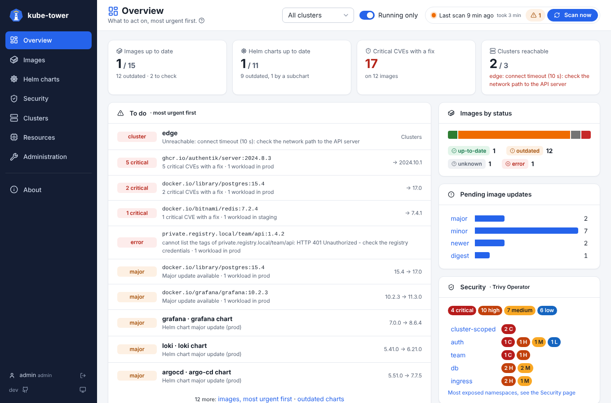

# Overview page

The home page: what to act on first. It follows the **Cluster** and **Running only** filters of the
top bar (see [usage](usage.md)).

## Tiles

| Tile | Shows | Opens |
| --- | --- | --- |
| Images | Up to date out of all, how many are outdated and how many to check (`unknown` or `error`) | the Images page |
| Helm charts | Up to date, and the ones outdated only because of a subchart | the Helm charts page |
| Critical CVEs with a fix | Their number, on how many images | the Images page, filtered |
| Clusters | Reachable out of all, with the error of the first unreachable one | the Clusters tab |

## To do

The urgent items, most urgent first:

1. unreachable clusters;
2. images with critical CVEs that have a fix;
3. image checks in error;
4. major updates of images and of Helm charts;
5. floating tags (`latest`…) pushed again;
6. images on an end of life OS.

A few of each kind are shown, so one kind does not hide the others. Click a line for its details
(images) or its list (charts, clusters).

## Charts and cards

- **Images by status**: click a segment or a status for the filtered list.
- **Pending updates by type** (major, minor, patch, newer, new digest): click a type for the Images
  page filtered on it (`images?update=major`).
- **Security** (with Trivy Operator): findings per severity and the most exposed namespaces, see
  [Security](security.md).
