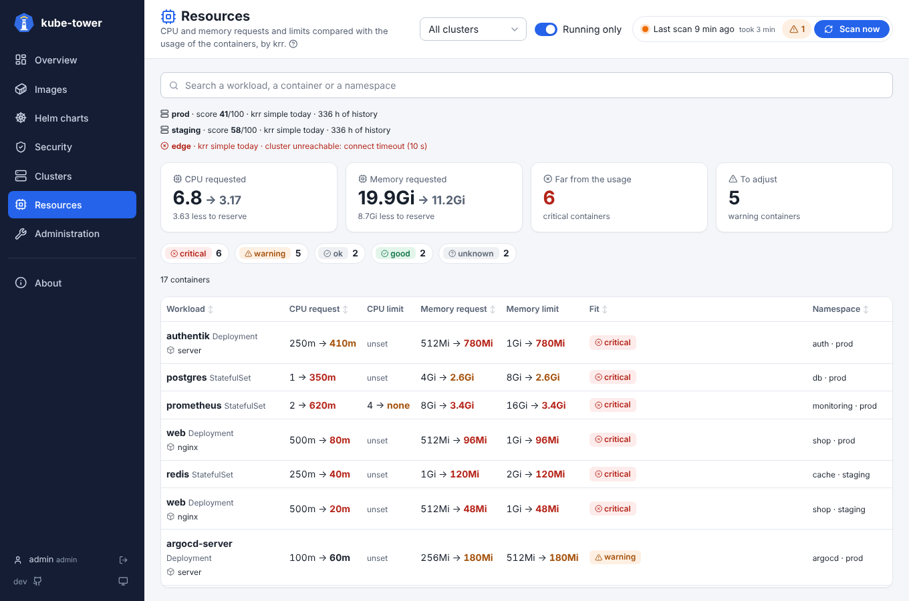
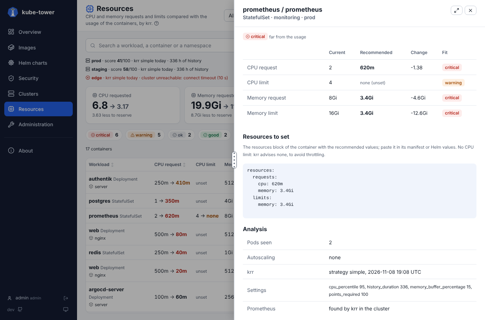

# Resources page

The CPU and memory requests and limits of every container next to what krr recommends from their usage in
Prometheus. How to turn it on is in [resources](resources.md); the page is in the sidebar once
`resources.enabled` (with the Helm chart, `krr.enabled`). How detail panels work in general is in
[usage](usage.md).

## Top of the page

- **Last run of krr per cluster**: its score (out of 100, the share of containers that fit), when it ran,
  the hours of history read, the Prometheus used, and the error when it failed.
- **Tiles**: the CPU and memory requested now, then what krr recommends (for the containers it can
  recommend for), and how much less or more that reserves; the containers *far from the usage*
  (critical) and *to adjust* (warning).
- **Chips** by fit, to show only the containers of one fit, and a **search** box (workload, container,
  namespace, cluster).

## The list

One line per container, the ones furthest from their usage first:

| Column | Shows |
| --- | --- |
| **Workload** | name and kind, the container when its name differs, `HPA` when a HorizontalPodAutoscaler scales it |
| **CPU request**, **CPU limit**, **Memory request**, **Memory limit** | the current value, an arrow, the recommended one in bold, red or orange when far from the usage. *unset*: no value set now; *none*: krr advises no value (no CPU limit); *?*: not enough data |
| **Fit** | the worst of the four: *critical*, *warning*, *ok*, *good* or *unknown*, with the reason when krr could not recommend |
| **Namespace** | namespace and cluster |

The **Cluster** filter of the top bar applies. *Running only* does not: krr only analyses workloads that
ran during the history. A role [limited to some clusters](rbac.md#clusters-of-a-role) only sees those.

## Detail panel

Click a line for:

- the four values: current, recommended, the change (`-950m`, `+128Mi`) and the fit of each;
- **Resources to set**: the `resources` block of the container with the recommended values, to paste in
  its manifest or Helm values (click to copy);
- the analysis: pods seen in Prometheus, autoscaling, warnings of krr, its strategy and settings, the
  Prometheus it read.

## On the Clusters page

Each card of the [Clusters page](ui-clusters.md) has a **CPU and memory** block: the critical and warning
containers (links to this page, filtered), the requests now and recommended, and the score of krr.
