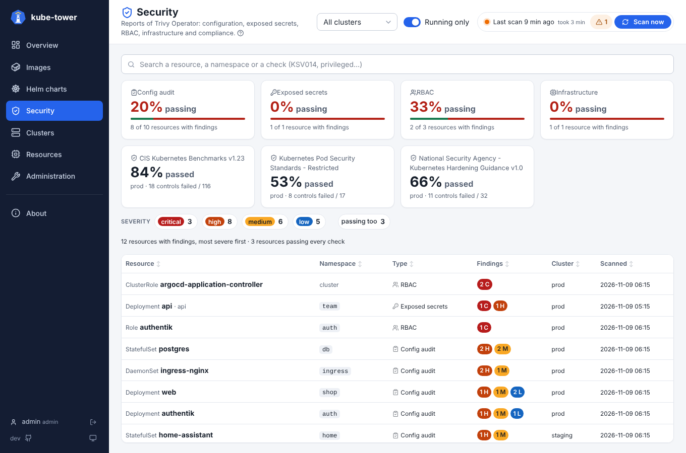
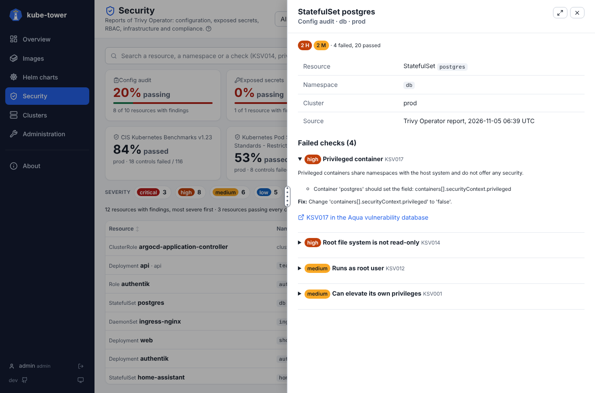
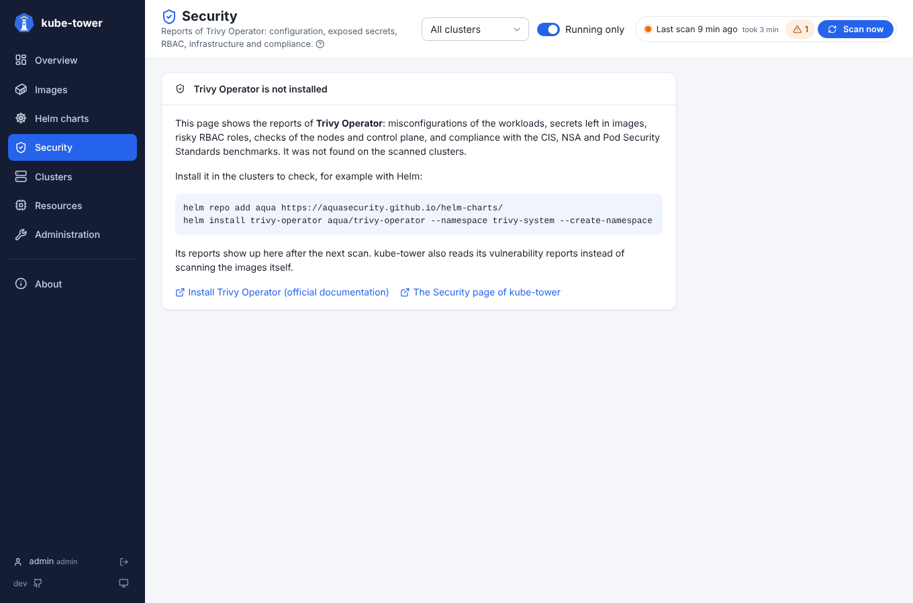

# Security page

The reports of [Trivy Operator](https://aquasecurity.github.io/trivy-operator/) for every cluster at
once: config audit, exposed secrets, RBAC, infrastructure and compliance. What each report checks and
how to turn it on is in [security](security.md). How lists and detail panels work in general is in
[usage](usage.md).

## Tiles

| Tile | Shows | Click |
| --- | --- | --- |
| One per type of report | Share of checked resources that pass every check, and how many have findings | Lists only that type; click again for every type |
| One per compliance framework and cluster | Share of controls passed | Lists its failed controls, most severe first |

A framework not evaluated yet says so: Trivy Operator fills them on its own schedule
(`compliance.cron`).

## The list

One line per resource with failed checks: a Deployment, a ClusterRole, a node, or the container of an
image with secrets. Most severe first; the headers sort it.

| Column | Meaning |
| --- | --- |
| Resource | Kind and name, with its namespace |
| Type | Type of report |
| Findings | Number of findings per severity (*none* when every check passes) |
| Cluster | Where the report comes from |
| Checked | When Trivy Operator checked it |

- **Severity chips** keep the resources with at least one finding of that severity.
- **Passing too** also lists the resources that pass every check.
- **Search** in resource names, namespaces, containers, images, and the IDs and titles of the checks:
  `KSV017`, `privileged`, `billing`...
- The **Cluster** filter of the top bar applies. *Running only* does not, because reports are about
  resources, not images.

## Detail panel

Every failed check of the resource, with:

- its severity and the message of Trivy (which container, which field);
- the description and how to fix it;
- a link to the check in the Aqua vulnerability database (`KSV…`, `KCV…`).

For an exposed secret: the rule, the file in the image and the masked line. Rotate a secret found in an
image, because anyone who can pull the image can read it.

## Overview card

The [Overview](ui-overview.md) gets a Security card when Trivy Operator runs on a cluster: the findings
per severity and the most exposed namespaces.

## Without Trivy Operator

The page says so, with the Helm command to install it and a link to its
[installation guide](https://aquasecurity.github.io/trivy-operator/latest/getting-started/installation/).
The reports show up after the next scan.

