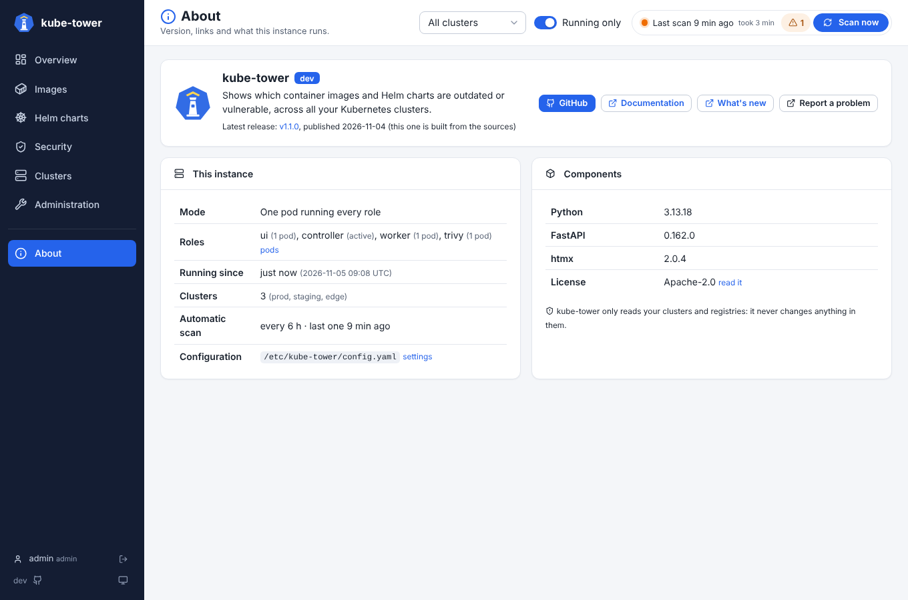

# Upgrading

kube-tower is stateless: an upgrade only restarts the pods, which scan again (with a Redis or Valkey,
the last inventory is shown at once). kube-tower shows a new version of its own chart in its Helm charts
page, and the About page tells when a newer release is published.



## With Helm

```sh
helm upgrade kube-tower oci://ghcr.io/arcanexus/charts/kube-tower -n kube-tower --reuse-values --version <new>
```

## With ArgoCD

Bump `targetRevision` to the new chart version in the Application and sync.

## Version notes

Read the [changelog](../CHANGELOG.md) for every change. What needs a step of yours:

### 1.3.0: Flux, Helm releases and deprecated APIs

- On remote clusters, apply [`deploy/remote-cluster-rbac.yaml`](../deploy/remote-cluster-rbac.yaml)
  again: it adds the Flux HelmReleases and their sources, and `get` on the `/metrics` URL of the API
  server (the [deprecated APIs](ui-clusters.md#deprecated-apis)). Without them the scan reports a
  permission error for these parts and carries on. The chart updates the ClusterRole of the local cluster.

### 1.2.0: Clusters page and custom roles

- Nothing to do: the new settings have defaults, and `readonly` and `admin` keep their rights. Custom
  roles are optional, see [RBAC](rbac.md).
- The controller now asks [endoflife.date](https://endoflife.date) and [OSV](https://osv.dev) once per
  scan for the Kubernetes and containerd versions of the clusters. Behind a strict egress, allow
  `endoflife.date` and `api.osv.dev` (see [network](network.md)), point `config.kubernetesVersions` to
  mirrors, or set `config.kubernetesVersions.enabled: false`.
- `clusters` is now the new [Clusters page](ui-clusters.md), no longer a redirect to the Administration
  page: the registration and connectivity of the clusters stay in its Clusters tab.

### 1.1.0: the login is on by default

`auth.enabled` is now `true`: after an upgrade from 1.0, log in as `admin` with the password
kube-tower generates in the Secret `<release>-auth`:

```sh
kubectl -n kube-tower get secret kube-tower-auth -o jsonpath='{.data.admin\.password}' | base64 -d; echo
```

Scripts calling the API need the Basic auth of a local account (`curl -u admin:$PASSWORD`), see
[authentication](authentication.md#api-and-metrics). Set `auth.enabled: false` to keep kube-tower open as
in 1.0. With `rbac.create: false`, give the ServiceAccount the rights on the auth Secret, see
[permissions](permissions.md#login).

### 1.0.0: Security page and new pages

- The [Security](security.md) page reads more Trivy Operator reports: apply
  [`deploy/remote-cluster-rbac.yaml`](../deploy/remote-cluster-rbac.yaml) again on remote clusters (the
  chart updates its own ClusterRole).
- The former pages still answer, so bookmarks keep working: `synthesis` opens the Overview,
  `vulnerabilities` the Images page, `clusters` (until 1.2.0), `settings`, `logs` and `maintenance` the
  Administration page.

### 1.0.0-rc.4: the pods talk through Valkey

Up to rc.3 the pods talked over an internal API of the controller (port 8081) with a shared token. From
rc.4 they talk through Valkey only:

1. keep (or set) `redis.valkey.enabled: true`, or `redis.url`: the chart refuses to render without one;
2. remove `distributed.internal` from your values (ignored, the chart notes say so), then delete the
   Secret of the token (and its ExternalSecret);
3. sync: during the rollout, the pods of rc.3 lose the controller for less than a minute, the time the
   new ones replace them. The inventory kept in Valkey is shown at once.
