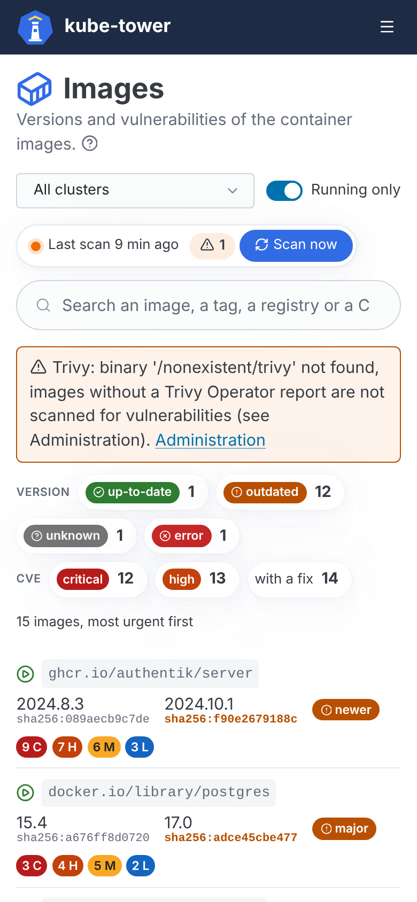
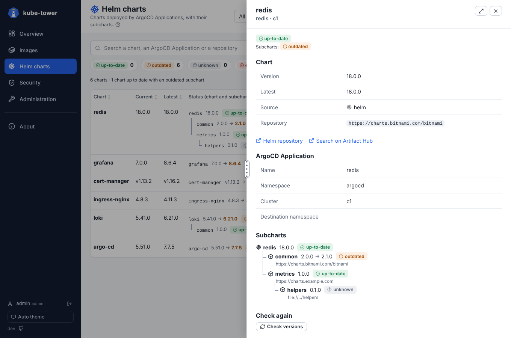
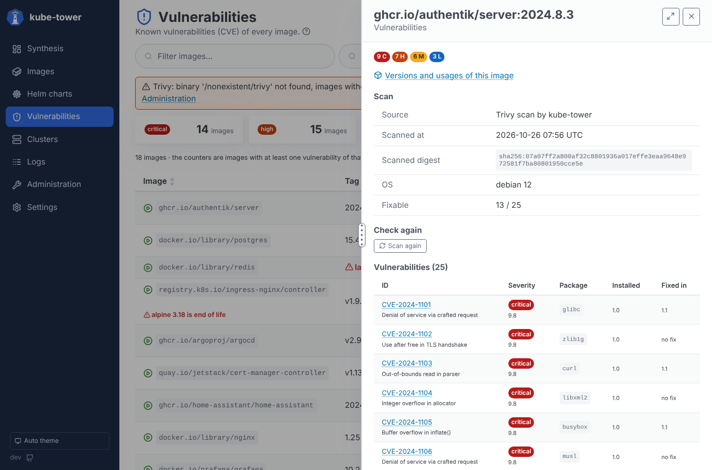
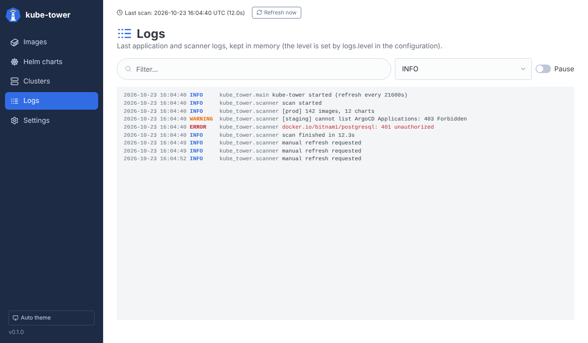
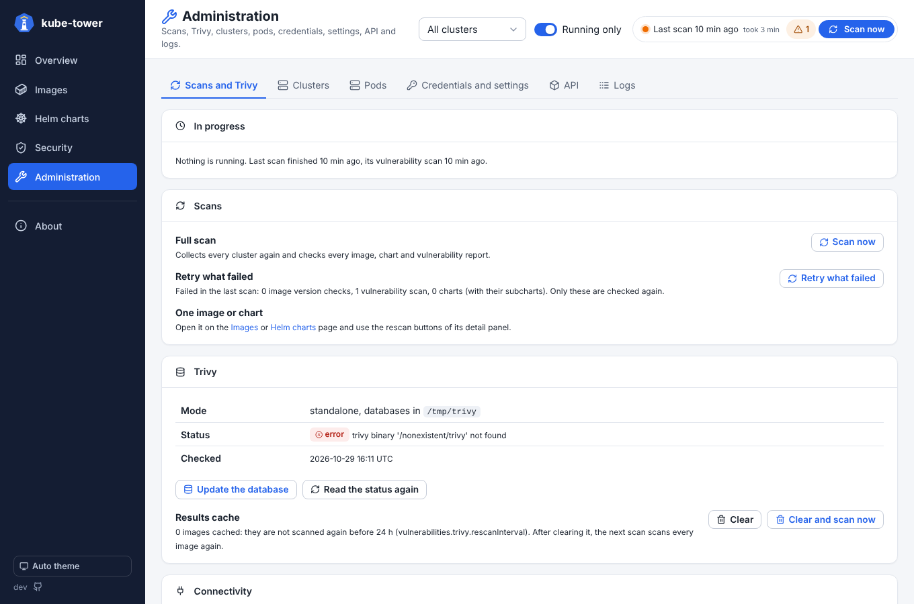
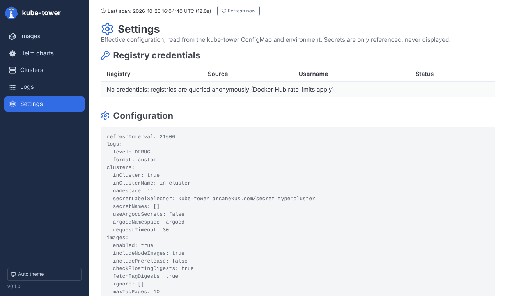

# Usage

## The dashboards

The left sidebar gives access to eight pages, and its bottom button switches the theme between
auto (follows the system), light and dark; the choice is remembered by the browser.

The scan status sits at the top right of every page: a dot (green when there is no problem,
orange with problems, pulsing blue while a scan runs), the age of the last scan (its exact date on
hover) and how long it took, the number of problems and a **Scan now** button that starts a full
scan immediately. Click the problem count to read them: problems of kube-tower itself (e.g. the
Trivy binary is missing, so images without a Trivy Operator report are not scanned), collection
errors (e.g. a missing permission on a cluster) and version check errors (e.g. a registry that
cannot be queried). A Trivy problem is also shown at the top of the Vulnerabilities page. Each error is also logged as a warning, visible on the Logs page and in the pod logs.

On the list pages (Images, Helm charts, Vulnerabilities, Clusters), only the list scrolls: the
title, the filters, the counters and the column headers stay in place. Click a column header to
sort the list on it, click again to reverse the order (the arrow shows the current sort); the
sort is kept when the filters change. Headers can also be sorted with the keyboard (Tab, then Enter
or Space), and a "Skip to content" link (first Tab) jumps over the sidebar. The ⓘ icon after a page
subtitle explains the page. Status columns sort what needs attention first (`outdated`,
`error`, `unknown`, then `up-to-date`), counts sort the largest first.

On the Images, Helm charts and Vulnerabilities pages, the counters at the top are buttons: clicking one shows only
that status (click it again to show everything). Filters are kept in the URL, so a filtered view
can be bookmarked or shared. Clicking a line opens a detail panel on the right; close it with its
button, a click outside or `Esc`. The panel starts with what was found (status, current → latest
version) and ends with the buttons that check the item again. Drag its left edge, marked by a
grip (⋮) in its middle, to resize it (or focus the edge and use the arrow keys; a double click restores the default width), or open it
full screen with the button next to the close one. The width and the full screen choice are kept
in the browser for the next panels.

The Images page shows the current and the latest version of each image, each with the start of its
digest below (the running digest, else the one pinned or published for the tag), so they can be
compared at a glance: a latest digest different from the current one is highlighted. The latest
column says `unknown` when the registry could not tell (see the status). A Helm chart shows the
worst status of the chart and its subcharts (the one the counters and the filter use), with
"chart up-to-date, subchart outdated" when only a subchart is outdated. On the Vulnerabilities page
and the Synthesis, the severity counters are numbers of **images** with at least one vulnerability
of that severity.

### Dark theme and phones

The theme follows the system (or the sidebar button). On a phone, the sidebar becomes a menu and the
lists show each line as a block: name first, then the versions and the status.

| Dark theme | Phone |
| --- | --- |
|  |  |

### Rescan one image or chart

No need to wait for the next scan (or to rescan everything) after an upgrade: the detail panels
have buttons that check one item again, in the background.

| Detail panel | Buttons |
| --- | --- |
| Image | **Check version** (registry query) and **Scan vulnerabilities** |
| Vulnerabilities of an image | **Scan again** (or **Scan now** when it was never scanned) |
| Helm chart | **Check versions** (the chart and its subcharts) |

An image rescan covers every image with its name (`registry/repository`): all its tags, used by
workloads or only cached on nodes (the buttons say how many). The clusters are read again first, so
the tags deployed since the last scan are found, added to the lists and checked too (both their
version and their vulnerabilities, whatever the button); images no longer found stay until the next
full scan.

While it runs the panel shows *Rescanning…*, then the panel and the line of the list are updated.
The vulnerabilities of an image read from a Trivy Operator report are read again from its clusters
(the operator scans the images itself); the other images are scanned again with Trivy, without
using the cached result. The buttons are disabled while a full scan runs, since it checks
everything again. A rescan only updates the existing results: new workloads or images only appear
with the next full scan.

### Synthesis


The home page: an overview of the last scan. Tiles give the number of images and charts (with
the share that is up to date), the reachable clusters, the images with critical vulnerabilities and
the images using `latest`. Below, the distribution of images and charts by status (click a segment or
a status to open the filtered list), the pending image updates by type (major, minor, patch, new
digest), the images per registry, the images by worst vulnerability severity, the most vulnerable
and the most used outdated images (click one for its details) and the figures per cluster.

### Images


One line per image reference (`registry/repository:tag`), whatever the number of workloads using
it. The counters at the top summarize the statuses; filter by text, status or cluster, and
turn on **Running only** to keep the images a pod runs (`images?running=1`). Images using `latest` (or no
tag at all, which means `latest`) are shown in red: the running version changes on every pull, pin
a version instead.

The icon in front of each image tells whether it runs: a green play icon when a pod uses it, a grey
pause icon otherwise (workload scaled to zero, CronJob between two runs, or image only cached on
nodes). Hover it for the explanation.

| Column | Meaning |
| --- | --- |
| Image | Normalized name: `nginx` becomes `docker.io/library/nginx` |
| Current | Tag used by the workloads, with the start of its digest below (the digest pinned in the manifest, else the one reported by the running pods, else the one published for the tag) |
| Latest | Highest tag of the same shape and [versioning scheme](#versioning-schemes) published in the registry (the current tag again for a floating tag pushed again, or when up to date), with the start of its digest below, in orange when it differs from the current one; `unknown` when the registry could not tell |
| Status | See [statuses](#statuses) |
| Used by | Number of workloads, pods and nodes using the image, and their clusters (hidden on phones) |

The detail panel of an image starts with its status and "current → latest" (with their digests),
then the upgrade target, links to the image page on its registry
(Docker Hub, GitHub Packages, Quay, ECR Public, Microsoft Artifact Registry), every place where it
is used, and compares digests: the digests reported by the running pods, the digest currently
published for the same tag (a difference means the tag was pushed again since the pods started),
and the digest of the latest tag. Published digests are read with `images.fetchTagDigests`
(enabled by default). The rescan buttons are at the bottom (**Check again**).


**Used by** shows where the image is used as a tree: cluster > namespace > workload > pods, with
the node each pod runs on and the containers using the image. Pods hang under their workload (the
Deployment of their ReplicaSet, the CronJob of their Job); a workload without pod says **no pod
running** (scaled to zero, CronJob between two runs). The nodes that have the image in their cache
close each cluster. Clusters and namespaces fold.

#### Versioning schemes

kube-tower tells from the current tag how the image is versioned, shows it in the detail panel
(**Versioning**) and only compares the tag with tags of the same scheme, on top of the same shape
(prefix, number of components, suffix):

| Scheme | Tags | Update type |
| --- | --- | --- |
| `semver` | `1.25.3`, `v2.1`, `7` | `major`, `minor`, `patch` |
| `calver` | `2024.10.1`, `2024.10` (a year from 1990 to 2100, then more numbers) | `newer` |
| `date` | `20241024`, `20241024.1`, `202410241530` (a date, then optional hours, minutes, seconds) | `newer` |
| `build` | `4521` (a single number from 1000) | `newer` |

So `redis:7` is not reported outdated because of a `4521` CI build tag, and `1.2` is not compared
with `2024.10`. A single number below 1000 counts as `semver`: a build number `999` is not compared
with `1000` and above.

### Helm charts


One line per Helm source of every ArgoCD Application (multi-source Applications give several
lines). The subcharts are shown as a tree under each chart, always expanded, including the
subcharts of subcharts (down to 3 levels). The status used by the counters and filters is the
worst one of the chart and its whole subchart tree, so a chart whose subchart is outdated shows up
when filtering on `outdated`; the badge of the chart line shows that same status, with
"chart up-to-date, subchart outdated" when only a subchart is behind. The detail panel of a chart shows its source, the ArgoCD Application,
links to the repository and Artifact Hub, and the subchart tree: the chart, then each subchart with
its version (→ the latest one when it is behind), status and repository, drawn like the **Used by**
tree of the images.




| Source type | Current version | Latest version |
| --- | --- | --- |
| `helm` (HTTP repository) | Application `targetRevision` | from the repository `index.yaml` |
| `oci` | Application `targetRevision` | from the registry tags |
| `git` (chart in a git path) | `version` of `Chart.yaml` at `targetRevision` | n/a: the chart follows git, only its subcharts are checked |

### Vulnerabilities


Known vulnerabilities (CVE) of every image, from Trivy Operator reports or scanned with Trivy.
Filter by image, by severity, by cluster, and by **CVE**: type all or part of one or several
vulnerability IDs (e.g. `CVE-2025-68121`, `2025-681` or `GHSA-`, separated by spaces or commas) to
list only the images affected, with the matching IDs under their counts; their detail panel lists
the matching vulnerabilities first. The severity counters at the top are numbers of images with at
least one vulnerability of that severity. When Trivy cannot run (binary not found, status error), a
notice at the top of the page says so, with a link to the Administration page. See
[vulnerabilities](vulnerabilities.md).



### Clusters


Every cluster kube-tower knows, its API server and where it comes from (`in-cluster`, `secret`,
`argocd-secret`), its Kubernetes version and whether it answered, with its figures from the last
scan: images and Helm charts (with how many are outdated) and images with critical CVEs. Each
number opens the filtered list.
Unreachable clusters are skipped during the scan and show the connection error.

### Logs



The last 2000 log lines of kube-tower (scans, registries, clusters), kept in memory and followed
live, like `kubectl logs -f`. Filter by text or minimum level, and pause the stream to read. Only
the lines logged at the configured `logs.level` or above are kept: set it to `DEBUG` to debug a
scan.

| Level | What is logged |
| --- | --- |
| `DEBUG` | Every registry, Helm repository and git request (method, URL without query, HTTP status), registry tokens requested, Kubernetes objects listed per kind, the result of each image, chart and subchart check, cluster secrets found |
| `INFO` | Scan start and end, clusters to scan with their Kubernetes version, per cluster collection summary (objects listed, ArgoCD Applications, Helm charts), registry credentials loaded (registry names only), check summaries per status |
| `WARNING` | Non fatal problems: an unreachable cluster, an invalid cluster secret, a resource that cannot be listed (e.g. 403), an image, chart or subchart that cannot be checked, ignored credentials |
| `ERROR` | A scan that failed as a whole (with the stack trace); the previous results are kept |

### Administration



Administration actions, run in the background (the page follows them and reloads when they are over):

| Section | Actions |
| --- | --- |
| In progress | First section: what runs now, each with its start time: the two phases of the full scan (clusters and versions, then vulnerabilities with Trivy), the scans waiting for the Trivy phase of another one, the rescans and the administration actions. The scan status at the top of every page links to it |
| Scans | **Scan now** (same as the button of the scan status). A scan checks the versions first, then scans the vulnerabilities with Trivy: during this Trivy phase a new scan, *Retry what failed* and the rescans can already start (a new scan waits for the Trivy phase to end before its own one). **Retry what failed**: checks again only the image version checks, vulnerability scans and charts (or subcharts) in error in the last scan, e.g. after fixing credentials or a rate limit. One image or chart is rescanned from its detail panel (see above) |
| Trivy | Trivy version and vulnerability database (version, build date, next update, download date). **Update the database** downloads it when a newer one is published (standalone mode; with `trivy.server.enabled` the Trivy server updates its own). Scans wait for the update. **Clear** forgets the cached scan results (kept `vulnerabilities.trivy.rescanInterval`), so the next scan scans every image again; **Clear and scan now** also starts it |
| Connectivity | **Test the connectivity** of every cluster (Kubernetes API `/version`, cluster Secrets read again), every container registry of the last scan and every registry with credentials (`/v2/`, and a pull token for one of its repositories), every HTTP Helm repository (`index.yaml`) and the Trivy server (`/healthz`), with kube-tower's credentials. Failures say why (proxy, DNS, TLS, 401/403…) |
| API | Links to the API documentation (`api/docs`), the last scan as JSON (`api/snapshot`) and the Prometheus metrics (`metrics`) |
| Unused node images | Images cached on nodes that no workload of their cluster uses, per cluster, with the `crictl rmi` command to run on the node. kube-tower stays read-only and does not remove them: the kubelet garbage collects unused images when a node's disk goes over `imageGCHighThresholdPercent` (85 % by default). Needs `images.includeNodeImages` |

### Settings



The effective configuration, one table per section (with the same camelCase keys as `config.yaml`;
durations in a readable form with their value in seconds; values changed from the defaults
highlighted and counted; the whole configuration as YAML at the bottom), and the registry
credentials that were loaded. Secret values are never displayed: only the registry, where the
credentials come from, the username and whether they could be read.

The **Authentication** column tells whether the registry accepted the credentials, at the last
request that sent them (a scan, a rescan or the connectivity test of the Administration page):
**accepted**, **refused** (with the registry's answer, e.g. `HTTP 401 Unauthorized`) or **not tried
yet** (no request with these credentials since kube-tower started). For a pattern
(`*.dkr.ecr.*.amazonaws.com`), a refusal by any matching registry is shown first, with its host.

## Statuses

| Status | Meaning |
| --- | --- |
| 🟢 `up-to-date` | Nothing newer is published (or, for floating tags, the running digest is the published one) |
| 🟠 `outdated` | A newer version, or a newer image under the same floating tag, is available |
| ⚪ `unknown` | Cannot be compared: image pinned by digest only, floating tag without known digest, version constraint (`1.x`), local subchart (`file://`) |
| 🔴 `error` | The registry or repository could not be queried: the message tells why (authentication, not found, timeout…) |

## API

| Endpoint | Description |
| --- | --- |
| `GET /api/snapshot` | The last scan: images, charts, clusters, errors, timestamps |
| `POST /api/refresh` | Start a scan now (`{"started": false}` if one is already running) |
| `POST /api/rescan/image?ref=…` | Check an image again (`ref` as in the snapshot, e.g. `docker.io/library/nginx:1.25`): every image with its name is checked (all tags, including the new ones found on the clusters); `versions=false` or `vulnerabilities=false` to skip one part. 202 when started, 409 with a `reason` if a scan is running, 404 if unknown |
| `POST /api/rescan/chart?cluster=…&namespace=…&app=…&chart=…` | Check one Helm chart and its subcharts again (`namespace` is the Application's namespace) |
| `POST /api/administration/retry-failed` | Check again everything that failed in the last scan (202, or 409 with a `reason`) |
| `POST /api/administration/trivy-db` | Update the Trivy databases when a newer one is published (standalone mode) |
| `DELETE /api/administration/trivy-cache` | Forget the cached Trivy results (`{"cleared": n}`) |
| `POST /api/administration/connectivity` | Start a connectivity test; results with `GET /api/administration/connectivity` |
| `GET /api/administration/unused-images` | Images cached on nodes that no workload of their cluster uses |
| `GET /healthz` | Liveness |
| `GET /readyz` | 200 once the first scan has finished |
| `GET /api/docs` | Interactive OpenAPI documentation |

Requests that change something (`POST`, `DELETE`) are refused with a 403 when a browser says they come
from another site (`Sec-Fetch-Site`, else `Origin` compared with the host, or `X-Forwarded-Host` behind a
proxy): a page on another site cannot start scans through the browser of someone who can reach
kube-tower. The UI itself and clients that are not browsers (curl, scripts) are not affected.

```sh
# Outdated images, as "image current -> latest"
curl -s http://kube-tower/api/snapshot \
  | jq -r '.images[] | select(.status=="outdated") | "\(.image.ref) -> \(.latest_tag // .latest_digest)"'
```

## Prometheus metrics and Grafana

`GET /metrics` is a Prometheus exporter for the result of the last scan: current and latest
version of every image and chart, update type (major, minor, patch), workloads and clusters,
scan duration and errors. A ready-made Grafana dashboard ships with the chart.

See [Metrics and Grafana](metrics.md) for the metric reference, PromQL examples, alerts and the dashboard.
