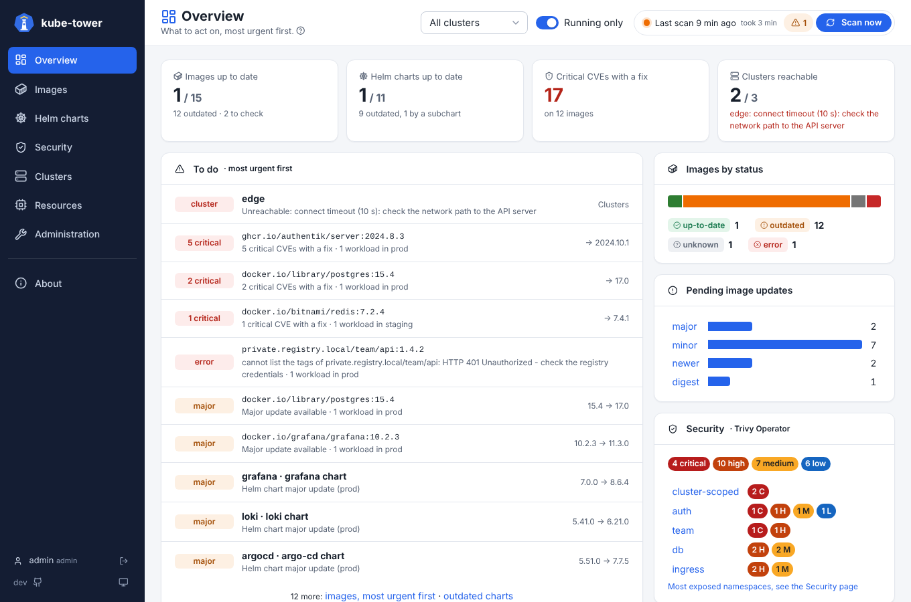
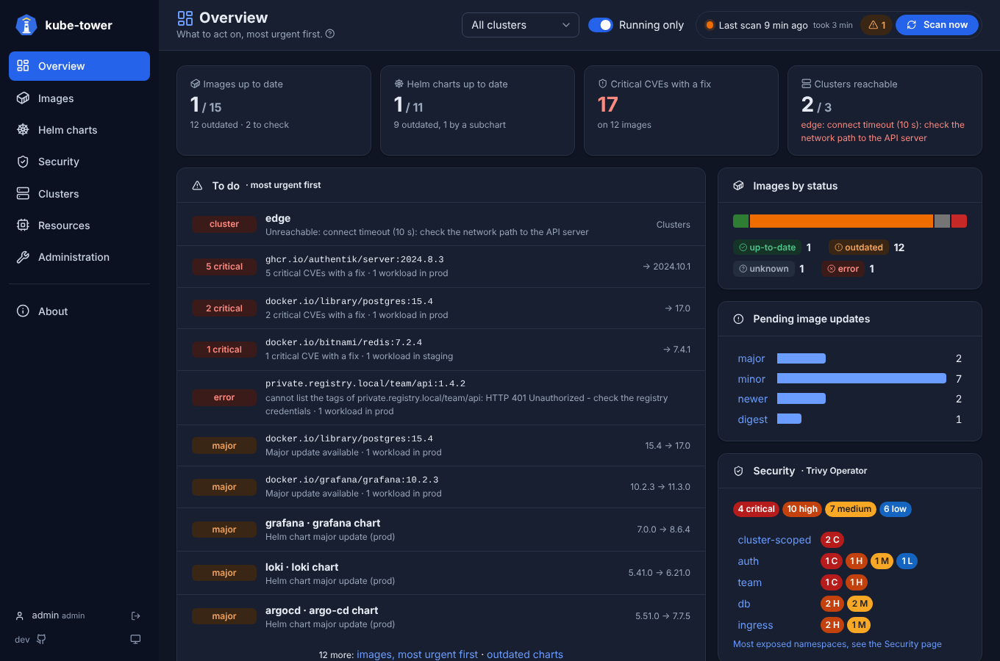
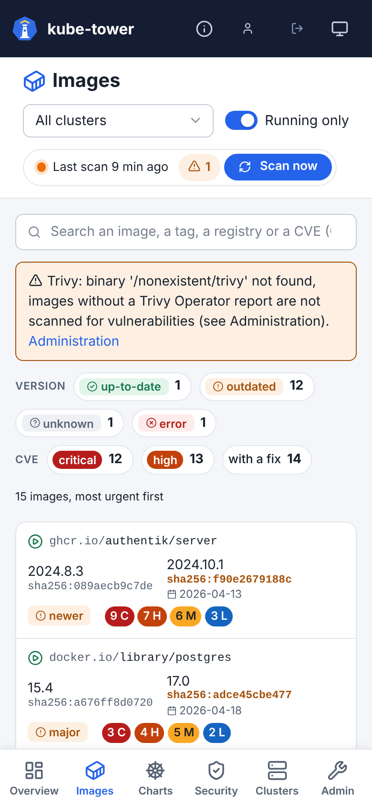
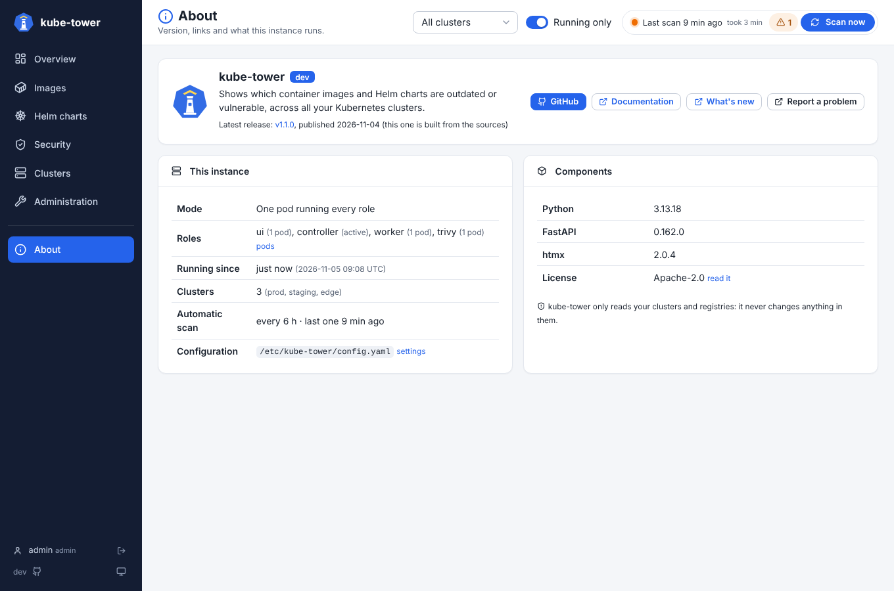

# Usage

How to find your way in kube-tower: what every page has in common. Each page has its own guide:

| Page | What it shows | Guide |
| --- | --- | --- |
| **Overview** | What to act on first, figures of the whole inventory | [Overview page](ui-overview.md) |
| **Images** | Every image, its versions and its vulnerabilities | [Images page](ui-images.md) |
| **Helm charts** | Every chart of the ArgoCD Applications and its subcharts | [Helm charts page](ui-charts.md) |
| **Security** | The reports of Trivy Operator | [Security page](ui-security.md) |
| **Administration** | Scans, Trivy, clusters, pods, credentials, settings, API, logs | [Administration page](ui-administration.md) |
| **About** | Version, latest release, what this instance runs | [below](#about) |

What `outdated`, `unknown` or `major` mean is explained in [statuses and versions](statuses.md).

## Sidebar and top bar

- **Sidebar** (left): the five pages, then **About**. At the bottom: the user logged in and its role,
  *Log out*, the version, the GitHub link, and the **theme** icon (auto, light or dark, remembered by
  the browser).
- **Cluster** filter (top bar): only the images, charts and figures of one cluster.
- **Running only** filter (top bar, on by default): leaves out the images no pod runs (only cached on
  nodes, workload scaled to zero, CronJob between two runs).
- **Scan status** (top right): a dot (green, orange with problems, pulsing blue while a scan runs), the
  age and duration of the last scan, the **number of problems** (click it to read them) and
  **Scan now**.

Both filters apply to every page and are remembered by the browser; `?cluster=prod` or `?running=0` in
a link sets them too.

## Lists

The Images and Helm charts pages are lists that work the same way:

- **Chips** above the list are filters with their count: click to keep only these items, click again
  to show everything.
- **Search** box: words of the name, all or part.
- **Sort**: click a column header, again to reverse. Status columns put what needs attention first.
- **Scroll**: only the list scrolls, the headers stay. Rows load 30 at a time as you scroll.
- **URL**: the search, chips and sort are kept in the URL, so a filtered view can be bookmarked or
  shared.

## Detail panels

Click a line to open its details on the right:

- it starts with what was found (status, current → latest version), the buttons to check the item
  again come near the end;
- resize it by dragging its left edge (the ⋮ grip), or open it **full screen** with the button next to
  the close one;
- close it with its button, `Esc`, or a click outside (which also does what it was meant to, e.g.
  open another line).

### Rescan one image or chart

No need to wait for the next scan after an upgrade: the detail panels check one item again, in the
background.

| Panel | Buttons |
| --- | --- |
| Image | **Check version** (registry) and **Scan vulnerabilities** (when kube-tower can scan it) |
| Helm chart | **Check versions** (the chart and its subcharts) |

- An image rescan covers **every tag** of the image name, found again on the clusters first, so newly
  deployed tags are added too.
- The panel shows *Rescanning…*, then the panel and the list are updated.
- Vulnerabilities from Trivy Operator are read again from the clusters; the other images are scanned
  again with Trivy, ignoring its cache.
- The buttons are disabled while a full scan runs. New workloads only appear with the next full scan.

## Dark theme and phones

The theme follows the system, or the icon at the bottom of the sidebar. On a phone, the pages are in a
tab bar at the bottom, and each line of a list is shown as a block.

| Dark theme | Phone |
| --- | --- |
|  |  |

## Keyboard and links

- Tab then Enter or Space sorts a column; the first Tab offers *Skip to content*.
- The ⓘ icon after a page subtitle explains the page.
- Moving between pages does not reload them: the back button works as usual.
- The former pages still answer: `synthesis` opens the Overview, `vulnerabilities` the Images page,
  `clusters`, `settings` and `logs` the matching tab of the Administration page.

## About

- The version of kube-tower and the latest release on GitHub (asked by your browser, never by
  kube-tower);
- links to the repository, the documentation, the changelog and to report a problem;
- what this instance runs: one pod or the distributed mode, its roles, since when, the clusters, the
  scan interval, the configuration file;
- the versions of its components (Trivy and its database, Python, FastAPI, htmx) and its license.
