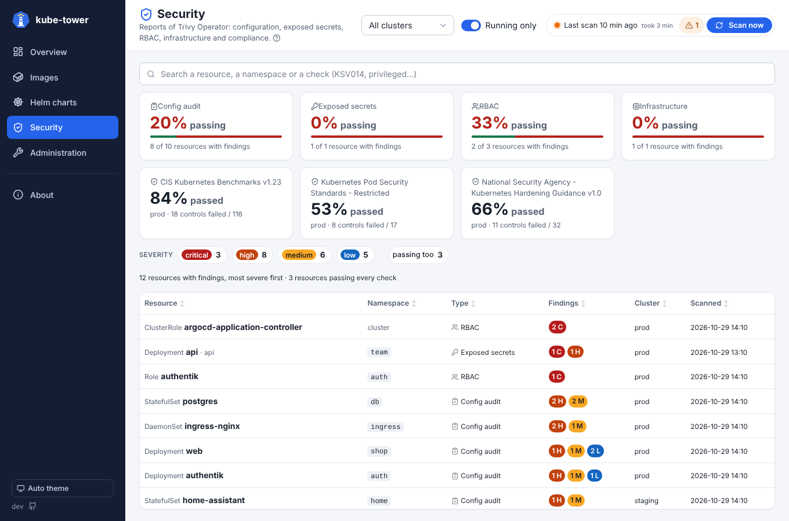
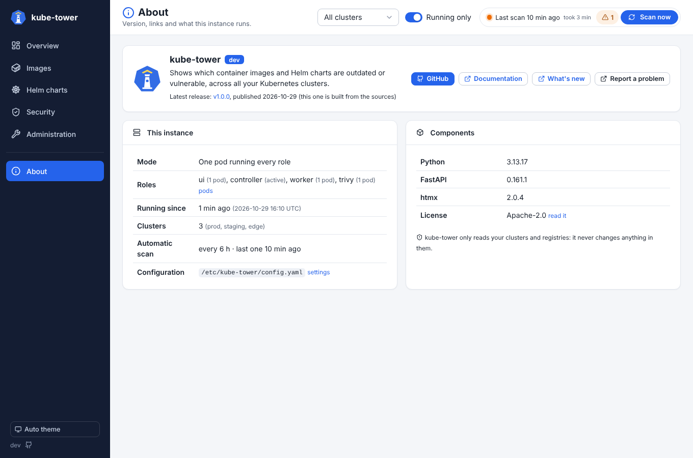

# Usage

## The dashboards

The left sidebar gives access to five pages: **Overview**, **Images**, **Helm charts**, **Security**
and **Administration**, then **About**. Its bottom button switches the theme between auto (follows the
system), light and dark; the choice is remembered by the browser. The version under it opens the
About page, the GitHub icon the repository.

The top bar of every page holds, after the page title:

- the **Cluster** and **Running only** filters, common to every page. **Cluster** shows only the images,
  charts and figures of one cluster. **Running only** (on by default) leaves out the images no pod runs:
  the images only cached on nodes or declared by workloads without pods (scaled to zero, CronJob between
  two runs). The browser remembers both (in cookies, on the path of the UI) and every page follows them;
  a link or a bookmark with `?cluster=prod` or `?running=0` sets them too.
- the scan status: a dot (green when there is no problem, orange with problems, pulsing blue while a
  scan runs), the age of the last scan (its exact date on hover) and how long it took, the number of
  problems and a **Scan now** button that starts a full scan immediately. Click the problem count to
  read them: problems of kube-tower itself (e.g. the Trivy binary is missing, so images without a
  Trivy Operator report are not scanned), collection errors (e.g. a missing permission on a cluster)
  and version check errors (e.g. a registry that cannot be queried). A Trivy problem is also shown at
  the top of the Images page. Each error is also logged as a warning, visible in the Logs tab of the
  Administration page and in the pod logs.

The menu and the links swap the content of the page instead of loading it again, so moving between
pages is immediate; the back button works as usual.

On the list pages (Images, Helm charts), only the list scrolls: the title, the search, the chips and
the column headers stay in place. Click a column header to sort the list on it, click again to
reverse the order (the arrow shows the current sort); the sort is kept when the filters change.
The lists load 30 rows at a time: the next 30 load when the bottom of the list comes into view (an
animated "Loading…" row shows meanwhile). While rows are left to load, the count says how many are
shown (`1500 images · 30 shown`) and a "N more below" button stays at the bottom of the list, over a
fade; clicking it scrolls down. The server sorts these lists, so the order covers every row, not only
the loaded ones (`sort` and `dir` in the URL). Headers can also be sorted with the keyboard (Tab, then
Enter or Space), and a "Skip to content" link (first Tab) jumps over the sidebar. The ⓘ icon after a
page subtitle explains the page. Status columns sort what needs attention first (`outdated`,
`error`, `unknown`, then `up-to-date`), counts sort the largest first.

The chips above a list are filters with their number of items: click one to show only these items,
click it again to show everything. The search and the chips are kept in the URL, so a filtered view
can be bookmarked or shared. Clicking a line opens a detail panel on the right; close it with its
button, a click outside (which also does what it was meant to: one click on another line opens its
details, one click on a filter uses it) or `Esc`. The panel starts with what was found (status,
current → latest version) and has the buttons that check the item again near its end. Drag its left
edge, marked by a grip (⋮) in its middle, to resize it (or focus the edge and use the arrow keys; a
double click restores the default width), or open it full screen, as a large window centred over the
page, with the button next to the close one. Each panel opens at the default size.

The former pages still answer, so bookmarks keep working: `synthesis` opens the Overview,
`vulnerabilities` the Images page (with its CVE and severity filters), `clusters`, `settings` and `logs`
the matching tab of the Administration page.

### Dark theme and phones

The theme follows the system (or the sidebar button). On a phone, the five pages are in a tab bar at the
bottom of the screen, the top bar keeps the About link and the theme button, and the lists show each line
as a block: name first, then the versions and the status.

| Dark theme | Phone |
| --- | --- |
|  |  |

### Rescan one image or chart

No need to wait for the next scan (or to rescan everything) after an upgrade: the detail panels
have buttons that check one item again, in the background.

| Detail panel | Buttons |
| --- | --- |
| Image | **Check version** (registry query) and **Scan vulnerabilities** (when kube-tower can scan it) |
| Helm chart | **Check versions** (the chart and its subcharts) |

An image rescan covers every image with its name (`registry/repository`): all its tags, used by
workloads or only cached on nodes (the buttons say how many). The clusters are read again first, so
the tags deployed since the last scan are found, added to the lists and checked too (both their
version and their vulnerabilities, whatever the button); images no longer found stay until the next
full scan.

While it runs the panel shows *Rescanning…*, then the panel and the line of the list are updated.
The vulnerabilities of an image read from a Trivy Operator report are read again from its clusters
(the operator scans the images itself); the other images are scanned again with Trivy, without
using the cached result. The buttons are disabled while a full scan runs, since it checks
everything again. A rescan only updates the existing results: new workloads or images only appear
with the next full scan.

### Overview


The home page: what to act on, following the Cluster and Running only filters of the top bar.

- Four tiles: the images up to date (out of all, with how many are outdated and how many to check:
  unknown or in error), the Helm charts up to date (with the ones outdated only because of a subchart),
  the **critical CVEs with a fix** (on how many images) and the clusters reachable (with the error of
  the first unreachable one). Each tile opens the matching list.
- **To do**, most urgent first: unreachable clusters, images with critical CVEs that have a fix, image
  checks in error, major updates of images and of Helm charts, floating tags (`latest`…) pushed again,
  images on an end of life OS. A few of each kind are shown so that one kind does not hide the others;
  click a line for its details (images) or its list (charts, clusters).
- The images by status (click a segment or a status to open the filtered list) and the pending image
  updates by type (major, minor, patch, newer, new digest): click a type to open the Images page
  filtered on it (`images?update=major`, shown as a chip above the results, removed with its ✕).
- With Trivy Operator in a cluster, a **Security** card: the findings of its security reports per
  severity, and the most exposed namespaces (see [Security](security.md)).

### Images


One line per image reference (`registry/repository:tag`), whatever the number of workloads using it,
with its versions **and** its vulnerabilities. The list starts with what is most urgent: images with
critical CVEs that have a fix, then outdated images (major updates first), then the checks in error,
then the most vulnerable.

The search box takes words of the image reference (registry, repository, tag) and vulnerability IDs,
all or part, separated by spaces or commas: `nginx`, `ghcr.io 1.2`, `CVE-2025-68121`, `2025-681` or
`GHSA-`. With an ID, only the images affected are listed, with the matching IDs under their
vulnerability counts, and their detail panel lists the matching vulnerabilities first. The chips filter
on the **version** status, and on the **CVE**: images with critical or high vulnerabilities, images with
vulnerabilities that have a fix. Their numbers are images.

Images using `latest` (or no tag at all, which means `latest`) are shown in red: the running version
changes on every pull, pin a version instead. The icon in front of each image tells whether it runs:
a green play icon when a pod uses it, a grey pause icon otherwise (workload scaled to zero, CronJob
between two runs, or image only cached on nodes). Hover it for the explanation. An image on an end of
life OS release says so under its name.

| Column | Meaning |
| --- | --- |
| Image | Normalized name: `nginx` becomes `docker.io/library/nginx` |
| Current | Tag used by the workloads, with the start of its digest below (the digest pinned in the manifest, else the one reported by the running pods, else the one published for the tag) |
| Latest | Highest tag of the same shape and [versioning scheme](#versioning-schemes) published in the registry (the current tag again for a floating tag pushed again, or when up to date), with the start of its digest below, in orange when it differs from the current one; `unknown` when the registry could not tell |
| Update | The kind of update when the image is outdated (`major`, `minor`, `patch`, `newer`, `new digest`), else its [status](#statuses) |
| Vulnerabilities | Number of vulnerabilities by severity (C critical, H high, M medium, L low), `scan failed` (reason on hover), `pending` while the vulnerability scan runs, or `not scanned` |
| Used by | Number of workloads using the image (or `cached on nodes`), and their clusters (hidden on phones) |

The detail panel of an image starts with its update and "current → latest" (with their digests),
then:

- **Versions**: the reference, the [versioning scheme](#versioning-schemes), the latest tag and the
  upgrade target, with links to the image page on its registry (Docker Hub, GitHub Packages, Quay, ECR
  Public, Microsoft Artifact Registry).
- **Vulnerabilities**: the counts by severity and how many have a fix, the source (Trivy Operator
  report or Trivy scan by kube-tower), the scan date, the scanned digest and the OS (with a warning
  when it is end of life).
- **Used by**: where the image is used as a tree: cluster > namespace > workload > pods, with the node
  each pod runs on and the containers using the image. Pods hang under their workload (the Deployment
  of their ReplicaSet, the CronJob of their Job); a workload without pod says **no pod running**
  (scaled to zero, CronJob between two runs). The nodes that have the image in their cache close each
  cluster. Clusters and namespaces fold.
- **Digests**: the digests reported by the running pods, the digest currently published for the same
  tag (a difference means the tag was pushed again since the pods started), and the digest of the
  latest tag. Published digests are read with `images.fetchTagDigests` (enabled by default).
- **Check again**: the rescan buttons.
- **All vulnerabilities**: every vulnerability with its severity (and score), package, installed and
  fixed version, linked to its advisory.


See [vulnerabilities](vulnerabilities.md) for where the vulnerabilities come from.

#### Versioning schemes

kube-tower tells from the current tag how the image is versioned, shows it in the detail panel
(**Versioning**) and only compares the tag with tags of the same scheme, on top of the same shape
(prefix, number of components, suffix):

| Scheme | Tags | Update type |
| --- | --- | --- |
| `semver` | `1.25.3`, `v2.1`, `7` | `major`, `minor`, `patch` |
| `calver` | `2024.10.1`, `2024.10` (a year from 1990 to 2100, then more numbers) | `newer` |
| `date` | `20241024`, `20241024.1`, `202410241530` (a date, then optional hours, minutes, seconds) | `newer` |
| `build` | `4521` (a single number from 1000) | `newer` |

So `redis:7` is not reported outdated because of a `4521` CI build tag, and `1.2` is not compared
with `2024.10`. A single number below 1000 counts as `semver`: a build number `999` is not compared
with `1000` and above.

### Helm charts


One line per Helm source of every ArgoCD Application (multi-source Applications give several lines).
The **Status** column shows the chart and its subcharts as one tree, always expanded: the chart at the
root, then its subcharts, including the subcharts of subcharts (down to 3 levels), each with its
version (→ the latest one when it is behind) and its own status. When the chart is up to date but a
subchart is not, its root line says how many subcharts are outdated. The chips and the sort use the
worst status of the chart and its whole subchart tree, so a chart whose subchart is outdated shows up
with the `outdated` chip. The other columns give the chart name, its current and latest version, the
repository (and source type) and the **ArgoCD Application** (with its cluster and destination
namespace). Search by chart, Application or repository.

The detail panel of a chart shows its source, the ArgoCD Application, links to the repository and
Artifact Hub, and the subchart tree with the repository of each subchart, drawn like the **Used by**
tree of the images.


| Source type | Current version | Latest version |
| --- | --- | --- |
| `helm` (HTTP repository) | Application `targetRevision` | from the repository `index.yaml` |
| `oci` | Application `targetRevision` | from the registry tags |
| `git` (chart in a git path) | `version` of `Chart.yaml` at `targetRevision` | n/a: the chart follows git, only its subcharts are checked |

### Security



The reports of Trivy Operator (without it, the page explains how to install it): its config audit, exposed secrets, RBAC,
infrastructure and compliance reports, one tile per type (share of resources passing every check,
click to filter), compliance tiles (share of controls passed) and one line per resource with failed
checks, most severe first. Severity chips, a **passing too** chip and a search on resources and check
IDs (`KSV017`). The detail panel lists the failed checks with their message, description, fix and a
link to the Aqua vulnerability database. See [Security](security.md).

### Administration


Six tabs, Logs last.

#### Scans and Trivy

Administration actions, run in the background (the tab follows them and reloads when they are over):

| Section | Actions |
| --- | --- |
| In progress | What runs now, each with its start time: the two phases of the full scan (clusters and versions, then vulnerabilities with Trivy), the scans waiting for the Trivy phase of another one, the rescans and the administration actions. The scan status at the top of every page links to it |
| Scans | **Scan now** (same as the button of the scan status). A scan checks the versions first, then scans the vulnerabilities with Trivy: during this Trivy phase a new scan, *Retry what failed* and the rescans can already start (a new scan waits for the Trivy phase to end before its own one). **Retry what failed**: checks again only the image version checks, vulnerability scans and charts (or subcharts) in error in the last scan, e.g. after fixing credentials or a rate limit. One image or chart is rescanned from its detail panel (see above) |
| Trivy | Trivy version and vulnerability database (version, build date, next update, download date). **Update the database** downloads it when a newer one is published (standalone mode; with `trivy.server.enabled` the Trivy server updates its own). Scans wait for the update. **Clear** forgets the cached scan results (kept `vulnerabilities.trivy.rescanInterval`), so the next scan scans every image again; **Clear and scan now** also starts it |
| Connectivity | **Test the connectivity** of every cluster (Kubernetes API `/version`, cluster Secrets read again), every container registry of the last scan and every registry with credentials (`/v2/`, and a pull token for one of its repositories), every HTTP Helm repository (`index.yaml`) and the Trivy server (`/healthz`), with kube-tower's credentials. Failures say why (proxy, DNS, TLS, 401/403…) |

#### Clusters


Every cluster kube-tower knows, its API server and where it comes from (`in-cluster`, `secret`,
`argocd-secret`), its Kubernetes version and whether it answered, with its figures from the last scan:
images and Helm charts (with how many are outdated) and images with critical CVEs. Each number opens
the list of this cluster (and sets the Cluster filter of the top bar). The images counted follow the
Running only filter. Unreachable clusters are skipped during the scan and show the connection error.

#### Pods

One tile per role (**ui**, **controller**, **worker**, **trivy**), green when its pods are running,
orange when some are lost, red when no pod runs it (or no controller is active); then every pod with
its roles, its state (**active** / **standby** controller, **ok**, **lost** when it has not reported for
30 seconds), the task it runs, its version, start time and last report. Read again every 5 seconds. In
the distributed mode each pod writes a presence key in Valkey every 5 seconds, read by the controller;
a stopped pod (e.g. replaced by a rollout) leaves the list at once, a lost one after 15 minutes. With
one pod running every role, it is the only line.

#### Credentials and settings


The registry credentials loaded (Secrets, image pull secrets, cloud providers): registry, where they
come from, username and whether they could be read; secret values are never displayed.
**Authentication** tells whether the registry accepted them at the last request that sent them (a scan,
a rescan or the connectivity test): **accepted**, **refused** (with the registry's answer, e.g.
`HTTP 401 Unauthorized`) or **not tried yet** (no request with these credentials since the controller
started). In the distributed mode the worker pods send what the registries answered them with each
result. For a pattern (`*.dkr.ecr.*.amazonaws.com`), a refusal by any matching registry is shown
first, with its host.

Below, the effective configuration, one table per section (with the same camelCase keys as
`config.yaml`; durations in a readable form with their value in seconds; values changed from the
defaults highlighted and counted; the whole configuration as YAML at the bottom). Secrets are only
referenced (Secret name, file, environment variable), never displayed.

#### API

Links to the API documentation (`api/docs`), the last scan as JSON (`api/snapshot`) and the Prometheus
metrics (`metrics`), and the main endpoints (see [API](#api)). The images cached on nodes that no
workload uses are listed by `api/administration/unused-images`; the UI shows them with the grey icon of
the Images page.

#### Logs


The last 2000 log lines of kube-tower (scans, registries, clusters), kept in memory and followed
live, like `kubectl logs -f`. Filter by text or minimum level, and pause the stream to read. Only
the lines logged at the configured `logs.level` or above are kept: set it to `DEBUG` to debug a
scan.

In the [distributed mode](scaling.md) the tab gathers the lines of every pod: each pod ships its
lines to Valkey every 5 seconds, which keeps the last 10,000 of all pods. Each line shows the pod it
comes from (its roles on hover), and the **ui**, **controller**, **worker** and **trivy** switches
keep the lines of the pods running these roles. The text filter also matches the pod names.

| Level | What is logged |
| --- | --- |
| `DEBUG` | Every registry, Helm repository and git request (method, URL without query, HTTP status), registry tokens requested, Kubernetes objects listed per kind, the result of each image, chart and subchart check, cluster secrets found |
| `INFO` | Scan start and end, clusters to scan with their Kubernetes version, per cluster collection summary (objects listed, ArgoCD Applications, Helm charts), registry credentials loaded (registry names only), check summaries per status |
| `WARNING` | Non fatal problems: an unreachable cluster, an invalid cluster secret, a resource that cannot be listed (e.g. 403), an image, chart or subchart that cannot be checked, ignored credentials |
| `ERROR` | A scan that failed as a whole (with the stack trace); the previous results are kept |

### About



The version of kube-tower, and the latest release published on GitHub (asked by your browser: kube-tower
itself makes no call to GitHub), links to the repository, the documentation, the changelog and to
report a problem; what this instance runs (one pod or the distributed mode, its roles, since when, the
clusters, the interval of the automatic scan, the configuration file), and the versions of its
components (Trivy and its database, Python, FastAPI, htmx) and its license.

## Statuses

| Status | Meaning |
| --- | --- |
| 🟢 `up-to-date` | Nothing newer is published (or, for floating tags, the running digest is the published one) |
| 🟠 `outdated` | A newer version, or a newer image under the same floating tag, is available |
| ⚪ `unknown` | Cannot be compared: image pinned by digest only, floating tag without known digest, version constraint (`1.x`), local subchart (`file://`) |
| 🔴 `error` | The registry or repository could not be queried: the message tells why (authentication, not found, timeout…) |

## API

| Endpoint | Description |
| --- | --- |
| `GET /api/snapshot` | The last scan: images, charts, clusters, errors, timestamps |
| `POST /api/refresh` | Start a scan now (`{"started": false}` if one is already running) |
| `POST /api/rescan/image?ref=…` | Check an image again (`ref` as in the snapshot, e.g. `docker.io/library/nginx:1.25`): every image with its name is checked (all tags, including the new ones found on the clusters); `versions=false` or `vulnerabilities=false` to skip one part. 202 when started, 409 with a `reason` if a scan is running, 404 if unknown |
| `POST /api/rescan/chart?cluster=…&namespace=…&app=…&chart=…` | Check one Helm chart and its subcharts again (`namespace` is the Application's namespace) |
| `POST /api/administration/retry-failed` | Check again everything that failed in the last scan (202, or 409 with a `reason`) |
| `POST /api/administration/trivy-db` | Update the Trivy databases when a newer one is published (standalone mode) |
| `DELETE /api/administration/trivy-cache` | Forget the cached Trivy results (`{"cleared": n}`) |
| `POST /api/administration/connectivity` | Start a connectivity test; results with `GET /api/administration/connectivity` |
| `GET /api/administration/unused-images` | Images cached on nodes that no workload of their cluster uses |
| `GET /healthz` | Liveness |
| `GET /readyz` | 200 once the first scan has finished |
| `GET /api/docs` | Interactive OpenAPI documentation |

Requests that change something (`POST`, `DELETE`) are refused with a 403 when a browser says they come
from another site (`Sec-Fetch-Site`, else `Origin` compared with the host, or `X-Forwarded-Host` behind a
proxy): a page on another site cannot start scans through the browser of someone who can reach
kube-tower. The UI itself and clients that are not browsers (curl, scripts) are not affected.

```sh
# Outdated images, as "image current -> latest"
curl -s http://kube-tower/api/snapshot \
  | jq -r '.images[] | select(.status=="outdated") | "\(.image.ref) -> \(.latest_tag // .latest_digest)"'
```

## Prometheus metrics and Grafana

`GET /metrics` is a Prometheus exporter for the result of the last scan: current and latest
version of every image and chart, update type (major, minor, patch), workloads and clusters,
scan duration and errors. A ready-made Grafana dashboard ships with the chart.

See [Metrics and Grafana](metrics.md) for the metric reference, PromQL examples, alerts and the dashboard.
