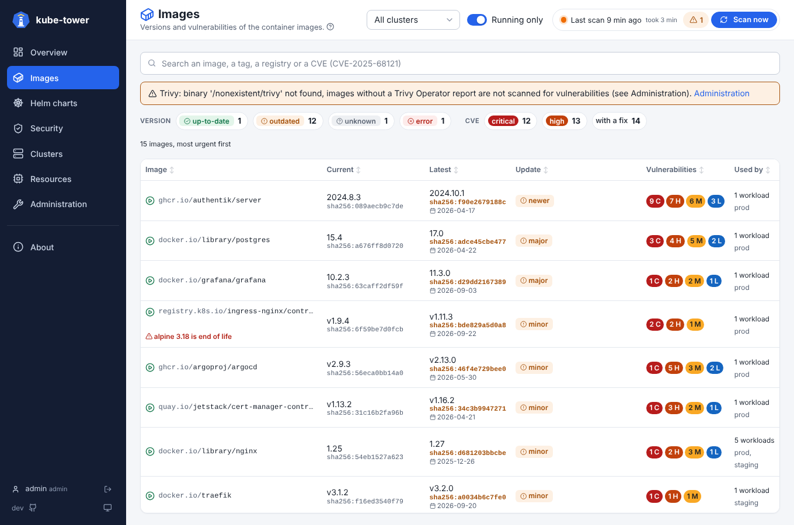
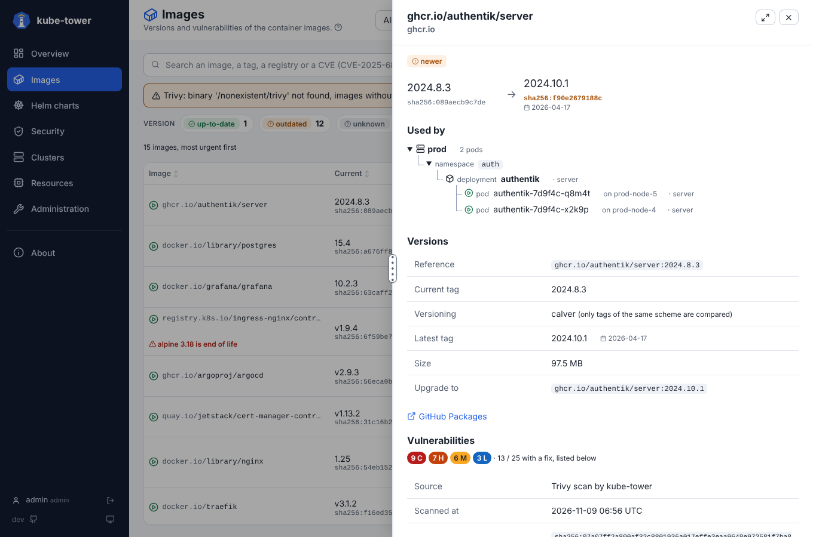

# Vulnerabilities (CVE)

kube-tower lists the known vulnerabilities of every image it found (workloads and node images) on
the **Images** page, in the image details and in the Prometheus metrics. It reads them
from two sources, for each image:

1. **Trivy Operator reports**: when [Trivy Operator](https://aquasecurity.github.io/trivy-operator/)
   runs in a cluster, kube-tower reads its `VulnerabilityReports` (`aquasecurity.github.io/v1alpha1`).
   Nothing is scanned by kube-tower for these images. Reports of every cluster are merged per image
   reference; the newest report of a digest that actually runs wins.
2. **Trivy, run by kube-tower**: the other images (no operator, images only cached on nodes, a
   workload the operator has not scanned yet) are scanned with the [Trivy](https://trivy.dev) CLI.
   Trivy pulls the image layers from the registry itself (no container runtime needed), with the
   [registry credentials](registries.md) of kube-tower.



The other reports of Trivy Operator (misconfigurations, exposed secrets, RBAC, compliance) are on the
[Security](security.md) page.

The vulnerability scan runs after the version checks of each scan: versions show up first, and
the Images page says when the vulnerability scan is still in progress. Trivy results
are kept in memory and reused until `rescanInterval` (24h by default), so a scan every 6h does not
download every image again. A scan that fails on a transient error (an image layer read cut short,
`unexpected EOF`, a connection reset or timeout, a registry answering 429 or 5xx) is tried again at
once, after 10 then 30 seconds; the other failures, and the ones still failing after 3 attempts, are
retried at the next scan. To scan an
image again right away (e.g. after a rebuild), use **Scan vulnerabilities** in its detail panel: it scans
every tag of the image, including the new ones found on the clusters (see [Rescan one image or chart](usage.md#rescan-one-image-or-chart)).

## On the Images page

The vulnerabilities are shown with the versions, on the [Images](ui-images.md) page: one line per
image, with its counts per severity (`C`ritical, `H`igh, `M`edium, `L`ow, `U`nknown). The list starts
with the images that have critical vulnerabilities with a fix in a newer package version. The **CVE**
chips show only the images with critical or high vulnerabilities, or with vulnerabilities that have a
fix; their numbers are images. An image whose OS release is **end of life** (no more security fixes,
e.g. `alpine 3.18`) is flagged in red. Click the Vulnerabilities header to sort the most vulnerable
first.

To find the images affected by a given vulnerability, type all or part of its ID in the search box,
e.g. `CVE-2025-68121` (or `2025-68121`, `GHSA-`; several IDs separated by spaces or commas, with
words of the image if needed): only the images with a matching vulnerability are listed, with the
matching IDs, and the chips only count them. The search is kept in the URL
(`images?q=CVE-2025-68121`), so the result can be shared.

Clicking an image opens its detail panel: the counts, the source and date of the scan, the OS, then the
list of its vulnerabilities at the end: ID (linked to its advisory), severity and CVSS score, package,
installed version and the version that fixes it. With a CVE in the search, the matching vulnerabilities
are listed first and highlighted.



## Trivy setups

The modes and their values are summed up in [Trivy configuration](configuration.md#trivy-configuration).

| Mode | When | Database |
| --- | --- | --- |
| **Standalone** (default) | `trivy.server.enabled: false` | Downloaded by kube-tower at each scan into an `emptyDir` (~1.6 GB, 3 GiB limit by default) |
| **Client/server** | `trivy.server.enabled: true` | Held and refreshed by a Trivy server Deployment of the chart; the kube-tower pod stays small |

Choose one of these setups in the values of the chart:

**Standalone (default)**: kube-tower downloads the vulnerability database (~1.6 GB) into an
`emptyDir` and scans the images itself. Nothing to set; size the pod if needed:

```yaml
trivy:
  cacheSizeLimit: 3Gi            # emptyDir of the database
resources:
  limits:
    memory: 1536Mi               # raise it, or lower config.vulnerabilities.trivy.concurrency, if OOMKilled
```

**Client/server**: the chart deploys a Trivy server that holds and refreshes the database;
kube-tower scans in client mode and its pod stays small. `config.vulnerabilities.trivy.serverUrl` is
set automatically.

```yaml
trivy:
  server:
    enabled: true
    resources:
      limits:
        memory: 1Gi
    nodeSelector:
      kubernetes.io/arch: amd64
```

To use a Trivy server you already run, keep `trivy.server.enabled: false` and set
`config.vulnerabilities.trivy.serverUrl: http://trivy.trivy-system:4954`.

**Which one?** Standalone suits a few dozen images. Beyond that, prefer client/server. In standalone
mode each scan keeps the image layers in memory only (`--cache-backend memory`, so that concurrent scans
do not fail with "cache may be in use"): the base layers shared by many images (Debian, Alpine,
distroless…) are downloaded and analysed again for every image, at every scan. The Trivy server keeps
the analysis of each layer: a layer already seen, in another image or in a previous scan, is neither
downloaded nor analysed again, so scans are faster and pull much less from the registries (rate
limits). The database is also downloaded once by the server instead of by each kube-tower pod.

**Trivy Operator only**: no Trivy in kube-tower, only the operator's reports are shown (images
only cached on nodes are not scanned):

```yaml
trivy:
  enabled: false                 # no init container
```

**No vulnerabilities at all**: `config.vulnerabilities.enabled: false`.

On `linux/arm/v7` nodes (no official Trivy image), use the Trivy Operator setup, a Trivy server on
other nodes, or `trivy.image` pointing to an image of yours holding `/usr/local/bin/trivy`. A
private `trivy.image` is pulled with `imagePullSecrets` (kube-tower pod and Trivy server).

By default the Java database (~1.5 GB more) is not downloaded and Java archives (`.jar`, `.war`,
`.ear`, `.par`) are skipped: set `config.vulnerabilities.trivy.javaDb: true` to scan them.

### Where the Trivy CLI comes from

The kube-tower image does not contain Trivy (it would add ~170 MB). With the Helm chart, an init
container copies the `trivy` binary from the official image (`trivy.image`, default
`ghcr.io/aquasecurity/trivy:0.76.2`) into an `emptyDir` at pod start, and the chart points
`config.vulnerabilities.trivy.binary` to it. Trivy is upgraded by changing `trivy.image.tag`,
without a new kube-tower release.

Without the chart, install Trivy next to kube-tower and set `vulnerabilities.trivy.binary`.

## Trivy Operator

Nothing to configure: kube-tower reads the reports when the CRD exists (the chart's ClusterRole and
[`deploy/remote-cluster-rbac.yaml`](../deploy/remote-cluster-rbac.yaml) grant `get`/`list` on
`vulnerabilityreports.aquasecurity.github.io`, see [permissions](permissions.md#trivy-operator-reports)). Without the operator, the CRD is simply not found
and Trivy scans every image. Set `config.vulnerabilities.trivyOperator: false` to always scan with
Trivy.

## Settings

The settings are in `config.vulnerabilities`, every key is listed in
[configuration](configuration.md#security) (Trivy modes, vulnerabilities, audit). The Trivy CLI uses the [registry credentials](registries.md) of kube-tower to pull the
layers of private images. In standalone mode, the pod must reach the database registries
(`mirror.gcr.io` and `ghcr.io`, or the mirror given in `extraArgs`); in client/server mode, only the
Trivy server needs them.

Examples of `config.yaml` (under `config` in the values of the chart):

```yaml
# Only report what can be fixed, scan once a week, skip some images
vulnerabilities:
  ignore:
    - registry.k8s.io/pause*
    - docker.io/library/busybox*
  trivy:
    ignoreUnfixed: true
    rescanInterval: 7d
```

```yaml
# Trivy Operator already scans every workload: do not run Trivy in kube-tower
# (node images without an operator report are then not scanned)
vulnerabilities:
  trivy:
    enabled: false
```

## Overview and Grafana

The **Overview** page counts the critical vulnerabilities that have a fix (tile) and lists the images
with such vulnerabilities first in its **To do** list; the Clusters tab of the Administration page has
the images with critical vulnerabilities per cluster. The [Grafana dashboard](metrics.md#grafana-dashboard) has a **Vulnerabilities**
row with the same figures, their evolution and the workloads running an image with critical
vulnerabilities, filtered by cluster.

## Metrics and troubleshooting

The vulnerability metrics (`kube_tower_image_vulnerabilities`, `..._fixable`, `kube_tower_image_os_eosl`...)
are listed in [metrics](metrics.md#vulnerabilities), with PromQL examples. Common Trivy problems (binary
not found, database download, OOMKilled pod, images `not scanned`) are in
[troubleshooting](troubleshooting.md#vulnerabilities).
